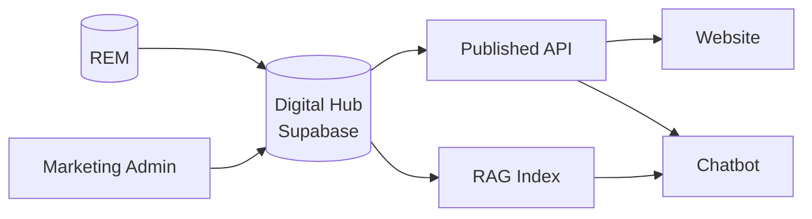

# SENA Digital Hub & AI Knowledge Platform

ศูนย์กลางข้อมูลโครงการและ Digital Assets ที่ทำหน้าที่เป็น **Source of Truth เดียว**
สำหรับ Website, AI Chatbot และ consumer อื่น ๆ

## เอกสารออกแบบ

| เอกสาร | เนื้อหา |
|--------|---------|
| [00 — รีวิวแผน Codex และช่องว่าง](docs/00-executive-review.md) | สิ่งที่แผนเดิมทำถูก, ช่องว่าง P0/P1/P2, ข้อเสนอ 10 อันดับแรก |
| [01 — สถาปัตยกรรม Source of Truth](docs/01-source-of-truth.md) | หลักการ 7 ข้อ, **System of Record Matrix**, consumer contract |
| [02 — Data Model](docs/02-data-model.md) | schema ที่เพิ่ม: spatial tree, model type spec, versioning, i18n |
| [03 — **User Flows**](docs/03-user-flows.md) | Setup Wizard 10 ขั้น, Asset Library, Promotion, REM Drift, Publish, Chatbot routing |
| [04 — Campaign & Promotion](docs/04-promotions.md) | scope corporate/brand/project/model, include–exclude, กฎ resolve |
| [05 — Published Content API](docs/05-api-contract.md) | endpoint, response envelope, change feed, security |
| [06 — RAG](docs/06-rag.md) | แก้บั๊ก stale chunk, hybrid retrieval ภาษาไทย, eval metrics |
| [07 — แผนส่งมอบ](docs/07-delivery-plan.md) | vertical slice, descope levers, DoD, ความเสี่ยง |
| [08 — **Promotion: REM + Ads**](docs/08-promotion-integration.md) | เชื่อม Promotion 7,676 รายการจาก REM, แยก Offer ออกจาก Public Promotion, เชื่อมกับการลงทะเบียน Ads |
| [09 — **Ads Registry**](docs/09-ads-registry-integration.md) | อ่าน Google Sheet ของทีม content แบบไม่แก้ไฟล์, เชื่อมด้วย URL ปลายทาง, UTM กับ Meta campaign id |

## สรุปสั้นที่สุด

**แผนเดิมวางโครงถูกแล้ว 6 เรื่อง** — แยก Hub/RAG, REM name ≠ public name, asset registry กลาง,
published-only API, routing table ของ chatbot, และมี out-of-scope ที่ชัดเจน

**ช่องว่างที่ต้องปิดก่อนเริ่มเขียนโค้ด (P0):**

1. ไม่มี schema ของเฟส / ตึก / ชั้น / โซน
2. ไม่มี attribute ของ Model Type (ห้องนอน พื้นที่ ที่จอดรถ) → chatbot ตอบคำถามหลักไม่ได้
3. ไม่มี data model ของโปรโมชั่นเลย
4. ไม่มี versioning / atomic publish / rollback
5. RAG pipeline ไม่มีขั้นตอนลบ chunk เก่า
6. ไม่มี System of Record Matrix
7. `paste_url` ไม่มีนโยบาย mirror → ลิงก์ตาย
8. ไม่มี i18n
9. ไม่มี change feed / cache invalidation → โปรฯ หมดอายุยังโชว์
10. ไม่มี REM drift detection

## Repository ที่เกี่ยวข้อง

- `sena_digital_hub_mkt` (ที่นี่) — schema, Admin, Storage, Published API, RAG ingestion
- `sena_ai_chatbot_mkt` — Chat UI, routing, structured tools, retrieval client, handoff
