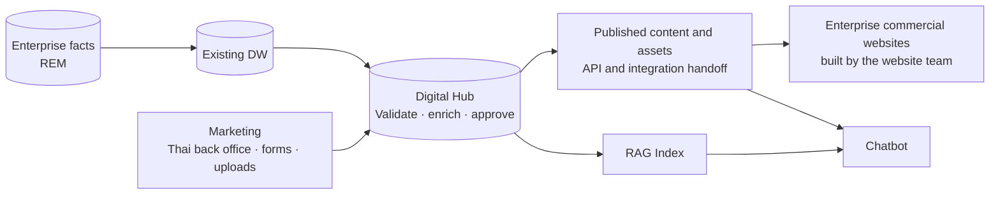

# SENA Digital Hub & AI Knowledge Platform

**Implementation status (18 September 2026):** the local back office includes Thai brand/project editing, source selection, model specification editing, human mapping review, and image/PDF uploads with library reuse and rights review. Brands have approved logo versions; projects keep their source brand and company identities separate. FastAPI and PostgreSQL protect drafts, publication and consumer access to approved files. Synthetic examples remain labelled. **HYABC is now the only current pilot selection, replacing KUBON/B_PO in the intake plan.** Its direct REM snapshot is staged locally, with HYABC and brand `25` / FLEXI created as unpublished drafts under source company `HSP`; all 13 model mappings remain unconfirmed. The earlier KUBON/B_PO drafts, staging and evidence remain unchanged in the local workspace because they already contained work. The 13 HYABC model-master records do not establish the distinct model count in DW unit records. See [current HYABC intake and status](docs/16-pilot-intake-hyabc.md), [local setup and implementation limits](docs/11-local-development.md), and [brand/project mapping](docs/12-brand-project-mapping.md). This is not recurring DW synchronization, acceptance of the pilot, or a production deployment.

ศูนย์กลางข้อมูลโครงการและ Digital Assets ที่ทำหน้าที่เป็น **Source of Truth เดียว**
รวบรวมข้อมูลจาก Marketing และข้อมูลธุรกิจผ่าน DW เพื่อเตรียมและเผยแพร่ข้อมูลคุณภาพให้เว็บไซต์เชิงพาณิชย์ขององค์กรและ AI Chatbot โดยทีมเว็บไซต์รับผิดชอบตัวเว็บไซต์

**Current scope (15 September 2026): build the Thai back office and rich content platform for SENA residential — 7 pilot projects — to feed the enterprise commercial websites and SENA AI pilot.** The Hub collects enterprise data through DW and Marketing content through forms, uploads and imports, then validates, enriches, approves and publishes it. It owns content/assets/promotions, stored SEO and locale metadata, APIs and the website data handoff, including Hub-side integration support. The separate website team owns commercial page design, frontend code, hosting, rendering and launch. All internal staff are Thai-speaking; the interface and default authoring language are Thai. Solar is entirely deferred to Phase 2 after October. EV, LivNex and other non-residential BUs are also outside Phase 1; no cross-BU workspace or generic product framework is required now.

Original planning baseline: **30 September — one-project internal pilot · 16 October — core residential Hub · 30 October — SENA AI pilot**. These dates assumed two full-time developers. **18 September capacity update: one full-time developer with Codex/agent assistance.** The baseline is at risk; see the [current status, KPI measures and proposed forecast](docs/15-status-kpi-plan-20260918.md) for provisional 9 October / 6 November / 27 November targets, to be reviewed on 25 September. These are not approved revised deadlines. Phase 2 has no committed launch date and follows Phase 1 acceptance. Required gates in [REQUIREMENTS §1.3](REQUIREMENTS.md#13-delivery-milestones) and [the delivery plan](docs/07-delivery-plan.md) remain unchanged. The requirements take precedence over historical examples elsewhere in `docs/`.

## Requirements

**[REQUIREMENTS.md](REQUIREMENTS.md)** — implementation specification in English, self-contained,
with numbered testable requirements (P0/P1/P2), acceptance criteria and open questions.
ส่งให้ engineering agent หรือทีม dev ได้โดยไม่ต้องอ่านเอกสารอื่นประกอบ

## เอกสารออกแบบ

| เอกสาร | เนื้อหา |
|--------|---------|
| [00 — รีวิวแผน Codex และช่องว่าง](docs/00-executive-review.md) | สิ่งที่แผนเดิมทำถูก, ช่องว่าง P0/P1/P2, ข้อเสนอ 10 อันดับแรก |
| [01 — สถาปัตยกรรม Source of Truth](docs/01-source-of-truth.md) | หลักการ 7 ข้อ, **System of Record Matrix**, consumer contract |
| [02 — Data Model](docs/02-data-model.md) | schema ที่เพิ่ม: spatial tree, model type spec, versioning, i18n |
| [03 — **User Flows**](docs/03-user-flows.md) | Original wider workflow reference; current project/model form decisions are in document 17 |
| [04 — Campaign & Promotion](docs/04-promotions.md) | scope corporate/brand/project/model, include–exclude, กฎ resolve |
| [05 — Published Content API](docs/05-api-contract.md) | endpoint, response envelope, change feed, security |
| [06 — RAG](docs/06-rag.md) | แก้บั๊ก stale chunk, hybrid retrieval ภาษาไทย, eval metrics |
| [07 — แผนส่งมอบ](docs/07-delivery-plan.md) | vertical slice, descope levers, DoD, ความเสี่ยง |
| [08 — **Promotion: REM + Ads**](docs/08-promotion-integration.md) | เชื่อม Promotion 7,676 รายการจาก REM, แยก Offer ออกจาก Public Promotion, เชื่อมกับการลงทะเบียน Ads |
| [09 — **Ads Registry**](docs/09-ads-registry-integration.md) | อ่าน Google Sheet ของทีม content แบบไม่แก้ไฟล์, เชื่อมด้วย URL ปลายทาง, UTM กับ Meta campaign id |
| [10 — **Tech Stack**](docs/10-tech-stack.md) | FastAPI, Supabase, Thai admin บน Next.js/Vercel, pgvector, OpenAI, deployment และ CI |
| [11 — **Local development**](docs/11-local-development.md) | Run the first working slice, verification and remaining pilot work |
| [12 — **Brand / Project mapping**](docs/12-brand-project-mapping.md) | REM brand/company evidence, content ownership and versioned brand relationships |
| [13 — **Source identity / field ownership**](docs/13-source-field-ownership.md) | Verified REM keys and metadata, Unit Type distinctions, intake gaps and future non-REM policy |
| [14 — **Historical KUBON / B_PO intake**](docs/14-pilot-intake-kubon-b-po.md) | Preserved source mappings, 96 model records, ModelTypeID/ModelArea findings and earlier staging event |
| [15 — **Status / KPI delivery forecast**](docs/15-status-kpi-plan-20260918.md) | Decisions, actual progress, issues, one-developer planning scenario, Gantt and measurable acceptance gates |
| [16 — **HYABC current pilot intake**](docs/16-pilot-intake-hyabc.md) | Replacement selection, exact source identities, 13 model-master records and pending DW unit reconciliation |
| [17 — **Project form / model and plan flow**](docs/17-project-form-and-plans.md) | Ordered Thai/English fields, verified Gold defaults, three workspace tabs, image placement and building/floor layout variants |
| [28 — **DW brands / published Hub content**](docs/28-dw-brands-and-published-content.md) | Local verified brand dictionary, source review, identity-only creation and DW export contract |

## สรุปสั้นที่สุด

**แผนเดิมวางโครงถูกแล้ว 6 เรื่อง** — แยก Hub/RAG, REM name ≠ public name, asset registry กลาง,
published-only API, routing table ของ chatbot, และมี out-of-scope ที่ชัดเจน

**ช่องว่างที่ต้องปิดก่อนเริ่มเขียนโค้ด (P0):**

1. ไม่มี schema ของเฟส / ตึก / ชั้น / โซน
2. ไม่มี attribute ของ Model Type (ห้องนอน พื้นที่ ที่จอดรถ) → chatbot ตอบคำถามหลักไม่ได้
3. ไม่มี data model ของโปรโมชั่นเลย
4. ไม่มี versioning / atomic publish / rollback
5. RAG pipeline ไม่มีขั้นตอนลบ chunk เก่า
6. ไม่มี System of Record Matrix
7. `paste_url` ไม่มีนโยบาย mirror → ลิงก์ตาย
8. ไม่มี i18n
9. ไม่มี change feed / cache invalidation → โปรฯ หมดอายุยังโชว์
10. ไม่มี REM drift detection

## Repository ที่เกี่ยวข้อง

- `sena_digital_hub_mkt` (ที่นี่) — schema, Admin, Storage, Published API, RAG ingestion
- `sena_ai_chatbot_mkt` — Chat UI, routing, structured tools, retrieval client, handoff
