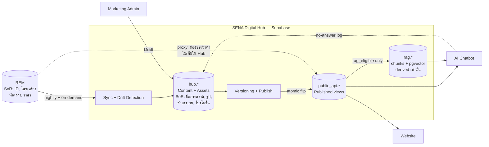

# 01 — สถาปัตยกรรม Source of Truth

## 1. หลักการ 7 ข้อ

1. **หนึ่ง field มีเจ้าของระบบเดียว** — ห้ามมีสองระบบเขียน field เดียวกัน
2. **REM เป็นต้นทางของ "ความจริงเชิงธุรกิจ"** (ID, โครงสร้าง, ห้องว่าง, ราคา) — Hub *mirror* ได้ แต่ห้าม *แก้*
3. **Hub เป็นต้นทางของ "ความจริงเชิงการสื่อสาร"** (ชื่อทางการตลาด, รูป, คำบรรยาย, โปรโมชั่นที่อนุมัติแล้ว)
4. **RAG เป็น derived index เสมอ** — ลบทิ้งแล้ว rebuild ใหม่ได้ 100% โดยไม่สูญเสียข้อมูล ถ้าทำไม่ได้แปลว่าออกแบบผิด
5. **Consumer ห้ามมี side channel** — website และ chatbot ห้าม hardcode เนื้อหา ห้ามต่อ REM ตรงสำหรับข้อมูลที่ Hub เป็นเจ้าของ
6. **ทุกคำตอบต้องตามรอยกลับได้** — ทุก record ที่ออก public API ต้องบอกได้ว่า version ไหน ใคร publish เมื่อไร จากต้นทางอะไร
7. **ข้อมูลที่หมดอายุต้องหายเอง** — ไม่พึ่งให้คนมาลบ

## 2. System of Record Matrix ⭐

> นี่คือเอกสารที่ควร "เซ็นรับ" ร่วมกันระหว่าง Marketing / IT / REM Owner ก่อนเริ่มพัฒนา
> *(แก้ไข 14 ก.ย. 2026 — แยกแถว Promotion เป็นสองแถวหลังตรวจ REM พบว่ามี Promotion อยู่แล้ว 7,676 รายการ ดู [08](08-promotion-integration.md))*

| ข้อมูล | System of Record | บทบาทของ Hub | Consumer เรียกจาก | เขียนได้โดย |
|--------|------------------|--------------|-------------------|-------------|
| Company / Project / Model **ID** | **REM** | mirror (read-only) | Hub | sync job เท่านั้น |
| ชื่อโครงการ/แบบบ้าน **ตาม REM** | **REM** | mirror (read-only) | Hub (เป็น attribute) | sync job เท่านั้น |
| โครงสร้าง Phase/Building/Floor | **REM** (ถ้ามี) / **Hub** (ถ้า REM ไม่มี) | mirror + เติมส่วนที่ REM ไม่มี | Hub | sync + Editor |
| **ชื่อทางการตลาด (Public Name)** | **Hub** | **owner** | Hub | Editor → Publisher |
| **Asset ทุกชนิด** (รูป, วิดีโอ, แปลน, brochure) | **Hub** | **owner** | Hub | Editor → Publisher |
| **คำบรรยาย / จุดเด่น / FAQ** | **Hub** | **owner** | Hub | Editor → Publisher |
| **Facility / Nearby / Map pin** | **Hub** | **owner** | Hub | Editor → Publisher |
| **Promotion — *Offer*** (สิทธิ์ที่ Sales ให้ได้จริง) | **REM** + ระบบ BU อื่น | mirror (read-only) | Hub | sync job เท่านั้น |
| **Promotion — *Public Promotion*** (สิ่งที่เราพูดต่อสาธารณะ) | **Hub** | **owner** | Hub (live API) | Editor → Data Owner → Legal → Publisher |
| SEO (slug, meta, og:image) | **Hub** | **owner** | Hub | Editor |
| **ห้องว่าง / Unit availability** | **REM** | **ไม่เก็บเด็ดขาด** | REM API (ผ่าน Hub proxy) | — |
| **ราคา (list / current)** | **REM / Pricing** | cache snapshot + `price_as_of` | Hub proxy (มี freshness) | sync job |
| Lead / ข้อมูลลูกค้า | **CRM** | **ไม่แตะเด็ดขาด** (PDPA) | CRM | — |
| ผลโฆษณา (Meta / GA4) | Meta / GA4 | out of scope รอบนี้ | — | — |

**กติกาการอ่าน matrix:**
- แถวที่ Hub เป็น **owner** → ไม่มีระบบอื่นเขียนได้ และ Hub ต้องเป็น endpoint เดียวที่ consumer เรียก
- แถวที่ REM เป็น SoR → Hub ห้ามมี UI ให้แก้ แม้แต่ admin (ถ้าผิดต้องไปแก้ที่ REM)
- แถว **ห้องว่าง/ราคา** → Hub ทำได้แค่ *proxy + แนบ freshness* เพื่อไม่ให้ consumer ต้องรู้จัก REM แต่ Hub ไม่รับประกันความสด

## 3. ขอบเขตที่แก้จากแผนเดิม: "ID ไหนคือ Public Key"

แผนเดิมเขียน `project_id_rem` = "Master Key" แล้ว API เป็น `GET /projects/{project_id}` ซึ่งกำกวม

**ข้อเสนอ:**

| ID | ใช้ทำอะไร | เปิดเผยสู่ public? |
|----|-----------|--------------------|
| `project_id` (uuid) | primary key ภายใน Hub | ไม่ |
| `project_id_rem` | join กับ REM / availability / price | เปิดเป็น *attribute* ได้ แต่ไม่ใช่ path |
| `public_project_id` | **canonical key ของ public API** — opaque, stable, ห้าม reuse | ใช่ (ใน path) |
| `slug` | URL ที่มนุษย์อ่านได้ + SEO | ใช่ (เปลี่ยนได้ ต้องมี redirect map) |

**เหตุผล:** ถ้าใช้ `project_id_rem` เป็น path ของเว็บ เท่ากับผูก URL สาธารณะและ SEO ไว้กับระบบหลังบ้าน วันที่ย้าย/ปรับ REM เว็บจะพังทั้งระบบ

## 4. Consumer Contract

ทุก consumer ต้องลงทะเบียนใน `hub.api_consumers` (ชื่อ, เจ้าของ, key, scope, rate limit)

**Hub รับประกัน:**
- Response มี `version`, `published_at`, `source_updated_at`, `data_freshness` เสมอ
- Breaking change แจ้งล่วงหน้า ≥ 30 วัน และรัน 2 version ขนานกัน (`/v1`, `/v2`)
- ข้อมูล Draft / Archived / Expired ไม่หลุดออก public API — บังคับด้วย DB view ไม่ใช่ if ใน application code
- มี `GET /changes?since=` ให้ consumer sync แบบ delta และมี webhook สำหรับ invalidation ทันทีในกรณีโปรโมชั่น

**Consumer รับปาก:**
- ไม่ hardcode เนื้อหา ไม่ cache promotion เกิน TTL ที่ Hub กำหนด (`cache_control` มาใน response)
- เคารพ `fallback_indicator` — ถ้า Hub บอกว่ารูปไม่ครบ ต้องใช้ placeholder ไม่ใช่รูปจากที่อื่น
- ใช้ API key ของตัวเอง ไม่แชร์ข้ามระบบ

## 5. Data Flow

**จุดที่ต่างจากแผนเดิม:**
- RAG อ่านจาก `public_api` เท่านั้น **ไม่ใช่จาก `hub`** — เพื่อรับประกันว่าเอกสารที่ยังไม่ publish เข้า index ไม่ได้เชิงโครงสร้าง ไม่ใช่เชิงนโยบาย
- เพิ่มเส้น **proxy** ของห้องว่าง/ราคา ที่ไม่ผ่าน storage ของ Hub
- เพิ่มเส้น **feedback loop** จาก chatbot กลับเข้า content gap queue
