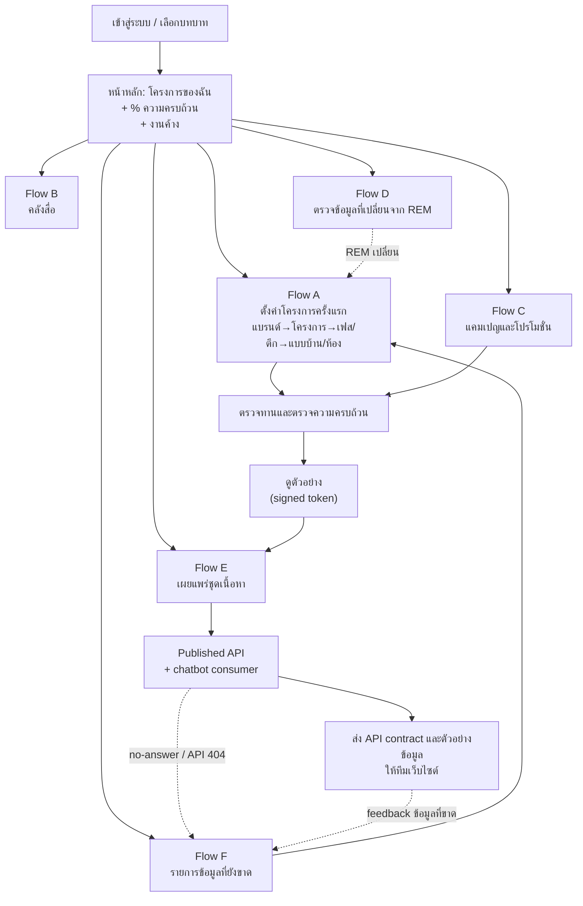
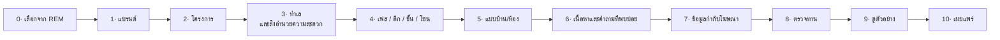
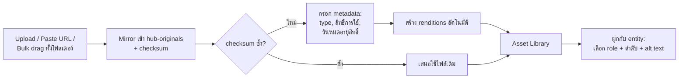
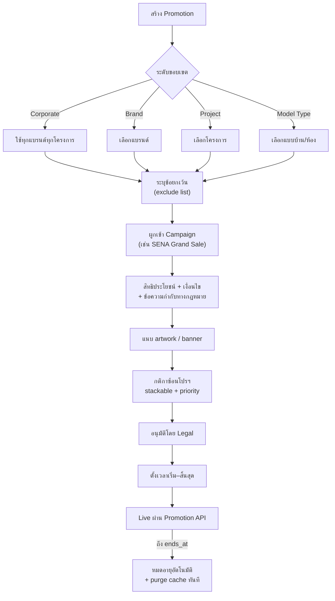
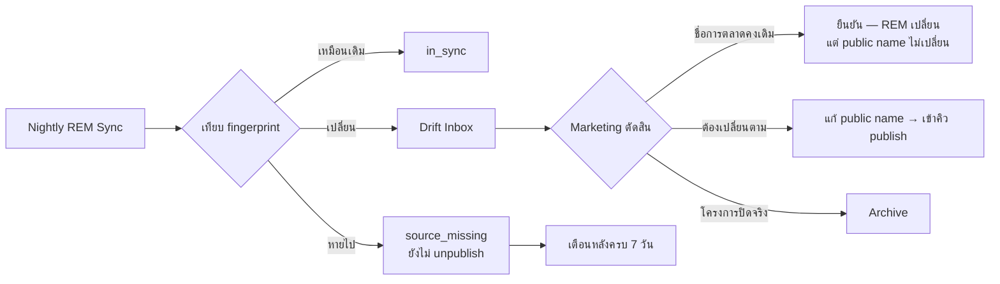
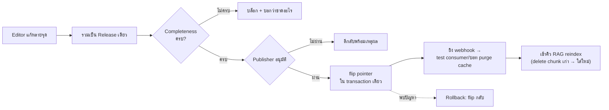
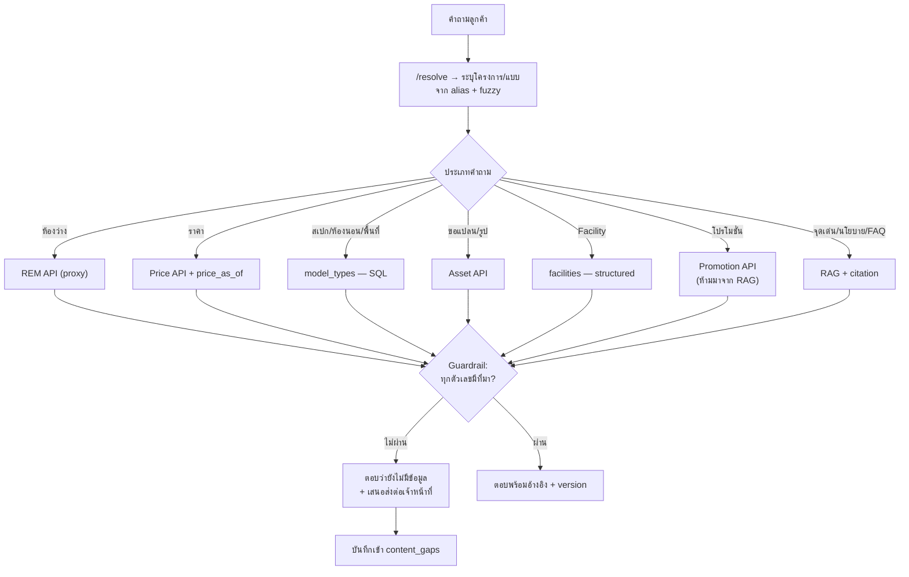

# 03 — User Flows (ข้อเสนอหลัก)

> **4 พ.ย. 2026:** โครงเมนู flow การกรอกและแก้ไข และขั้นอนุมัติกับเผยแพร่ ใช้ตาม [47 — Unified content workspace](47-unified-content-workspace.md) แทนเอกสารนี้ในส่วนที่ขัดกัน

## ภาษาการใช้งานและขอบเขต

ทีม SENA ภายใน **พูดภาษาไทย 100%** จึงใช้หน้าจอและข้อความช่วยเหลือภาษาไทย **งานของทีมนี้คือสร้าง back office และแพลตฟอร์มข้อมูล Hub** เพื่อรวบรวมข้อมูล Marketing และข้อมูลองค์กรในขอบเขต SENA residential, ตรวจ/อนุมัติ และส่งข้อมูลที่สมบูรณ์ให้เว็บไซต์เชิงพาณิชย์ขององค์กรและ chatbot

**Hub-side integration อยู่ใน scope:** ประสาน field mapping และ content/API contract กับทีมเว็บไซต์, จัดทำตัวอย่าง payload และรับ feedback ของข้อมูลที่ขาด ส่วน website frontend, design, hosting, page rendering และ integration code ฝั่งเว็บไซต์เป็นงานของทีมเว็บไซต์ การเปิดเว็บไซต์จริงไม่ใช่ gate ของ Hub; พิสูจน์สัญญาข้อมูลด้วย API/test consumer และ cache harness

- **Admin ใช้ภาษาไทย:** ชื่อเมนู, label, ปุ่ม, คำแนะนำ, validation/error messages, การแจ้งเตือน และรายงานตรวจ/อนุมัติต้องเป็นภาษาไทย ส่วนชื่อ API, field และ role identifiers ในเอกสารนี้เป็นคำสำหรับ implementation ไม่ใช่ข้อความที่ต้องแสดงให้พนักงานอ่าน
- **เริ่มเขียน content ใน `th`:** ชื่อสาธารณะ, คำอธิบาย, FAQ, โปรฯ, คำบรรยายภาพและ alt text เริ่มที่ภาษาไทย หากมีเนื้อหาภาษาอื่นส่งมา ให้แก้และตรวจ locale นั้นในหน้าจอภาษาไทยผ่าน approval/publish flow เดิม การมีข้อความหรือ AI draft ไม่ถือว่าผ่านอนุมัติแล้ว
- **ภาษาใน API:** ใช้ `th` เป็นค่าเริ่มต้นและตอบตาม locale ที่ consumer ขอ พร้อม fallback metadata ตามสัญญา API ไม่อนุมานภาษาจากสัญชาติหรือประเทศ ทดสอบด้วย API/test consumer ได้โดยไม่ต้องแก้เว็บไซต์
- หากภายหลังมี **AI ช่วยเสนอข้อความให้พนักงาน** รวมถึงคำบรรยายภาพ ให้เสนอภาษาไทยเป็นค่าเริ่มต้นและให้คนตรวจตาม flow เดิม ข้อนี้กำหนดภาษาเท่านั้น ไม่เพิ่มฟีเจอร์ AI ใหม่ในแผนส่งมอบ

## 0. ข้อสังเกตสำคัญก่อนเข้า flow

Flow ที่คุณร่างไว้ (Brand → Project → Phase/ตึก → Model Type) **ถูกต้องในฐานะ "ลำดับการกรอกครั้งแรก"**
แต่มี 3 เรื่องที่ต้องเพิ่มไม่งั้นระบบจะใช้จริงไม่ได้:

| ปัญหาของ flow แบบ wizard ล้วน | ทางแก้ |
|-------------------------------|--------|
| **1. Wizard ดีตอน setup ครั้งแรก แต่แย่ตอนแก้ประจำวัน** — คนจะไม่ยอมคลิกผ่าน 4 ขั้นเพื่อเปลี่ยนรูปเดียว | ทำ **2 โหมด**: `Setup Wizard` (ครั้งแรก, guided) และ `Manage` (hub-and-spoke, กระโดดแก้ตรงจุด) ใช้ข้อมูลชุดเดียวกัน |
| **2. ถ้าอัปโหลดรูปได้เฉพาะในขั้นตอน จะเกิดรูปซ้ำเต็มระบบ** — โลโก้แบรนด์เดียวจะถูกอัปซ้ำ 7 ครั้งใน 7 โครงการ ขัดกับ `entity_assets` ที่ออกแบบให้ผูกหลายบริบทได้ | เพิ่ม **Asset Library** เป็นหน้ากลาง: *อัปครั้งเดียว ผูกได้ทุกที่* ทุกขั้นตอนของ wizard เลือกจาก Library ได้ (หรืออัปใหม่ซึ่งจะเข้า Library อัตโนมัติ) |
| **3. ไม่มีจุดเริ่มจาก REM** — ถ้าให้พิมพ์ชื่อโครงการเอง จะได้ record ที่ไม่มี REM anchor แล้วต้องมา map ย้อนหลัง ซึ่งคือปัญหาที่แผนพยายามแก้ตั้งแต่แรก | เพิ่ม **Step 0: เลือกโครงการจาก REM** — ทุก record เกิดจาก REM เสมอ crosswalk จึงสมบูรณ์ตั้งแต่วินาทีแรก |

และ **Promotion แยกเป็น flow ของตัวเอง** ไม่อยู่ใน wizard ของโครงการ เพราะ (ก) ขอบเขตข้าม/เหนือโครงการ (ข) วงจรชีวิตสั้นกว่ามาก (ค) ต้องมีผู้อนุมัติคนละคน

### Intake → ตรวจช่องว่าง → อนุมัติ → ส่งมอบข้อมูลให้ consumer

1. Marketing ส่ง content/assets ผ่าน intake template หรือ back office; ข้อมูลองค์กรจาก REM รับผ่าน DW bronze/raw ตามสิทธิ์และเจ้าของข้อมูลเดิม
2. ทำ field mapping กับข้อมูลที่ทีมเว็บไซต์ต้องใช้ ระบุ source, required fields และเจ้าของข้อมูลที่ยังขาด ไม่ให้ source sync เขียนทับ public content
3. ผู้รับผิดชอบเติมข้อมูลผ่าน flow แก้ไข/ตรวจความครบถ้วน และผ่าน data/legal approval ที่เกี่ยวข้องก่อน publish
4. ส่งตัวอย่างข้อมูลที่อนุมัติแล้วครอบคลุม project, model, assets, FAQ, documents, promotions, SEO metadata และ locale พร้อม API/auth/cache/webhook contract ให้ทีมเว็บไซต์นำไปเชื่อมต่อ
5. รับ missing-field feedback กลับเป็น checklist พร้อมเจ้าของงาน ให้ Marketing หรือผู้ดูแล source แก้และเผยแพร่ใหม่ การมีหน้าจอ queue แบบเต็มเป็น optional แต่การรับ/ติดตามช่องว่างข้อมูลและส่งมอบ contract ต้องมี; ไม่รอ website frontend หรือ go-live

---

## 1. แผนที่รวมทุก Flow

---

## 2. Flow A — Setup Wizard (flow หลักตามที่คุณร่าง + ปรับปรุง)

> ขั้นที่ **1, 2, 4, 5** = ที่คุณร่างไว้ · ขั้นที่ **0, 3, 6, 7, 8, 9, 10** = ที่เสนอเพิ่ม

### Step 0 — เลือกโครงการจาก REM *(เพิ่มใหม่)*
- แสดงรายการโครงการจาก REM ผ่าน DW bronze/raw ที่ยังไม่มีใน Hub
- เลือกแล้วระบบสร้าง shell record พร้อม `project_id_rem`, `project_name_rem`, `company_id_rem` ครบ
- ระบบเสนอ **brand ที่น่าจะใช่** จาก `company_id_rem` ให้ยืนยัน
- ถ้าโครงการยังไม่มีใน REM → มีทางออก "สร้างแบบ Pre-REM" ที่ **บังคับ map ภายหลังก่อน publish**

### Step 1 — Brand
| Field | ที่มา | หมายเหตุ |
|-------|-------|----------|
| `brand_name`, `public_company_name` | Admin | — |
| `company_id_rem` / `company_name_rem` | **REM (read-only)** | ห้ามแก้ |
| Logo | Asset Library / Upload / **Paste link** | รองรับหลายเวอร์ชัน: ปกติ, ขาว, ดำ, favicon → ใช้ `asset_role` แยก |
| Brand guideline, brand story | Upload / link | เข้า RAG ได้ |

> **ข้อเสนอ:** Brand เป็น master data ที่สร้าง **ครั้งเดียวโดย Admin** ไม่ควรให้ Editor สร้างใหม่ระหว่างทำโครงการ (ไม่งั้นจะได้ "SENA", "เสนา", "Sena Dev" เป็น 3 brand) — ใน wizard จึงเป็น **เลือก** ไม่ใช่ **สร้าง** และมีปุ่ม "ขอสร้างแบรนด์ใหม่" ที่ส่งให้ Admin อนุมัติ

### Step 2 — Project
| Field | ที่มา | หมายเหตุ |
|-------|-------|----------|
| `project_name_rem` | REM | **แสดงแบบอ่านอย่างเดียว ตลอดเวลา** |
| `public_project_name` (`th` เริ่มต้น; locale อื่นเมื่อมีเนื้อหาส่งมา) | **default = ชื่อ REM** | แก้ได้ เมื่อแก้ระบบจะตั้ง `name_source='marketing_override'` |
| `slug`, `meta_title`, `meta_description` | auto-suggest จากชื่อ | แก้ได้; เมื่อเปลี่ยน slug เก็บ old-to-new slug metadata ให้ consumer ไม่รวมการ deploy HTTP redirect บนเว็บไซต์ |
| `product_type`, `project_status` | REM default, override ได้ | — |
| Assets | **หลายไฟล์** | `thumbnail`(1), `hero`(1), `gallery`(n), `video`(n), `brochure`(n), `master_plan`(n), `virtual_tour`(link) |

**การอัปโหลดรองรับ 3 ทางเสมอ** (ตามที่คุณระบุ): `Upload ไฟล์` · `เลือกจาก Asset Library` · `Paste URL`
→ **Paste URL ระบบจะดึงไฟล์มาเก็บที่ Hub ให้อัตโนมัติ** แล้วเสิร์ฟจาก Hub (ดู [02 §6.1](02-data-model.md)) ป้องกันลิงก์ตาย

### Step 3 — Location & Facility *(เพิ่มใหม่)*
- ปักหมุดบนแผนที่ (แก้พิกัดจาก REM ได้ เพราะ REM มักเพี้ยน)
- เลือก Facility จาก **checklist ที่ควบคุมคำศัพท์** + ใส่รายละเอียดเพิ่ม
- Nearby places: BTS/MRT/โรงเรียน/ห้าง พร้อมระยะทาง + เวลาเดินทาง
- **ทำไมต้องมีขั้นนี้:** API filters ("ใกล้ BTS", "มีสระ") และคำถามยอดฮิตของ bot ("มีสระว่ายน้ำไหม") ต้องตอบจาก structured data ไม่ใช่ RAG

### Step 4 — เฟส / ตึก / ชั้น / โซน *(ตามที่คุณร่าง + ทำให้เป็น tree)*
- UI เป็น **tree editor** เพิ่ม node ได้ตามชนิดของ product:
  - **คอนโด:** เฟส → ตึก (กี่ชั้น, กี่ยูนิต, ลิฟต์) → ชั้น
  - **แนวราบ:** เฟส → โซน/คลัสเตอร์ (กี่แปลง)
- ทุก node แนบ asset ได้: `phase_plan`, `building_plan`, `floor_plan`, `master_plan` (**ผังหมู่บ้าน**)
- **ทางลัดสำคัญ:** ปุ่ม *"สร้างชั้น 1–8 อัตโนมัติ"* + *"ใช้ typical floor plan กับชั้น 2–8"* — เพราะไม่มีใครยอมกรอกชั้น 30 ชั้นด้วยมือ ขั้นนี้จะกลายเป็นคอขวดของ timeline ถ้าไม่มี

### Step 5 — Model Type *(ตามที่คุณร่าง + เพิ่ม spec)*
| Field | ที่มา |
|-------|-------|
| `rem_model_name` | REM (read-only) |
| `public_model_name` (`th` เริ่มต้น; locale อื่นเมื่อมีเนื้อหาส่งมา) | **default = ชื่อ REM** แก้ได้ |
| ผูกกับเฟส/ตึกไหน | เลือกจาก tree ของ Step 4 |
| **สเปก**: ห้องนอน, ห้องน้ำ, พื้นที่ใช้สอย, เนื้อที่ดิน (ตร.ว.), หน้ากว้าง, ชั้น, ที่จอดรถ, ห้องพิเศษ | Marketing กรอก (REM prefill ถ้ามี) |
| Assets | `model_floor_plan`(n), `model_thumbnail`(1), `gallery`(n), `virtual_tour` |
| Variants | A / A1 / A2 |

> ⚠️ **จุดที่แผนเดิมพลาดมากที่สุด** — ถ้าไม่กรอกสเปกตรงนี้ chatbot จะตอบคำถามสเปกไม่ได้เลยทุกคำถาม

### Step 6 — Content & FAQ *(เพิ่มใหม่)*
- แก้เป็น **section** ไม่ใช่ textarea ก้อนเดียว: ภาพรวม / จุดเด่น / ทำเลและการเดินทาง / แนวคิดการออกแบบ / ส่วนกลาง / เงื่อนไขการผ่อนดาวน์
- FAQ: เพิ่มเอง หรือ **ดึงจาก FAQ template กลาง** แล้วแก้เฉพาะโครงการ
- มี toggle `rag_eligible` ต่อ section (เช่น ข้อความภายในไม่ให้เข้า bot)
- **ผลพลอยได้:** section เหล่านี้กลายเป็น RAG chunk คุณภาพสูงทันทีโดยไม่ต้อง chunk ด้วย algorithm

### Step 7 — Compliance *(เพิ่มใหม่)*
- เลขที่ใบอนุญาต, สถานะ EIA, ข้อความกำกับโฆษณา
- ทำที่นี่ครั้งเดียว → API ส่งข้อความที่อนุมัติแล้วให้ chatbot และ consumer ภายนอกใช้ตรงกัน

### Step 8 — Review + Completeness
- แสดง **% ความครบถ้วน** และรายการที่ยังขาด พร้อมลิงก์กระโดดไปแก้
- **บล็อก publish** ถ้า required field ไม่ครบ (gate ดีกว่า fallback)
- แสดง diff เทียบกับ version ที่ live อยู่
- ใช้คำอธิบายและรายงานอนุมัติภาษาไทย เช่น "กรุณาระบุภาพหลักก่อนเผยแพร่" และแสดง locale ของเนื้อหาที่กำลังตรวจอย่างชัดเจน

### Step 9 — Preview ภายใน Hub
- ดูเนื้อหาหรือ API payload ภายใน Hub ด้วย **signed preview token** ที่ชี้ไป `version_id` ที่ยังไม่ publish; ไม่รวมการสร้างหรือเชื่อมหน้า preview ของเว็บไซต์
- การทดสอบ chatbot เชื่อมผ่าน repository `sena_ai_chatbot_mkt` และข้อมูลที่เผยแพร่ในสภาพแวดล้อมทดสอบ ไม่ส่ง draft เข้า production RAG index

### Step 10 — Publish
- เลือก **publish ทันที** หรือ **ตั้งเวลา**
- ถ้า Editor ≠ Publisher → ส่งเข้า approval queue
- Publish เป็น **release เดียว** (atomic) + ปุ่ม **Rollback** ตลอด 24 ชม. แรก

---

## 3. Flow B — Asset Library *(เพิ่มใหม่ แต่จำเป็น)*

- **Dedup ด้วย checksum** — ถ้าไม่มี คุณจะได้ไฟล์ซ้ำหลายร้อยใบภายในเดือนแรก
- **ผูกหลายบริบทได้** — รูป 1 ใบเป็น `gallery` ของโครงการ และ `hero` ของ model type พร้อมกัน โดยมี alt text คนละอัน
- **แจ้งเตือนสิทธิ์ใกล้หมดอายุ 30 วันล่วงหน้า** (สัญญานักแสดง/ช่างภาพ) → ป้องกันการใช้ภาพเกินสิทธิ์
- **Bulk upload ตาม naming convention** เช่น `PROJ-KITH-RSU__model__TYPE-A__floorplan__01.jpg` แล้วระบบ pre-map ให้ → นี่คือสิ่งที่จะช่วยให้ป้อนข้อมูล 7 โครงการทันกำหนด

---

## 4. Flow C — Campaign & Promotion *(ตอบคำถามเรื่อง Corporate / Brand / Project)*

รายละเอียดเต็มและกฎการ resolve อยู่ใน **[04-promotions.md](04-promotions.md)**

---

## 5. Flow D — REM Drift Inbox *(เพิ่มใหม่)*

**หลักการที่ต้องยึด:** REM เปลี่ยน **ไม่เคย** แก้ข้อมูล public โดยอัตโนมัติ — ระบบแค่ *แจ้ง* ให้คนตัดสิน

---

## 6. Flow E — Publish / Release + Rollback

---

## 7. Screen Inventory (16 หน้า)

| # | หน้าจอ | Role | MVP? |
|---|--------|------|------|
| 1 | เข้าสู่ระบบ / SSO | ทุกคน | ✅ |
| 2 | หน้าหลัก — โครงการของฉัน + % ครบถ้วน + งานค้าง | ทุกคน | ✅ |
| 3 | เลือกโครงการจาก REM (Step 0) | Editor | ✅ |
| 4 | จัดการแบรนด์ | Admin | ✅ |
| 5 | แก้ไขโครงการ (Step 2) | Editor | ✅ |
| 6 | ทำเลและสิ่งอำนวยความสะดวก (Step 3) | Editor | ✅ |
| 7 | จัดการเฟส/ตึก/ชั้น/โซน (Step 4) | Editor | ✅ |
| 8 | แก้ไขแบบบ้าน/ห้อง (Step 5) | Editor | ✅ |
| 9 | เนื้อหาและคำถามที่พบบ่อย (Step 6) | Editor | ✅ |
| 10 | **คลังสื่อ** + อัปโหลดหลายไฟล์ | Editor | ✅ |
| 11 | ตรวจทานและความครบถ้วน (Step 8) | Editor / Publisher | ✅ |
| 12 | ดูตัวอย่างเนื้อหา/API ภายใน Hub | ทุกคน | 🟡 |
| 13 | คิวเผยแพร่ / ชุดเนื้อหา / ย้อนกลับ | Publisher | ✅ |
| 14 | **จัดการแคมเปญและโปรโมชั่น** | Editor / Legal | ✅ |
| 15 | ตรวจข้อมูลที่เปลี่ยนจาก REM | Editor | 🟡 |
| 16 | รายการข้อมูลที่ยังขาด | Editor | ⬜ P1 — optional Phase 1 UI; การ log ของ RAG ยังต้องมีตาม [REQUIREMENTS.md](../REQUIREMENTS.md) |

## 8. Role × สิทธิ์

| หน้าที่ | Viewer | Editor | Publisher | Legal | Admin |
|---------|:---:|:---:|:---:|:---:|:---:|
| ดูข้อมูล | ✅ | ✅ | ✅ | ✅ | ✅ |
| แก้ draft / อัปโหลด asset | | ✅ | ✅ | | ✅ |
| ยืนยัน REM crosswalk | | ✅ | ✅ | | ✅ |
| Publish / Rollback | | | ✅ | | ✅ |
| อนุมัติโปรโมชั่น (legal) | | | | ✅ | ✅ |
| จัดการ brand / taxonomy / user | | | | | ✅ |

> **ข้อเสนอเรื่องขอบเขต:** แผนเดิมตัด multi-level approval ออกจาก scope ซึ่งถูกต้องสำหรับ content ทั่วไป
> แต่ควรมีข้อยกเว้น **เฉพาะ Promotion และ Compliance** ที่ต้องผ่าน Legal — เพราะเป็นจุดเดียวที่ความผิดพลาดมีผลทางกฎหมาย ไม่ใช่แค่ผลเชิงภาพลักษณ์

## 9. Flow F — Chatbot Query Routing (ฝั่ง consumer)

Chatbot เป็น consumer ใน repository แยก `sena_ai_chatbot_mkt` และยังอยู่ในขอบเขต AI pilot ตามแผนเดิม ใช้ภาษาไทยเป็นค่าเริ่มต้นและส่ง locale ที่ consumer ขอไปกับ API พร้อมจัดการ fallback ตามสัญญา การทดสอบคำถามภาษาอังกฤษตาม golden set ใช้หลักฐานภาษาไทยที่เผยแพร่แล้วได้ ไม่ใช่คำมั่นว่าจะเปิด content ทุกภาษา และไม่อนุมานภาษาจากประเทศของผู้ถาม

**ส่วนที่เพิ่มจากตาราง routing เดิม:** ขั้น `/resolve` ข้างหน้า (ไม่งั้น bot ไม่รู้ว่าลูกค้าหมายถึงโครงการไหน) และ **guardrail ตรวจว่าทุกตัวเลขในคำตอบสืบกลับไปหา structured source ได้** — ป้องกันการแต่งราคา/โปรฯ ซึ่งเป็นความเสี่ยงที่ร้ายแรงที่สุดของ chatbot อสังหาฯ

## Readiness decision — 7 October 2026

The product owner split publication requirements from recommended completeness. The [current contract](31-readiness-and-review.md) supersedes earlier model-blocking rules in this document. Models never block publication; only confirmed models with complete required specs enter new versions. Optional media with pending/expired rights is omitted. Existing versions remain immutable. `model_catalogue_complete` is frozen in new project payloads and appended as a nullable boolean in `hub_export.project_published` (NULL for older versions). Draft fact cards expose current completeness; published fact cards use the frozen value. Incomplete/unknown catalogues cause a chatbot handoff for room/specification questions.
