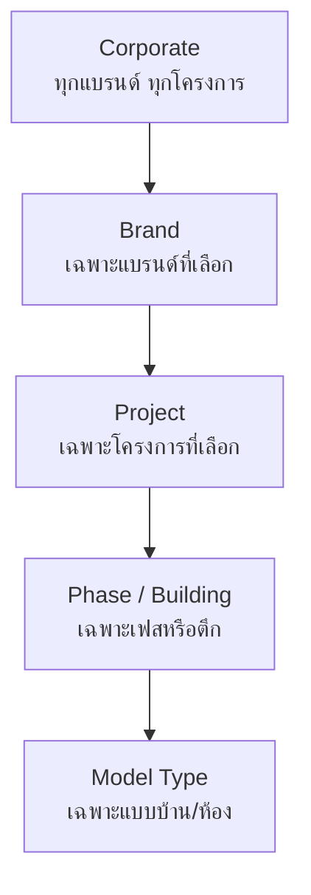

# 04 — Campaign & Promotion

> ⚠️ **เอกสารนี้ถูกแก้บางส่วนโดย [08-promotion-integration.md](08-promotion-integration.md)** (14 ก.ย. 2026)
> หลังตรวจ REM พบว่ามี Promotion อยู่แล้ว 7,676 รายการ ซึ่งเปลี่ยนข้อสรุปเรื่องเจ้าของข้อมูล:
> **REM เป็น SoR ของ *Offer* (สิทธิ์ที่ Sales ให้ได้จริง) ส่วน Hub เป็น SoR ของ *Public Promotion* (สิ่งที่เราพูดต่อสาธารณะ)**
> ส่วนที่ยังใช้ได้ทั้งหมดในเอกสารนี้คือ **แนวคิด Campaign/Promotion 2 ชั้น (§1), กฎ resolve และ precedence (§4), และกฎความปลอดภัย (§5)**
> ส่วนที่ถูกแทนที่คือ **`scope_level` แบบ enum เดี่ยวใน §2–§3** → เปลี่ยนเป็นความสัมพันธ์หลายเป้าหมายที่ไม่บังคับ ProjectID

> แผนเดิมไม่มี data model ของโปรโมชั่นเลย มีเพียงคำว่า "Approved Promotion API" และ asset_role `promotion`
> ทั้งที่โปรโมชั่นคือข้อมูลที่ **ลูกค้าถามมากที่สุด เปลี่ยนบ่อยที่สุด และมีความเสี่ยงทางกฎหมายสูงสุด**

## 1. แนวคิด 2 ชั้น: Campaign กับ Promotion

| | Campaign | Promotion |
|---|---|---|
| คืออะไร | "ร่ม" ทางการตลาด | ข้อเสนอจริงที่ลูกค้าได้รับ |
| ตัวอย่าง | *SENA Grand Sale 2026*, *Midyear Clearance* | *ฟรีค่าโอน*, *ลด 300,000*, *แถมเฟอร์ครบชุด* |
| ใช้ทำอะไร | จัดกลุ่ม, artwork ร่วม, รายงานผล | คำนวณสิทธิ์, แสดงบนเว็บ, ให้ bot ตอบ |
| จำเป็นไหม | ไม่ — promotion อยู่เดี่ยวได้ | ใช่ |

หนึ่ง Campaign มีหลาย Promotion และ Promotion หนึ่งอันมี **ขอบเขต (scope)** ของตัวเอง

## 2. โครงสร้างขอบเขต — ตอบคำถาม "Corporate / Brand / Project"



ยิ่งลงลึก **ความจำเพาะ (specificity) ยิ่งสูง** → ใช้ตัดสินเวลาโปรฯ ชนกัน (กฎนี้ยังใช้ได้ ดู §4)

> **แก้ไข:** ลำดับชั้นนี้ใช้ได้เฉพาะธุรกิจอสังหาฯ แต่ **ใช้กับ Solar / EV / LivNex / Corporate ไม่ได้** เพราะธุรกิจเหล่านั้นไม่มีโครงการ
> โมเดลที่ถูกต้องคือ **ความสัมพันธ์หลายเป้าหมายที่ไม่บังคับ ProjectID** — `COMPANY | BUSINESS | BRAND | PROJECT_GROUP | PROJECT | UNIT`
> พร้อม `project_applicability = APPLIES | NOT_APPLICABLE | UNKNOWN` ดู [08 §7](08-promotion-integration.md)
> (`scope_level` ด้านล่างคือรูปแบบเดิมที่ถูกแทนที่แล้ว เก็บไว้เพื่อให้เห็นที่มาของกฎ precedence)

**สำคัญ: ต้องมีทั้ง include และ exclude** — ในทางปฏิบัติ โปรฯ ระดับ corporate มักมีข้อยกเว้นเสมอ
(*"ฟรีค่าโอนทุกโครงการ ยกเว้นโครงการ A และ B"*) ถ้าไม่มี exclude list ทีมจะเลี่ยงไปสร้างโปรฯ ระดับ project ซ้ำ ๆ 30 อัน แล้วบำรุงรักษาไม่ไหว

## 3. Data Model

```sql
create table hub.campaigns (
  campaign_id   uuid primary key,
  code          text unique not null,       -- GRAND-SALE-2026
  name          jsonb not null,             -- {th, en}
  description   jsonb,
  campaign_type text not null,              -- corporate|brand|project|tactical
  starts_at     timestamptz not null,       -- เก็บ UTC, แสดงผล Asia/Bangkok
  ends_at       timestamptz not null,
  owner         text, status hub.lifecycle_status
);

create table hub.promotions (
  promotion_id   uuid primary key,
  campaign_id    uuid references hub.campaigns,
  code           text unique not null,
  scope_level    text not null,      -- corporate|brand|project|node|model_type
  title          jsonb not null,
  benefit_summary jsonb not null,    -- ข้อความสั้นที่ bot พูดได้
  benefit_type   text not null,      -- discount_amount|discount_pct|free_transfer_fee
                                     -- free_common_fee|furniture|cashback|rate_subsidy|gift|other
  benefit_value  numeric(14,2),
  benefit_unit   text,               -- THB|percent|months|items
  conditions     jsonb,              -- markdown ต่อ locale
  legal_terms    jsonb,              -- ข้อความเงื่อนไขฉบับเต็ม
  disclaimer     jsonb,              -- ข้อความกำกับโฆษณา

  stackable      boolean default false,
  priority       int default 100,    -- น้อย = สำคัญกว่า
  booking_window daterange,          -- ต้องจองภายในช่วงนี้
  transfer_window daterange,         -- ต้องโอนภายในช่วงนี้

  starts_at      timestamptz not null,
  ends_at        timestamptz not null,

  marketing_approved_by text, marketing_approved_at timestamptz,
  legal_approved_by     text, legal_approved_at     timestamptz,
  status hub.lifecycle_status not null default 'draft',
  constraint promo_window check (ends_at > starts_at)
);

create table hub.promotion_targets (
  promotion_id uuid references hub.promotions,
  target_type  text not null,   -- brand|project|node|model_type
  target_id    uuid not null,
  mode         text not null default 'include',   -- include|exclude
  primary key (promotion_id, target_type, target_id, mode)
);
```

Artwork / banner ผูกผ่าน `entity_assets` ด้วย `entity_type='promotion'` (ใช้กลไกเดิมได้เลย)

> **แก้ไข:** ตาราง `hub.promotions` ด้านบนถูกแทนที่ด้วย `hub.public_promotions` + `hub.promotion_entity_links`
> ใน [08 §7](08-promotion-integration.md) โดย `mode='exclude'` กลายเป็น `relationship_role='EXCLUDED_FROM'`
> และเพิ่ม `staging.source_offers` เป็นกระจกของ REM ที่ Hub ห้ามแก้

## 4. กฎการ Resolve — "โครงการนี้มีโปรฯ อะไรบ้าง"

```
1. รวบรวม candidate:
   - scope_level = 'corporate'
   - scope_level = 'brand'      และ brand ของโครงการอยู่ใน include
   - scope_level = 'project'    และ โครงการอยู่ใน include
   - scope_level = 'node'       และ เฟส/ตึกที่ถามอยู่ใน include
   - scope_level = 'model_type' และ แบบที่ถามอยู่ใน include
2. ตัดออก: อะไรก็ตามที่ entity นั้นอยู่ใน exclude list   ← exclude ชนะ include เสมอ
3. กรองเวลา: now() ต้องอยู่ใน [starts_at, ends_at)
4. กรองสถานะ: status='published' และ legal_approved_at is not null
5. เรียง: priority ASC → specificity DESC (model > node > project > brand > corporate)
6. ถ้า stackable=false → คืนอันที่ชนะอันเดียวต่อ benefit_type
   ถ้า stackable=true  → คืนทั้งหมดที่ซ้อนกันได้
7. แต่ละรายการคืน applies_via เพื่อบอกว่าได้สิทธิ์เพราะ scope ไหน
```

> กฎ 7 ข้อนี้ **ยังใช้ได้ทั้งหมด** เพียงเปลี่ยนแหล่งของขั้นที่ 1–2 จาก `scope_level` + `promotion_targets`
> ไปเป็น `hub.promotion_entity_links` ที่ `mapping_status='CONFIRMED'` — และเพิ่มขั้นที่ 4 ว่าต้องผ่าน **data approval ด้วย ไม่ใช่แค่ legal**
> ข้อสังเกต: ข้อเสนอของ REM audit **ไม่มีกฎลำดับเมื่อโปรฯ ชนกันเลย** ส่วนนี้จึงเป็นสิ่งที่เอกสารนี้เติมให้

`applies_via` สำคัญมากสำหรับ chatbot — บอทต้องพูดได้ว่า *"โปรฯ นี้เป็นโปรฯ ทั้งบริษัท ไม่ใช่เฉพาะโครงการนี้"* ซึ่งช่วยลด dispute หน้างานขายได้จริง

## 5. กฎความปลอดภัย 6 ข้อ (ข้อกำหนดตายตัว)

| # | กฎ | เหตุผล |
|---|-----|--------|
| 1 | **โปรโมชั่นห้ามเข้า RAG index เด็ดขาด** (`rag_eligible = false` บังคับที่ระดับ DB constraint) | vector index ล้าสมัยเสมอ — โปรฯ หมดอายุแล้วบอทยังพูดต่อ = โฆษณาเกินจริง |
| 2 | **หมดอายุต้องเกิดจากเวลา ไม่ใช่จาก cron** — `public_api.promotions` เป็น view ที่มี `now() < ends_at` อยู่ใน WHERE | ถ้าพึ่ง cron แล้ว cron ตาย โปรฯ จะค้างอยู่บนเว็บ |
| 3 | **`Cache-Control: max-age ≤ 300`** และยิง webhook purge เมื่อ publish/expire | กัน CDN ค้าง |
| 4 | **ต้องมี legal approval ก่อน publish** (`legal_approved_at is not null`) | จุดเดียวในระบบที่ควรมี approval 2 ชั้น |
| 5 | **ทุก response ต้องแนบ `legal_terms` + `disclaimer`** ไม่ใช่ optional | ให้เว็บ/บอท/sales แสดงเงื่อนไขตรงกัน |
| 6 | **Audit ทุกการเปลี่ยนแปลง** (ใคร/เมื่อไร/ค่าเดิม→ค่าใหม่) | ตอบคำถาม "ใครอนุมัติโปรฯ ที่ผิด" ได้ |

## 6. API

```http
GET /v1/promotions?project_id={id}&model_type_id={id}&locale=th
GET /v1/promotions?brand_id={id}
GET /v1/campaigns/{code}
```

ตัวอย่าง response:
```jsonc
{
  "data": [{
    "promotion_id": "...", "code": "FREE-TRANSFER-2026Q4",
    "title": "ฟรีค่าโอนกรรมสิทธิ์",
    "benefit_type": "free_transfer_fee",
    "applies_via": { "scope_level": "corporate", "campaign_code": "GRAND-SALE-2026" },
    "stackable": true, "priority": 50,
    "starts_at": "2026-10-01T00:00:00+07:00",
    "ends_at":   "2026-12-31T23:59:59+07:00",
    "legal_terms": "…", "disclaimer": "…",
    "assets": [{ "role": "promotion_banner", "url": "https://…", "alt_text": "…" }]
  }],
  "meta": { "resolved_at": "…", "cache_ttl": 300, "version": "v1" }
}
```

## 7. ขอบเขต MVP

**ทำในรอบนี้:** scope 5 ระดับ + include/exclude, campaign grouping, legal approval, ตั้งเวลาเริ่ม–จบ, auto-expire, artwork, API + webhook purge

**ยังไม่ทำ:** คำนวณราคาสุทธิหลังหักโปรฯ (ต้องต่อ pricing engine), โปรฯ เฉพาะบุคคล/โค้ดส่วนลดรายคน (แตะ PDPA), A/B test, การจองสิทธิ์โปรฯ
