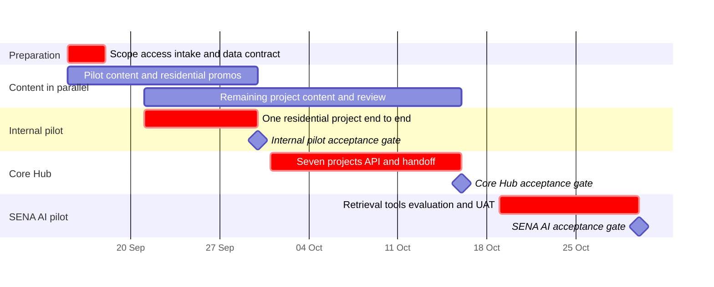

# 07 — แผนส่งมอบ Phase 1: SENA Residential

> ปรับแผนเมื่อ 15 ก.ย. 2026 · วันที่ด้านล่างเป็น **เป้าหมายประมาณการ** และต้องผ่าน acceptance gate ก่อนเปิดใช้แต่ละระยะ

> **อัปเดตกำลังคน 18 ก.ย. 2026:** ยืนยัน developer เต็มเวลา 1 คน โดยมี Codex/agents ช่วยพัฒนาและตรวจงาน วันที่ในเอกสารนี้คงไว้เป็น baseline เดิมที่สมมติ 2 คน ดู [สถานะปัจจุบันและแผน KPI ที่เสนอ](15-status-kpi-plan-20260918.md) สำหรับ forecast เบื้องต้นและการทบทวน 25 ก.ย. ยังไม่ได้เปลี่ยนวันส่งมอบที่ตกลงหรือผ่อนเกณฑ์ acceptance

## 1. ขอบเขตและสมมติฐานของแผน

**Phase 1 ถึงสิ้นเดือนตุลาคมทำเฉพาะ SENA residential:** Thai back office และแพลตฟอร์มข้อมูล Hub สำหรับรวบรวมข้อมูล Marketing/องค์กรและ asset ของ 7 โครงการนำร่อง, โปรโมชั่นที่อยู่อาศัยที่สร้างและอนุมัติใน Hub, API พร้อม data-contract handoff ให้เว็บไซต์องค์กร และ RAG/chatbot pilot ที่ตอบเรื่องโครงการเหล่านี้

**ขอบเขตเว็บไซต์แยกตามผู้รับผิดชอบ:** ทีม Hub ทำ field mapping/content contract, ตัวอย่าง approved payload, API/auth/cache/webhook handoff และติดตาม missing-field feedback ร่วมกับทีมเว็บไซต์ ส่วน website frontend, design, hosting, page rendering และ integration code ฝั่งเว็บไซต์เป็นของทีมเว็บไซต์ ไม่รวมในงานนี้ การเปิดเว็บไซต์จริงไม่ใช่ gate ของ Hub; ตรวจ Hub ผ่าน API/test consumer/cache harness โดยไม่ต้อง deploy เว็บไซต์ และยังเชื่อม chatbot ใน repository `sena_ai_chatbot_mkt` ตามแผนเดิม

**Solar ทั้งหมดอยู่ Phase 2 หลังตุลาคม** รวมถึง EV, LivNex และธุรกิจอื่นที่ไม่ใช่ที่อยู่อาศัย จึงไม่มีงาน BU workspace, generic product model หรือการเตรียมระบบสำหรับธุรกิจเหล่านี้ใน Phase 1 ส่วน Solar/EV ที่เป็นอุปกรณ์หรือของแถมในโครงการที่อยู่อาศัยยังบันทึกเป็นข้อมูลของโครงการหรือโปรฯ ที่อยู่อาศัยได้ โดยไม่ถือเป็นโปรฯ ของธุรกิจ Solar/EV

แผนนี้แทนกำหนดเดิมที่ให้ Hub MVP ครบ 7 โครงการเสร็จ 30 ก.ย. ณ วันที่ปรับแผน repository ยังเป็นเอกสารและ skill files จึงต้องเริ่มจากระบบที่ทำงานครบเส้นทางจริงก่อนขยายจำนวนโครงการ

ประมาณการตั้งอยู่บนสมมติฐานต่อไปนี้:

- มี developer **2 คนเต็มเวลา** ตลอดช่วงส่งมอบ พร้อมผู้รับผิดชอบ DW, content และ legal ที่ทำงานขนานกันและให้คำตอบได้ตาม gate
- ปิดขอบเขต, ระบุเจ้าของงาน และมีสิทธิ์เข้าถึงระบบที่ต้องใช้ใน pilot ภายใน **18 ก.ย.** รวมถึง DW bronze/raw, Supabase และสภาพแวดล้อมทดสอบ
- มีผู้ประสานจากทีมเว็บไซต์เพื่อทบทวน field mapping/content contract และตัวอย่าง payload; ใช้ API/test consumer ตรวจงาน Hub โดยไม่ต้องรอ website code หรือ go-live ยืนยันผู้ดูแล chatbot repository แยกและ API access ของโมเดลก่อนเริ่ม AI pilot
- เก็บ content ตั้งแต่วันแรก โดยเลือก 1 โครงการที่ข้อมูลพร้อมที่สุดเป็น pilot แล้วทยอยเตรียมอีก 6 โครงการ
- ถ้า access, ข้อมูล, ผู้อนุมัติ หรือผลทดสอบไม่พร้อม ให้ปรับวันส่งมอบของงานที่พึ่งพากัน วันที่ในตารางไม่ใช่การอนุญาตให้ข้าม gate

### ภาษาและการเขียน content

ทีมภายใน SENA **พูดไทย 100%** จึงใช้ภาษาไทยสำหรับ admin labels, คำแนะนำ, ข้อผิดพลาด, การแจ้งเตือน และรายงานตรวจ/อนุมัติทั้งหมด การเขียน content เริ่มที่ `th` และภาษาไทยเป็นข้อมูลที่ต้องมีในทุก milestone

คงโครงสร้าง content ที่รองรับ locale และ API fallback เดิม หากมีเนื้อหาภาษาอื่นส่งมาให้แก้ผ่านหน้าจอภาษาไทยได้ ทดสอบสัญญา locale/fallback ด้วย fixtures และอธิบายใน handoff; ไม่เพิ่มงาน public language rollout หรือกำหนดส่งคำแปล

## 2. ลำดับส่งมอบ

| ช่วงเวลา | สิ่งที่ทำ | Gate / ผลส่งมอบ |
|---|---|---|
| **15–18 ก.ย.** | ปิดขอบเขต SENA residential, ระบุ 7 โครงการและเจ้าของ, ตรวจ DW/access, เตรียม intake และประสาน data contract กับทีมเว็บไซต์ | พร้อมเริ่ม implementation, มีข้อมูลขั้นต่ำของ pilot และ field/gap checklist พร้อมผู้รับผิดชอบ |
| **21–30 ก.ย.** | สร้างระบบครบเส้นทางสำหรับ **1 โครงการ** และโปรฯ ที่อยู่อาศัยตัวอย่าง | **30 ก.ย.: limited internal pilot** ให้ทีมภายในทดลอง โดยผ่าน gate ใน §4.1 |
| **1–16 ต.ค.** | ขยาย content/admin/assets/API และโปรฯ ที่อยู่อาศัยครบ **7 โครงการ** พร้อม ads registry, API/test consumer และ data-contract/payload handoff ให้ทีมเว็บไซต์ | **16 ต.ค.: core Hub rollout** หลังผ่าน UAT และ gate ใน §4.2 โดยไม่รอเว็บไซต์ go-live |
| **19–30 ต.ค.** | RAG, structured tools, evaluation และ UAT สำหรับ SENA residential เท่านั้น | **30 ต.ค.: SENA-only AI pilot** หลังผ่าน gate ใน §4.3 |
| **Phase 2 หลัง 31 ต.ค.** | พิจารณา Solar และธุรกิจอื่นที่ไม่ใช่ที่อยู่อาศัย รวมถึง personalization ตามขอบเขตแยก | เริ่มวางแผนได้เร็วสุดเดือน พ.ย.; **ยังไม่กำหนดวันส่งมอบ Solar หรือธุรกิจอื่น** |



### ระบบครบเส้นทางของ pilot

```text
เลือกโครงการจาก REM/DW → ยืนยัน crosswalk → กรอกข้อมูลและ model ขั้นต่ำ
→ ผูก hero + thumbnail + disclaimer → ผ่าน readiness gate
→ publish เป็น release → API/test consumer อ่านเวอร์ชันที่เผยแพร่
→ ทดลองแก้ draft, ถอนเผยแพร่ และ rollback
```

ต้องมีโครงสร้างที่พอสำหรับ **brand, project, model, REM crosswalk, assets และ bindings, disclaimer, version history, publish set และสิทธิ์ผู้ใช้** ไม่ใช้ข้อจำกัดเดิมว่า schema เพียง 5 ตารางเพียงพอ การลดจำนวนโครงการเหลือหนึ่งไม่ลดกติกาการเผยแพร่

พัฒนา auth, RLS, storage, published views, publish/withdraw/rollback และ API/test consumer ไปพร้อมกับ flow นี้ ให้ Marketing ทดลองทันทีที่ flow ใช้งานได้ระหว่างช่วง 21–30 ก.ย. แล้วแก้ปัญหาก่อน gate

### Content Intake — ทำขนานกับ development

**ข้อมูลและการอนุมัติเป็น critical path ร่วมกับระบบ** ปริมาณ 7 โครงการประมาณ 300 records และ 300 files เป็นเพียงประมาณการสำหรับจัดคน ไม่ใช่ข้อมูลที่เก็บเสร็จแล้ว

1. สร้าง Excel/Google Sheet template ให้ตรงกับ schema ที่ตกลง พร้อมแยก REM name และ public name; เริ่มกรอก `th` และเก็บเนื้อหาภาษาอื่นที่ส่งมาแยกตาม locale ใน schema เดิม
2. ใช้ชื่อไฟล์ `{PROJECT_CODE}__{level}__{ref}__{role}__{seq}.{ext}` เช่น `KITH-RSU__model__TYPE-A__floorplan__01.jpg`
3. เก็บ model specifications, hero/thumbnail, floor plans, FAQ, disclaimer และข้อมูลโปรฯ ที่อยู่อาศัยของโครงการ pilot ก่อน
4. ระบุเจ้าของ content และผู้อนุมัติต่อโครงการ; ตรวจสิทธิ์ asset และเงื่อนไขโปรฯ ระหว่างเก็บข้อมูล
5. Import และแก้ validation errors เป็นชุดเล็กต่อเนื่อง แล้วตรวจความครบถ้วนของอีก 6 โครงการก่อน core Hub gate
6. รับข้อมูลองค์กรผ่าน DW bronze/raw และเทียบ field mapping กับ content contract ของทีมเว็บไซต์; ติดตาม missing-field feedback ใน checklist พร้อม source/เจ้าของงาน แล้วให้ Marketing หรือผู้ดูแล source เติมข้อมูลผ่าน approval/publish flow เดิม

## 3. การลดขอบเขตเมื่อไม่ทัน

ทบทวนความพร้อม **25 ก.ย., 9 ต.ค. และ 23 ต.ค.** ก่อน gate ของแต่ละระยะ ให้เลื่อนความสะดวกในการทำงานก่อน; ถ้าฟังก์ชันจำเป็นหรือหลักฐาน acceptance ยังไม่ผ่าน ให้เลื่อน gate

| สิ่งที่เลื่อนได้ | วิธีทำงานระหว่างรอ | เงื่อนไข |
|---|---|---|
| การสร้าง renditions อัตโนมัติ | ใช้ rendition ที่เตรียมไว้หรือ image transformation ตามข้อกำหนด asset | ยังต้องควบคุมสิทธิ์และแหล่งไฟล์ |
| Drag-drop เรียงรูป | กรอก `display_order` | ไม่กระทบ binding หรือ version ที่เผยแพร่ |
| Signed-token preview | ให้ผู้มีสิทธิ์ตรวจใน staging ที่ควบคุมการเข้าถึง | ห้ามใช้ public production เป็นพื้นที่ตรวจ draft |
| Drift Inbox แบบเต็ม | ใช้รายงาน drift รายวัน | ต้องตรวจ source changes และรักษากติกาถอนโปรฯ ที่ source ใช้ไม่ได้ |
| UI จัดการ Facility/Nearby แบบละเอียด | ใช้ bulk import ที่ตรวจ validation และผ่าน publish gate เดิม | ห้ามเขียนข้าม approval หรือ published views |
| หน้าจอ Content Gap Queue | ใช้รายงาน/checklist ให้ editor ตรวจ | Core Hub ยังต้องรับและติดตาม missing-field feedback จากทีมเว็บไซต์; AI pilot ยังต้องมี no-answer logging และ human handoff |

**ห้ามลด:** REM crosswalk, model specifications ขั้นต่ำ, การแยก draft/published, readiness gate, atomic publish, withdraw/rollback, consumer-role isolation, asset rights และทั้ง data/legal approval ของโปรฯ รวมถึงการหมดอายุและ cache invalidation

Solar, ธุรกิจอื่นที่ไม่ใช่ที่อยู่อาศัย, BU workspaces และ generic product model อยู่นอก Phase 1 ตั้งแต่ต้น ไม่ใช่งานสำรองที่เริ่มทำหากมีเวลาว่าง

## 4. Acceptance gates

### 4.1 Limited internal pilot — เป้าหมาย 30 ก.ย.

- [ ] ทีมภายในจัดการ **1 โครงการที่อยู่อาศัย** ได้ตั้งแต่เลือก REM/DW จน API/test consumer อ่านข้อมูลที่เผยแพร่ได้
- [ ] พนักงานทำ flow ด้วยหน้าจอ, คำแนะนำ, validation/errors, การแจ้งเตือน และรายงานอนุมัติภาษาไทย; หน้าเขียน content เริ่มที่ `th`
- [ ] Project และ model ที่นำมาเผยแพร่มี REM crosswalk ที่ confirmed; มี model ที่เผยแพร่อย่างน้อยหนึ่งแบบพร้อม bedrooms, bathrooms และ usable area
- [ ] Project มีข้อมูลขั้นต่ำครบตาม readiness gate รวม `public_name.th`, slug, address, coordinates, hero, thumbnail และ `ad_disclaimer`; ผูก asset role ผ่าน registry โดยใช้ไฟล์ที่มีสิทธิ์ใช้งาน
- [ ] เปลี่ยน draft แล้ว public response ไม่เปลี่ยนจน publish; publish set ทำงานเป็น transaction เดียว และพิสูจน์ withdraw/rollback ด้วยการอ่าน response จริง
- [ ] ทดสอบด้วย consumer role ว่า draft/archived/expired และข้อมูลภายในอ่านไม่ได้; rollback ต้องไม่ข้ามข้อจำกัดสิทธิ์หรือ validity ปัจจุบัน
- [ ] โปรฯ ที่อยู่อาศัยตัวอย่างผ่าน data approval และ legal approval ก่อนเผยแพร่; ทดลองวันเริ่ม/สิ้นสุด, exclusion และถอนเผยแพร่ โดย test consumer/cache harness ไม่ค้างโปรฯ เกิน cache contract
- [ ] ทดสอบว่าโปรฯ ที่อ้าง source ซึ่งถูกปิดหรือถูกลบไม่ออก API; ตรวจ webhook และการแจ้งเจ้าของงาน
- [ ] มี Publisher และผู้ยอมรับผล pilot ที่ระบุตัวบุคคล พร้อมหลักฐานทดสอบ; การผ่าน gate นี้ยังไม่เท่ากับส่งมอบครบ 7 โครงการหรือ AI pilot

### 4.2 Core Hub rollout — เป้าหมาย 16 ต.ค.

- [ ] ผ่าน pilot gate และ Marketing จัดการ content/assets ได้เองครบ **7 โครงการ SENA residential**
- [ ] ทุก project/model ที่เผยแพร่มี REM anchor confirmed; model specifications และข้อมูลที่ publish gate ต้องการครบทุกแบบใน 7 โครงการ
- [ ] Upload, paste URL และเลือกจาก Library ใช้งานได้; ไฟล์ที่นำมาเผยแพร่ให้ consumer ถูก mirror เข้า Hub และไม่มี external asset URL หลุดออก public API
- [ ] Bulk import รายงาน validation errors ที่แก้ต่อได้; ตรวจ completeness และมีเจ้าของ content ต่อโครงการ
- [ ] โปรฯ ที่อยู่อาศัยของ 7 โครงการสร้างและอนุมัติใน Hub ได้; resolve ครบ 6 target types (`COMPANY`, `BRAND`, `PROJECT_GROUP`, `PROJECT`, `MODEL`, `UNIT`) พร้อม include/exclude, validity, approval และกติกา source ที่เกี่ยวข้อง
- [ ] ทดสอบ atomic release ข้ามหลาย entity, rollback, withdraw, open-ended review deadline และการแยกสิทธิ์ตาม acceptance criteria
- [ ] Published API, change feed และ webhooks ใช้งานได้; เมื่อถึงวันหมดอายุ API ตัดโปรฯ ออกโดยไม่ต้องมี job, ตัวรับ webhook ทดสอบได้รับ signed expiry event ภายใน **60 วินาที** และ cache test client ไม่เก็บ response ที่หมดอายุเกิน `cache_expires_at` หรือ TTL สูงสุด **300 วินาที** ตาม A-13 โดยไม่ต้องแก้หรือเชื่อมเว็บไซต์จริง
- [ ] API ใช้ `th` เป็นค่าเริ่มต้นและส่ง fallback metadata ถูกต้อง; ใช้ fixtures ตรวจกรณีมี/ไม่มี locale ที่ consumer ขอได้ แม้ content จริงเป็นภาษาไทยเท่านั้น
- [ ] ส่งมอบ representative approved payloads ของ project/model/assets/FAQ/documents/promotions/SEO/locale พร้อม API/auth/cache/webhook contract ให้ทีมเว็บไซต์; ทบทวน field mapping และ field/gap checklist พร้อมเจ้าของงานตาม **A-21** ใช้ API/test consumer พิสูจน์ข้อมูล โดยไม่ต้องมี integration code หรือ deployment ฝั่งเว็บไซต์
- [ ] Ads registry อ่านอย่างเดียวและทดสอบกับ snapshot ชีตที่ระบุวันที่และมีโฆษณาที่อยู่อาศัย: จัดประเภททุกแถวเป็น residential หรือ `OUT_OF_SCOPE` ก่อนวัดผล, resolve ได้ ≥90% ของแถว residential ทั้งหมด โดย unresolved ยังอยู่ในตัวหาร และแสดงจำนวนแต่ละกลุ่มแยกกัน; ไม่สร้าง entity ของธุรกิจอื่น
- [ ] URL inbox และการเตือน ad ที่ยัง active แต่โปรฯ หมดอายุใช้งานได้ในขอบเขต SENA residential
- [ ] ผ่าน UAT ครบ 7 โครงการ พร้อม publish owner, หลักฐาน acceptance และผู้ดูแลระบบหลัง rollout

### 4.3 SENA-only AI pilot — เป้าหมาย 30 ต.ค.

- [ ] ใช้เนื้อหา SENA residential ที่ผ่าน core Hub gate; ingestion อ่านเฉพาะ published views
- [ ] RAG re-index ลบ chunk รุ่นก่อนและเพิ่มรุ่นใหม่ใน transaction เดียว; reconcile ไม่พบ orphan chunks
- [ ] คำตอบมี citation, version และ URL กลับไปยังเนื้อหาต้นทางที่อนุญาตให้เข้าถึง
- [ ] คำถามราคา, availability, specifications และโปรโมชั่นใช้ structured tools; ไม่ตอบข้อมูลเหล่านี้จาก vector index
- [ ] Golden set สำหรับ 7 โครงการมี cross-project leakage = 0%, volatile-answer rate = 0%, recall@5 ≥ 0.90 และ citation precision ≥ 0.95 พร้อมผ่านเกณฑ์ evaluation อื่นที่ระบุใน REQUIREMENTS
- [ ] ไม่มีข้อมูลลูกค้าใน Hub/vector store; มี human handoff และ no-answer logging ให้ editor ตรวจ
- [ ] คำถาม Solar หรือธุรกิจอื่นนอกที่อยู่อาศัยบอกขอบเขตที่รองรับและส่งต่อเมื่อเหมาะสม; ไม่ตอบโปรฯ บ้านที่มีของแถม Solar/EV ว่าเป็นโปรฯ ของธุรกิจเหล่านั้น
- [ ] ผ่าน UAT สำหรับ 7 โครงการ SENA residential ก่อนเปิด pilot กับกลุ่มผู้ใช้ที่กำหนด
- [ ] UAT ภาษาไทยเป็นฐานและทดสอบภาษาอังกฤษตาม golden set ด้วยหลักฐานที่เผยแพร่ รวมถึงหลักฐานภาษาไทย; ไม่ถือว่าต้องเปิด content ภาษาใหม่หรืออนุมานภาษาจากประเทศของผู้ใช้

การตรวจ boundary ว่าไม่รองรับธุรกิจอื่นและการทำงานภาษาไทยของพนักงานใช้ทุก milestone ตาม A-19/A-20; A-01 ถึง A-16, **A-21 (data-contract/payload handoff)** และ **A-22 (brand management)** เป็น gate ของ core Hub และ A-17 ถึง A-18 รวมเกณฑ์ RAG evaluation เป็น gate ของ AI pilot ตาม [REQUIREMENTS](../REQUIREMENTS.md)

### 4.4 Phase 2 — หลังตุลาคม

หลัง **31 ต.ค.** จึงพิจารณาแผน Solar และธุรกิจอื่นที่ไม่ใช่ที่อยู่อาศัย โดยกำหนดเจ้าของข้อมูล, ขอบเขตบริการ, สิทธิ์ผู้ใช้, integration และ acceptance แยกก่อนประเมินวันส่งมอบ **เดือน พ.ย. เป็นเพียงเวลาเริ่มที่เร็วที่สุด ไม่ใช่กำหนดส่ง Solar**

Personalization ที่ใช้ CRM/CDP, customer profiles, consent, segmentation, channel activation หรือ conversion feedback เป็นขอบเขตแยกที่ยังไม่มีวันส่งมอบ Phase 1 ไม่เพิ่มข้อมูลลูกค้าเข้า Hub และไม่รวมงานเตรียมระบบเหล่านี้

## 5. ความเสี่ยงและ dependency ที่ต้องติดตาม

| ความเสี่ยง / dependency | ผลต่อกำหนดการ | วิธีจัดการ |
|---|---|---|
| Content หรือการอนุมัติไม่ทัน | โครงการหรือโปรฯ ยังเผยแพร่ไม่ได้แม้ UI เสร็จ | จัด intake และ review ขนาน เลือก pilot จากข้อมูลที่พร้อมจริง |
| DW bronze/raw หรือ source tables ไม่พร้อม | ผูก REM และทดสอบ source lifecycle ไม่ครบ | ใช้ fixture ระหว่างพัฒนาได้ แต่ต้องผ่านข้อมูลจริงก่อน acceptance ของ integration |
| ขอบเขต/schema ยังไม่ตกลง | งาน admin, import และ API ต้องแก้ซ้ำ | ปิดขอบเขตที่อยู่อาศัยและสัญญาข้อมูลในช่วง 15–18 ก.ย.; ทบทวน migration และผลกระทบทุกครั้งที่เปลี่ยน |
| Field mapping หรือข้อมูลที่ทีมเว็บไซต์ต้องใช้ยังไม่ครบ | Handoff และ content completeness ไม่ผ่าน | ประสานทีมเว็บไซต์ตั้งแต่ preparation, ใช้ตัวอย่าง payload ทบทวน contract และให้เจ้าของแก้ field/gap checklist โดยไม่ผูก gate กับ website go-live |
| Source ถอนโปรฯ แต่ API/cache ยังแสดง | Public validity และการยอมรับงานไม่ผ่าน | บังคับด้วย view, expiry predicate, TTL และ webhook; ทดสอบผ่าน consumer/cache harness ใน pilot |
| Chatbot repository หรือ integration ไม่พร้อม | เริ่ม AI pilot หรือผ่าน UAT ไม่ได้ | ยืนยันผู้ดูแล `sena_ai_chatbot_mkt`, API contract และสภาพแวดล้อมทดสอบล่วงหน้า |
| Model API access หรือ host capacity ไม่พร้อม | เริ่ม AI pilot หรือผ่าน latency gate ไม่ได้ | ยืนยันสิทธิ์และทดสอบ capacity ล่วงหน้าระหว่าง core Hub development |
| ทีมไม่ครบหรือผล UAT ไม่ผ่าน | วันที่ของ milestone ที่พึ่งพากันเลื่อน | แจ้งความคืบหน้าเทียบ gate และปรับแผน ไม่ลดข้อควบคุมการเผยแพร่ |

## 6. สิ่งที่ต้องปิดในช่วง 15–18 ก.ย.

1. ระบุชื่อและ REM ID ของ 7 โครงการ เลือกโครงการ pilot และเจ้าของ content ต่อโครงการ
2. ยืนยัน DW bronze/raw ที่ใช้จริง สิทธิ์อ่าน ตารางที่มี และแผนเปิดตาราง source promotion ที่ยังขาด
3. ระบุ Publisher, data approver และ legal approver พร้อมคิวตรวจ content/โปรฯ
4. ยืนยันข้อมูลและไฟล์ขั้นต่ำของ pilot รวม model, hero/thumbnail, disclaimer และโปรฯ ที่อยู่อาศัยตัวอย่าง
5. ระบุผู้ประสานทีมเว็บไซต์และทบทวน field mapping/content contract, ตัวอย่าง payload ที่ต้องส่ง และวิธีรับ missing-field feedback; ไม่ต้องมีสิทธิ์ deploy หรือแก้ code เว็บไซต์
6. ยืนยันกำลังคน 2 developers เต็มเวลาและผู้สนับสนุน DW/content/legal; ภาษา admin และ content หลักตอบแล้วว่าเป็นไทย
7. มอบหมายผู้รับผิดชอบ ads-sheet viewer access, model API access และ host capacity พร้อมวันที่ต้องได้คำตอบก่อนงานที่พึ่งพาเริ่ม
8. ยืนยัน API/test consumer และสภาพแวดล้อมทดสอบ Hub รวมถึงผู้ดูแล integration และสิทธิ์เข้าถึง chatbot repository แยก
