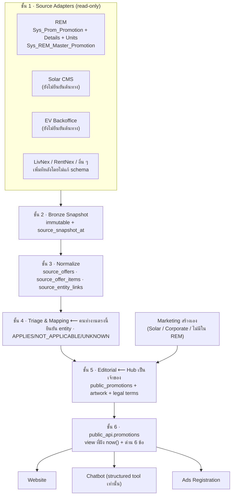
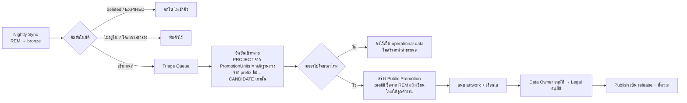
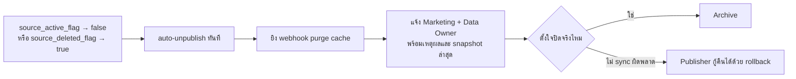
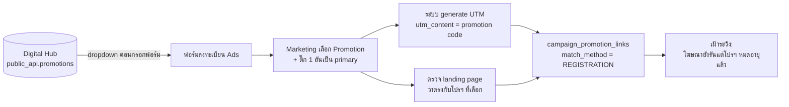

# 08 — Promotion: เชื่อม REM + Ads Registration เข้า Digital Hub

> อ้างอิงผลตรวจ REM แบบ read-only เมื่อ 14 ก.ย. 2026
> เอกสารนี้**แก้ข้อสรุปเดิมใน [04-promotions.md](04-promotions.md)** เรื่องเจ้าของข้อมูลโปรโมชั่น

---

## 1. ตอบคำถามตรง ๆ ก่อน

**รวมกับข้อมูลที่ Marketing ใช้ลงทะเบียน Ads ได้ไหม** — ได้ แต่**ต้องรวมผ่านชั้น mapping ที่คนกดยืนยัน ห้ามรวมด้วยการเดาจากชื่อ**
และวิธีที่ถูกที่สุดคือ **กลับด้านปัญหา**: แทนที่จะจับคู่ Ads กับ Promotion ย้อนหลัง (ซึ่งคือโจทย์ยากของ ADD-01)
ให้ **ฟอร์มลงทะเบียน Ads ดึงรายการ Promotion ที่ publish แล้วจาก Digital Hub มาให้เลือกตอนลงทะเบียน**
ความสัมพันธ์จะเกิดขึ้นเองตอนกรอก แม่นยำ 100% และไม่ต้องมี matching algorithm เลย

> รายละเอียดใน §8 · สิ่งที่ผมยังไม่รู้เกี่ยวกับระบบลงทะเบียน Ads ของฝั่งเรา อยู่ใน §11

---

## 2. การค้นพบที่สำคัญที่สุด — คำว่า "Promotion" หมายถึงสองสิ่งที่ต่างกัน

นี่คือรากของความสับสนทั้งหมด และเป็นเหตุผลที่ audit กับเอกสาร [04](04-promotions.md) ของผมดูขัดกัน ทั้งที่จริงแล้วพูดคนละเรื่อง

| | **Offer** (เชิงปฏิบัติการ) | **Public Promotion** (เชิงสื่อสาร) |
|---|---|---|
| คืออะไร | สิทธิ์ที่ Sales ให้ได้จริงตอนทำสัญญา | สิ่งที่เราพูดต่อสาธารณะ |
| อยู่ที่ไหน | `Sys_Prom_Promotion` → `Details` → `Units` | Digital Hub |
| **System of Record** | **REM** (และ Solar CMS / EV backoffice เมื่อเจอ) | **Digital Hub** |
| มีอะไร | ส่วนลด ของแถม ผูกกับ Unit ต้นทุน งบ | หัวเรื่อง คำบรรยาย artwork เงื่อนไขที่กฎหมายอนุมัติ |
| ใครแก้ | REM Owner / Sales Admin | Marketing → Legal |
| ปริมาณ | 7,676 รายการ | หลักสิบ |
| ตอบคำถามว่า | "ลูกค้ารายนี้ได้สิทธิ์อะไรได้บ้าง" | "ตอนนี้เราโฆษณาอะไรอยู่" |

**ทั้งสองไม่ใช่สิ่งเดียวกัน และความสัมพันธ์ไม่ใช่ 1:1**

- Public Promotion 1 อัน อาจอ้าง Offer จาก REM **0 ถึง N รายการ** (0 = โปรฯ Solar / Corporate ที่ไม่มีใน REM)
- Offer 1 รายการ อาจถูกอ้างโดย Public Promotion **0 ถึง N อัน** (0 = 7,236 รายการเก่าที่ไม่มีใครเอาไปโฆษณา)

**ผลต่อการออกแบบ:** ข้อเสนอ `dim_promotion` ของ audit วาง `promotion_name_raw` กับ `public_title_th` ไว้ในตารางเดียวกัน
ซึ่งเป็นปัญหาเดียวกับ *REM name เขียนทับ public name* ที่ทั้งโครงการนี้ตั้งใจแก้ตั้งแต่แรก แค่ย้ายมาเกิดในโดเมนโปรโมชั่น
ถ้า `public_title_th` เป็น column บนตารางที่ sync จาก REM ทุกคืน จะไม่มีทางมี draft / review / rollback และมีความเสี่ยงถูก sync ทับ

→ **ต้องแยกเป็นสองตารางคนละเจ้าของ แล้วเชื่อมด้วย citation** (§6)

---

## 3. สิ่งที่ audit ทำถูกและควรรับมาทั้งหมด

| # | ข้อค้นพบ | ทำไมถึงสำคัญ |
|---|---------|--------------|
| 1 | **Promotion ต้องเป็น source-neutral ไม่บังคับ ProjectID** | ถูกต้อง และแก้ข้อจำกัดของ [04](04-promotions.md) เดิมของผมที่ผูก scope กับโครงสร้างโครงการเป็นหลัก — Solar / EV / LivNex / Corporate ไม่มี ProjectID และ**ห้ามสร้าง ProjectID ปลอม** |
| 2 | **`project_applicability` = APPLIES / NOT_APPLICABLE / UNKNOWN** | ข้อเสนอที่ดีที่สุดในเอกสารทั้งฉบับ — แยก *"ไม่เกี่ยวกับโครงการ"* ออกจาก *"ยังหาโครงการไม่เจอ"* ค่าว่างตอบสองอย่างนี้ไม่ได้ และถ้าปนกันเมื่อไร AI จะตอบผิดทันที |
| 3 | **แยกสถานะเป็น 5 ตัว ไม่รวมเป็น status เดียว** | ดีกว่า `lifecycle_status` ตัวเดียวที่ผมเสนอไว้ใน 04 — ขอรับมาใช้แทน |
| 4 | **`temporal_status` คำนวณจาก `as_of` ไม่เก็บเป็นค่าคงที่** | ถูกมาก สถานะเวลาเป็น *ฟังก์ชันของคำถาม* ไม่ใช่คุณสมบัติของแถว |
| 5 | **ห้ามใช้ `isActive=1` เงื่อนไขเดียว** | หลักฐานชัด: 346 จาก 440 ไม่มี EndDate และ 323 เริ่มก่อนปี 2026 |
| 6 | **ห้ามตีความ Solar Roof ในโปรฯ บ้าน = โปรฯ ธุรกิจ Solar** | นี่คือ error ที่ LLM จะทำแน่นอนถ้าไม่กันไว้ (§5) |
| 7 | **Key ต้องมี namespace + เก็บ identifier เป็นข้อความ** | `REM:SENA_PRD:Sys_Prom_Promotion:2609003000` — จำเป็นเมื่อมีหลายต้นทาง และกัน leading zero หาย |
| 8 | **ความสัมพันธ์หลายเป้าหมาย ไม่ต้องเป็น tree** | ถูก — และดีกว่า `scope_level` แบบ enum เดี่ยวที่ผมเสนอไว้เดิม |
| 9 | **ห้ามแบ่ง Ads spend อัตโนมัติจากจำนวน Promotion** | ถูก และผมขอขยายเป็นกฎ grain ที่ชัดเจนใน §9 |

---

## 4. ช่องว่างของ audit ที่ควรปิดเพิ่ม

| # | ช่องว่าง | ผลถ้าไม่ปิด | ข้อเสนอ |
|---|---------|-------------|---------|
| **G1** | **ไม่แยก Offer ออกจาก Public Promotion** | `public_title_th` ถูก sync ทับ / ไม่มี draft / ไม่มี rollback | แยกสองตารางคนละเจ้าของ (§2, §6) |
| **G2** | **ไม่มี versioning / publish set** | `publication_status` เป็น flag ไม่ใช่ version → ปล่อยผิดแล้วย้อนไม่ได้ ไม่มี preview | ใช้ `entity_versions` + `publish_sets` เดิมจาก [02 §9](02-data-model.md) |
| **G3** | **`approval_status` ตัวเดียวรับสองคำถาม** | *"ข้อมูลถูกไหม"* (เจ้าของข้อมูล) กับ *"พูดแบบนี้ต่อสาธารณะได้ไหม"* (Legal) เป็นคนละคนและคนละคำถาม | แยกเป็น `data_approval` (REM/BU Owner) และ `legal_approval` (Legal) — ต้องผ่านทั้งคู่ |
| **G4** | **ไม่มีกลไกบังคับกรณีไม่มี EndDate** | เอกสารบอกว่า "ให้เจ้าของข้อมูลอนุมัติ" แต่ไม่มีอะไรบังคับ → 323 รายการเสี่ยงค้างบนเว็บ | `end_at IS NULL` → publish ไม่ได้ เว้นแต่มี `open_ended_approved_by` **และ** `review_due_at` (บังคับ ≤ 90 วัน) พอถึงกำหนดแล้วไม่ต่ออายุ → unpublish อัตโนมัติ |
| **G5** | **ไม่มี cache contract** | `temporal_status` ขึ้นกับ `as_of` → response ที่ cache ไว้**ผิดโดยโครงสร้าง**ทันทีที่ข้ามเที่ยงคืน | TTL ต้องไม่ข้ามเที่ยงคืน Asia/Bangkok: `max-age = min(300, วินาทีที่เหลือถึง 00:00 +07)` + webhook purge |
| **G6** | **`visibility` คุมที่ระดับแถว ไม่ใช่ระดับ field** | เอกสารบอกถูกว่าต้นทุน/งบห้ามส่งให้ AI แต่เป็นข้อความในเอกสาร ไม่ใช่โครงสร้าง | แยกฟิลด์ภายในไปคนละ schema ที่ consumer role **ไม่มีสิทธิ์อ่านเลย** — เหมือนที่ทำกับ `public_api` |
| **G7** | **`offer_type` ไม่มี controlled vocabulary** | "ฟรีค่าโอน" จะถูกเขียน 40 แบบใน 7,676 แถว → บอทตอบ *"มีโปรฟรีค่าโอนไหม"* ข้ามโครงการไม่ได้ | ทำ `offer_type_taxonomy` และ **seed จาก `Sys_REM_Master_Promotion`** (§5) |
| **G8** | **ไม่มีกฎลำดับเมื่อโปรฯ ชนกัน** | โครงการหนึ่งเข้าเงื่อนไข 5 โปรฯ พร้อมกัน แล้วเว็บกับบอทจะแสดงอันไหน | คงกฎ precedence + stackable จาก [04 §4](04-promotions.md) มาใช้กับโมเดล multi-target |
| **G9** | **`bridge_promotion_entity` ไม่มี role สำหรับข้อยกเว้น** | *"ทุกโครงการยกเว้น A และ B"* เขียนไม่ได้ ต้องไปสร้างโปรฯ ซ้ำ 30 อัน | เพิ่ม `relationship_role = EXCLUDED_FROM` และให้ **exclude ชนะ include เสมอ** |
| **G10** | **ไม่มีนโยบายเมื่อต้นทางปิดรายการ** | REM ปิดโปรฯ แล้วเว็บยังโชว์ = โฆษณาเกินจริง | **ข้อยกเว้นที่ตั้งใจ** ของกฎ "REM เปลี่ยนต้องให้คนตัดสิน": `source_active_flag` เปลี่ยนเป็น false หรือ `source_deleted_flag` = true → **auto-unpublish ทันทีแล้วค่อยแจ้งคน** (§7) |
| **G11** | **ไม่มี asset** | โปรฯ ต้องมี banner / artwork | ใช้ `entity_assets` เดิมด้วย `entity_type='public_promotion'` ไม่ต้องออกแบบใหม่ |
| **G12** | **ไม่มี dedup ข้ามต้นทาง** | ข้อเสนอเดียวกันอาจมีทั้งใน REM และ Solar CMS → โชว์ซ้ำ | แก้ได้ฟรีจากโมเดลสองชั้น — Public Promotion 1 อันอ้างหลาย source offer |
| **G13** | **`dim_` / `bridge_` เป็นศัพท์ warehouse** | Digital Hub เป็นระบบ operational บน Supabase คนละของกับ Gold model | กำหนดเส้นแบ่งให้ชัด (§6 ตารางเทียบชื่อ) |

---

## 5. Solar / EV — ตีความให้ถูก แล้วจะได้ของแถมฟรี

audit สรุปถูกแล้วว่า Promotion ที่ติดป้าย Solar 47 และ EV 10 รายการ **มี project signal ทั้งหมด**
แปลว่าเป็น **โปรฯ ขายบ้านที่แถม Solar Roof / EV Charger** ไม่ใช่โปรฯ ของธุรกิจ Solar

**การ map ที่ถูกต้อง:**

```
Sys_Prom_Promotion "ซื้อบ้าน... รับ Solar Roof ฟรี"
  → public_promotion  (business: REAL_ESTATE, project: APPLIES)
       └─ offer_item   (offer_type: SOLAR_PACKAGE)      ← Solar อยู่ตรงนี้
```
**ไม่ใช่**
```
  → public_promotion  (business: SOLAR)   ✗ ผิด
```

**ของแถมที่ได้ฟรี:** `Sys_REM_Master_Promotion` (Solar 82 + EV 8 รายการที่ไม่ถูกลบ) **ไม่มี StartDate/EndDate**
audit สรุปถูกว่าเป็นรายการสิทธิ์/สินค้า ไม่ใช่ campaign — ซึ่งแปลว่ามันคือ **แคตตาล็อกของแถมที่มีอยู่แล้ว**
→ ใช้เป็น **seed ของ `offer_type_taxonomy`** ได้ทันที (G7) ไม่ต้องนั่งคิดรายการ offer type เองตั้งแต่ศูนย์

**กฎที่ต้องบังคับ:** `business` ของ promotion มาจาก `bridge_promotion_entity` ที่คนยืนยันแล้วเท่านั้น
**ห้ามอนุมานจากชื่อ promotion หรือจากชื่อ offer item เด็ดขาด** — และควรเขียนเป็น test case ใน golden set ของ chatbot ตรง ๆ
(*"โปรโมชั่น Solar มีอะไรบ้าง"* → ต้องตอบว่ายังไม่มีโปรฯ ของธุรกิจ Solar แบบเดี่ยว ไม่ใช่หยิบ 47 รายการโปรฯ บ้านมาตอบ)

---

## 6. Funnel จริง — 7,676 ไม่ได้แปลว่าต้องรีวิว 7,676

คำนวณจากตัวเลขใน audit (เป็นการอนุมานจากตัวเลขที่ให้มา ไม่ใช่ตัวเลขที่ audit ระบุเอง — ต้องยืนยันด้วย query จริงอีกครั้ง):

| กลุ่ม | จำนวน | ทำอย่างไร |
|-------|------:|-----------|
| Promotion ทั้งหมด | 7,676 | เก็บเป็น bronze snapshot ไว้ ไม่ต้องแตะ |
| `isActive=1` และไม่ถูกลบ | 440 | เข้าคิว triage |
| ↳ **มี EndDate** (440 − 346) | **94** | คำนวณ `temporal_status` ได้ตรง ๆ — ส่วนที่ EXPIRED ตัดออกอัตโนมัติ |
| ↳ **ไม่มี EndDate แต่เริ่มปี 2026** (346 − 323) | **23** | น่าจะกำลังใช้จริง → เข้าคิวขออนุมัติ open-ended (G4) |
| ↳ **ไม่มี EndDate และเริ่มก่อนปี 2026** | **323** | ต้องสงสัยว่าค้างในระบบ → **ตั้ง default เป็นไม่เผยแพร่** ให้เจ้าของข้อมูลปลดล็อกเป็นราย ๆ |

**เพดานของสิ่งที่มีสิทธิ์ publish จริงคือประมาณ 117 รายการ ไม่ใช่ 440**
และเมื่อกรองเฉพาะที่เกี่ยวกับ **7 โครงการนำร่อง** จะเหลือหลักสิบ — เป็นปริมาณที่คนรีวิวไหวภายในสัปดาห์เดียว

> **ข้อเสนอขอบเขต MVP:** ingest ทั้ง 440 เข้าคิว แต่ **บังคับ scope การรีวิวไว้ที่ 7 โครงการนำร่องก่อน** ที่เหลือค้างคิวไว้ได้โดยไม่กระทบอะไร เพราะ default คือไม่เผยแพร่

---

## 7. สถาปัตยกรรม 6 ชั้น



**คุณสมบัติสำคัญของโครงนี้:** ชั้น 5 อยู่ได้โดยไม่ต้องมีชั้น 1 (โปรฯ Corporate/Solar ที่ไม่มีใน REM)
และชั้น 1 อยู่ได้โดยไม่ต้องมีชั้น 5 (7,236 รายการเก่าที่ไม่มีใครเอาไปโฆษณา)
— ตรงตามที่ audit ต้องการ (*ไม่บังคับ ProjectID*) และตรงตามที่การเผยแพร่ต้องการ (*ต้องมี draft/approve/rollback*) พร้อมกัน

### ตารางเทียบชื่อกับข้อเสนอของ audit

| ชื่อใน audit | ชั้น | ชื่อที่เสนอใน Hub | เจ้าของ | เขียนได้โดย |
|--------------|:---:|-------------------|---------|-------------|
| `dim_promotion` (ส่วน raw + สถานะต้นทาง) | 3 | `staging.source_offers` | ระบบต้นทาง | sync job เท่านั้น |
| `promotion_offer_item` | 3 | `staging.source_offer_items` | ระบบต้นทาง | sync job เท่านั้น |
| `bridge_promotion_entity` | 4 | `hub.promotion_entity_links` | **Hub** (คนยืนยัน) | Editor → Data Owner |
| `dim_promotion` (ส่วน `public_title_*`, `visibility`, `publication_status`) | 5 | **`hub.public_promotions`** | **Hub** | Editor → Legal → Publisher |
| `bridge_marketing_campaign_promotion` | — | `hub.campaign_promotion_links` | **Hub** | สร้างตอนลงทะเบียน Ads (§8) |

### Schema ที่ปรับ

```sql
-- ชั้น 3 — กระจกของต้นทาง ห้ามมี UI ให้แก้ แม้แต่ admin
create table staging.source_offers (
  promotion_key        text primary key,   -- REM:SENA_PRD:Sys_Prom_Promotion:2609003000
  source_system        text not null,      -- REM | SOLAR_CMS | EV_BACKOFFICE
  source_namespace     text not null,
  source_promotion_id  text not null,      -- text เสมอ กัน leading zero หาย
  promotion_name_raw   text,
  description_raw      text,
  start_at             timestamptz,
  end_at               timestamptz,        -- null ได้ → ต้องผ่าน G4
  sbu_id               text,
  source_active_flag   boolean not null,
  source_deleted_flag  boolean not null,
  source_created_at    timestamptz,
  source_modified_at   timestamptz,
  source_snapshot_at   timestamptz not null,
  source_fingerprint   text not null,      -- ใช้ตรวจ drift
  unique (source_system, source_namespace, source_promotion_id)
);

-- ชั้น 4 — ความสัมพันธ์ที่คนยืนยัน
create table hub.promotion_entity_links (
  link_id             uuid primary key,
  promotion_key       text,                -- อ้าง source_offers (nullable)
  public_promotion_id uuid,                -- หรืออ้าง public_promotions โดยตรง
  target_entity_type  text not null,       -- COMPANY|BUSINESS|BRAND|PROJECT_GROUP|PROJECT|UNIT
  target_namespace    text not null,
  target_id           text not null,
  target_name         text,
  relationship_role   text not null,       -- OFFERED_BY|APPLIES_TO|PROMOTES|FULFILLED_BY|EXCLUDED_FROM
  project_applicability text not null,     -- APPLIES|NOT_APPLICABLE|UNKNOWN  (ห้ามใช้ค่าว่าง)
  mapping_status      text not null,       -- CANDIDATE|CONFIRMED|REJECTED
  match_method        text not null,       -- PROMOTION_UNITS|NAME_PREFIX|MANUAL|SOURCE_FIELD
  evidence_reference  text,
  confirmed_by        text, confirmed_at timestamptz,
  valid_from timestamptz, valid_to timestamptz,
  check (num_nonnulls(promotion_key, public_promotion_id) >= 1)
);

-- ชั้น 5 — Hub เป็นเจ้าของเต็ม
create table hub.public_promotions (
  public_promotion_id uuid primary key,
  code                text unique not null,
  campaign_id         uuid references hub.campaigns,
  title               jsonb not null,       -- {th, en}
  summary             jsonb not null,       -- ข้อความสั้นที่บอทพูดได้
  conditions_public   jsonb,
  legal_terms         jsonb not null,
  disclaimer          jsonb not null,
  stackable           boolean default false,
  priority            int default 100,
  starts_at           timestamptz not null,
  ends_at             timestamptz,          -- null → ต้องผ่าน G4
  open_ended_approved_by text,
  review_due_at       timestamptz,
  visibility          text[] not null default '{}',   -- PUBLIC | AI | STAFF
  data_approved_by    text, data_approved_at  timestamptz,
  legal_approved_by   text, legal_approved_at timestamptz,
  published_version_id uuid references hub.entity_versions,
  status              hub.lifecycle_status not null default 'draft',
  constraint open_ended_needs_review
    check (ends_at is not null
           or (open_ended_approved_by is not null and review_due_at is not null))
);

-- citation: public promotion อ้าง source offer ได้ 0..N
create table hub.public_promotion_sources (
  public_promotion_id uuid references hub.public_promotions,
  promotion_key       text references staging.source_offers,
  is_primary          boolean default false,
  primary key (public_promotion_id, promotion_key)
);

-- ฟิลด์ภายใน แยก schema ที่ consumer role ไม่มีสิทธิ์อ่านเลย (G6)
create schema internal;
create table internal.promotion_costs (
  promotion_key text primary key, unit_cost numeric, budget numeric, internal_note text
);
```

---

## 8. Flow เข้า Digital Hub

### 8.1 Flow A — โปรฯ ที่มีต้นทางใน REM



### 8.2 Flow B — โปรฯ ที่ไม่มีต้นทาง (Solar / EV / Corporate / LivNex)

สร้างที่ Hub ตรง ๆ ข้ามชั้น 1–4 ทั้งหมด ผูก target เป็น `BUSINESS` หรือ `BRAND` และตั้ง `project_applicability = NOT_APPLICABLE`
ต่อ source adapter ทีหลังเมื่อเจอระบบต้นทางจริง **โดยไม่ต้องแก้ schema และไม่ต้องสร้างหน้าใหม่** — แค่เพิ่มแถวใน `public_promotion_sources`

### 8.3 Flow C — ต้นทางปิดรายการ (G10)



> **นี่คือข้อยกเว้นที่ตั้งใจ** ของหลักการใน [01](01-source-of-truth.md) ที่ว่า "REM เปลี่ยนต้องให้คนตัดสินเสมอ"
> เพราะความเสี่ยงสองด้านไม่เท่ากัน — ปิดเกินไปแล้วกู้คืนได้ใน 1 คลิก แต่ปล่อยโปรฯ ที่ยกเลิกแล้วค้างบนเว็บคือความเสี่ยงทางกฎหมาย

---

## 9. เชื่อมกับ Ads Registration

### 9.1 ข้อเสนอหลัก — กลับด้านปัญหา



**ทำไมวิธีนี้ดีกว่าการจับคู่ย้อนหลัง**

| | จับคู่ย้อนหลัง (ADD-01) | เลือกตอนลงทะเบียน |
|---|---|---|
| ความแม่นยำ | fuzzy — ต้องมีคนรีวิวทุกคู่ | 100% คนเลือกเอง |
| ต้นทุน | ต้องสร้างและดูแล matching algorithm | เพิ่ม dropdown ในฟอร์มเดิม |
| เวลาที่ได้ข้อมูล | หลังโฆษณารันไปแล้ว | ก่อนโฆษณาเริ่ม |
| ได้ของแถม | — | **UTM อัตโนมัติ + ตรวจ landing page + เตือนโฆษณาที่โปรฯ หมดอายุ** |

ของแถมข้อสุดท้ายมีมูลค่าจริง: **โฆษณาที่ยังรันอยู่แต่โปรโมชั่นหมดอายุไปแล้ว** คือทั้งการเสียเงินเปล่าและความเสี่ยงเรื่องโฆษณาเกินจริง
แต่จะตรวจจับได้ก็ต่อเมื่อมีเส้นเชื่อมนี้อยู่ — ซึ่งเป็นเหตุผลที่คุ้มค่าที่สุดในการทำ link ตั้งแต่ต้นทาง

### 9.2 ลำดับความน่าเชื่อถือของวิธีเชื่อม

| ลำดับ | วิธี | `match_method` | ใช้ได้เลยไหม |
|:---:|------|----------------|--------------|
| 1 | เลือกจาก dropdown ตอนลงทะเบียน | `REGISTRATION` | ✅ CONFIRMED ทันที |
| 2 | Landing page เป็นหน้าโปรฯ ที่ Hub publish | `LANDING_PAGE` | ✅ CONFIRMED ทันที |
| 3 | UTM พา promotion code มา | `UTM` | ✅ CONFIRMED ถ้า code ตรง |
| 4 | Naming convention ของ campaign | `NAME_CONVENTION` | ⚠️ CANDIDATE จนกว่าจะอนุมัติกฎการตั้งชื่อ |
| 5 | เทียบชื่อแบบ fuzzy | `FUZZY` | ⚠️ CANDIDATE เท่านั้น ห้าม auto-confirm |

**`mapping_status = CANDIDATE` ต้องไม่หลุดออก public API และไม่เข้ารายงาน** — กรองที่ view ไม่ใช่ที่โค้ด

### 9.3 กฎ grain — กันการนับซ้ำ

audit เตือนถูกแล้วว่าห้ามแบ่ง spend อัตโนมัติ ขอขยายเป็นกฎที่บังคับได้:

1. **`campaign_promotion_links` เป็นป้ายกำกับ ไม่ใช่กฎจัดสรร** — เป็น many-to-many โดยเจตนา
2. **Spend อยู่ที่ grain เดิมของมันเสมอ** (ad / ad set / campaign) ห้ามเขียนตัวเลข spend ลงในตาราง link
3. **รายงาน "spend ต่อ promotion" ใช้ `is_primary = true` เท่านั้น** เป็นค่าเริ่มต้น → ผลรวมเท่ากับ spend จริง ไม่บวมและไม่ขาด
4. ถ้าต้องการแบ่งแบบอื่น (เฉลี่ยเท่ากัน / ถ่วงน้ำหนัก) ต้องเป็น **model แยกที่มีชื่อและมีเอกสารกำกับ** และทุกรายงานต้องระบุว่าใช้กฎไหน — ห้าม derive เงียบ ๆ
5. ทุกรายงานที่รวมหลาย promotion ต้องแสดง **จำนวน link ที่เป็น CANDIDATE** ควบคู่ไปด้วย เพื่อให้คนอ่านรู้ว่าตัวเลขมีความไม่แน่นอนเท่าไร

---

## 10. สัญญากับ Website และ AI

### ด่าน 6 ข้อ — ต้องผ่านครบจึงจะออก public API (บังคับที่ view)

```sql
create view public_api.promotions as
select p.public_promotion_id, p.code, v.payload, p.priority, p.stackable
from hub.public_promotions p
join hub.entity_versions v on v.version_id = p.published_version_id
where p.deleted_at is null
  and p.status = 'published'                         -- publication_status
  and p.legal_approved_at is not null                -- legal approval
  and p.data_approved_at  is not null                -- data approval
  and p.starts_at <= now()
  and (p.ends_at is null or p.ends_at >= now())      -- temporal_status = ACTIVE
  and (p.ends_at is not null or p.review_due_at >= now())   -- G4: open-ended ที่เลยกำหนดรีวิวจะหายเอง
  and not exists (                                   -- ต้นทางยังเปิดอยู่
        select 1 from hub.public_promotion_sources s
        join staging.source_offers o using (promotion_key)
        where s.public_promotion_id = p.public_promotion_id
          and (o.source_deleted_flag or not o.source_active_flag));
```
`visibility` กรองเพิ่มอีกชั้นตาม consumer: website ต้องมี `PUBLIC`, chatbot ต้องมี `AI`

### API

```http
GET /v1/promotions?as_of=2026-09-14
GET /v1/promotions?business_id=SOLAR&as_of=2026-09-14
GET /v1/promotions?project_id=00412&as_of=2026-09-14
GET /v1/promotions/{promotion_key_or_code}
GET /v1/entities/{entity_type}/{entity_id}/promotions
```
`as_of` เป็น optional default = วันนี้ตาม Asia/Bangkok และนับ `end_at` แบบรวมทั้งวัน ตามที่ audit กำหนด

```jsonc
{
  "data": [{
    "code": "SOLAR-SEP-2026",
    "promotion_key": "SOLAR_CMS:promotion:ABC001",
    "title": "Solar September Offer",
    "temporal_status": "ACTIVE",
    "businesses": ["SOLAR"], "brands": ["SENA_SOLAR"], "projects": [],
    "project_applicability": "NOT_APPLICABLE",
    "applies_via": {"target_entity_type":"BUSINESS","relationship_role":"APPLIES_TO"},
    "offer_items": [{"offer_type":"SOLAR_PACKAGE","public_text_th":"…"}],
    "legal_terms": "…", "disclaimer": "…",
    "source_snapshot_at": "2026-09-14T10:30:00+07:00"
  }],
  "meta": {"as_of":"2026-09-14","timezone":"Asia/Bangkok","cache_ttl":300,
           "cache_expires_at":"2026-09-14T23:59:59+07:00"}
}
```

### กฎสำหรับ AI

รับกฎจาก audit มาทั้งหมด และเพิ่ม 4 ข้อ:

1. **โปรโมชั่นห้ามเข้า RAG เด็ดขาด** — เรียกผ่าน structured tool เท่านั้น (บังคับด้วย constraint ใน [06 §4](06-rag.md))
2. **ห้ามระบุ business จากชื่อ** — ต้องมาจาก link ที่ CONFIRMED แล้ว (§5)
3. **ต้องแสดง `source_snapshot_at` เสมอ** เมื่อพูดถึงโปรฯ
4. **ไม่มี EndDate → พูดว่า "ไม่พบวันสิ้นสุดในระบบ"** ห้ามเติมวันเอง และห้ามพูดว่า "ไม่มีกำหนดสิ้นสุด"
5. **`UNKNOWN` ≠ `NOT_APPLICABLE`** — ถ้า `project_applicability = UNKNOWN` ให้บอกว่ายังยืนยันไม่ได้ว่าใช้กับโครงการนี้ไหม แล้วเสนอส่งต่อเจ้าหน้าที่ **ห้ามเดาว่าใช้ได้**
6. **ตัวเลขทุกตัวมาจาก `offer_items`** ห้ามคำนวณส่วนลดสุทธิเอง

**Golden question ที่ต้องเพิ่ม:** *"โปรโมชั่น Solar มีอะไรบ้าง"* (ต้องไม่หยิบโปรฯ บ้านที่แถม Solar) · *"โปรฯ นี้หมดเมื่อไร"* กับรายการที่ไม่มี EndDate · *"โครงการ X มีโปรฯ ไหม"* กับรายการที่ `UNKNOWN`

---

## 11. สิ่งที่ผมยังไม่รู้ และต้องการคำตอบ

เรื่อง Ads — ผมออกแบบ §9 ไว้ให้ทำงานได้โดยไม่ขึ้นกับว่าระบบเป็นอะไร แต่ต้องรู้ 4 ข้อนี้ก่อนจึงจะลงรายละเอียดได้:

1. **Marketing ลงทะเบียน Ads ที่ไหน** — Google Sheet, ฟอร์มภายใน, เครื่องมือสำเร็จรูป หรือกรอกใน Meta/Google โดยตรง
2. **แก้ฟอร์มนั้นได้ไหม** — ถ้าแก้ได้ ข้อเสนอ §9.1 ใช้ได้ทันที ถ้าแก้ไม่ได้ต้องถอยไปใช้ UTM หรือ naming convention
3. **ตอนนี้มีการกรอก campaign id / utm / landing page เก็บไว้หรือยัง** — ถ้ามีแล้ว เชื่อมได้เลยโดยไม่ต้องเปลี่ยน process
4. **มี naming convention ของ campaign ที่บังคับใช้จริงหรือยัง** — ถ้ามีและคนทำตาม จะกลายเป็นวิธีเชื่อมลำดับ 4 ที่ใช้ได้

และ 9 ข้อที่ audit ตั้งไว้ ยังคงต้องหาเจ้าของข้อมูลมาตอบเหมือนเดิม โดย 4 ข้อนี้บล็อกงานจริง:

| # | คำถาม | บล็อกอะไร |
|---|-------|-----------|
| 3 | ฟิลด์ใดให้ลูกค้า/AI เห็นได้ | ออกแบบ `visibility` และ schema `internal` ไม่ได้ (G6) |
| 4 | ใครอนุมัติก่อน publish | สร้าง role และ approval flow ไม่ได้ (G3) |
| 5 | โปรฯ ที่ไม่มีวันสิ้นสุดทำอย่างไร | 323 รายการค้างคิว ปลดล็อกไม่ได้ (G4) |
| 1 | Solar/EV แบบเดี่ยวอยู่ระบบใด | เขียน adapter ไม่ได้ — **แต่ไม่บล็อก MVP** เพราะ Flow B (§8.2) ให้สร้างที่ Hub ตรง ๆ ได้ก่อน |

---

## 12. ข้อเสนอขอบเขต

**ทำในรอบนี้**
- Adapter ของ REM 4 ตาราง → bronze → normalize
- Triage queue จำกัด scope ที่ 7 โครงการนำร่อง
- `promotion_entity_links` พร้อม `EXCLUDED_FROM` และ `project_applicability` 3 ค่า
- `public_promotions` + citation + artwork + versioned publish + rollback
- ด่าน 6 ข้อที่ view + auto-unpublish เมื่อต้นทางปิด
- `offer_type_taxonomy` seed จาก `Sys_REM_Master_Promotion`
- API พร้อม `as_of` และ cache ที่ไม่ข้ามเที่ยงคืน
- `campaign_promotion_links` **schema + API ให้ฟอร์ม Ads เรียกใช้** (ตัวฟอร์มเป็นงานของทีม Ads)

**ยังไม่ทำ**
- Adapter ของ Solar / EV / LivNex (รอยืนยันต้นทาง — ใช้ Flow B ไปก่อน)
- Fuzzy matching ระหว่าง campaign กับ promotion
- การคำนวณราคาสุทธิหลังหักโปรฯ
- โมเดลจัดสรร Ads spend ทุกชนิด
- Promotion ย้อนหลังเชิงวิเคราะห์ (bronze เก็บไว้แล้ว ทำทีหลังได้)
