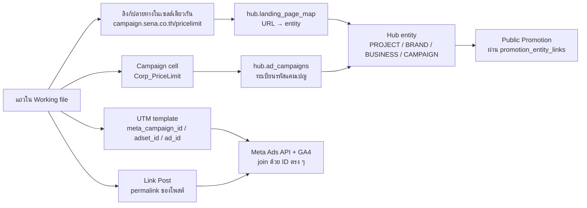
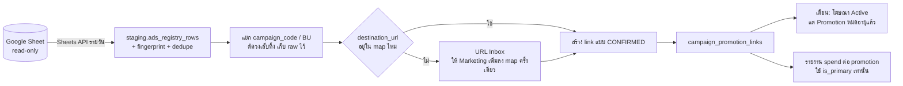

# 09 — เชื่อม Ads Registry (Google Sheet) เข้ากับ Digital Hub

> อ่านจากไฟล์จริง `Working file_for content team` เมื่อ 14 ก.ย. 2026 (read-only)
> เอกสารนี้แทนที่ข้อเสนอ "เพิ่ม dropdown ในฟอร์ม" ใน [08 §9](08-promotion-integration.md) เพราะข้อมูลจริงบอกว่าไม่จำเป็นต้องแก้ชีตเลย

---

## 1. ตอบ 4 คำถามตรง ๆ

| # | คำถาม | คำตอบ |
|---|-------|-------|
| 1 | ลงทะเบียน Ads ที่ไหน | Google Sheet — ชีต `Working file_for content team` เป็น **media plan + post log** ไม่ใช่ระบบทะเบียน แต่มีข้อมูลครบพอที่จะเชื่อมได้ |
| 2 | แก้ฟอร์มได้ไหม | **ไม่ต้องแก้เลย** — เส้นเชื่อมที่ต้องใช้มีอยู่ในชีตครบแล้ว ข้อเสนอเปลี่ยนเป็น *อ่านอย่างเดียว* และไปสร้างตารางแปลงที่ฝั่ง Hub แทน |
| 3 | UTM กับ campaign id ชนกันยังไง | **ชนกันอยู่แล้ว** — UTM template ของทีมมี `meta_campaign_id={{campaign.id}}` อยู่แล้ว ซึ่งเป็น macro ที่ Meta แทนค่า ID จริงตอนคลิก ปัญหาที่เหลือคือปลายทางเก็บค่านั้นไว้หรือเปล่า (§6) |
| 4 | naming convention คืออะไร | คือกฎการตั้งชื่อให้เครื่องอ่านความหมายออก — **ทีมมีอยู่แล้ว** (`Corp_PriceLimit`, `Corp_TradeIn`) แค่ยังไม่ได้เขียนเป็นเอกสารและยังไม่คงเส้นคงวา (§5) |

---

## 2. สิ่งที่พบในไฟล์จริง

ไฟล์นี้มีหลายส่วนในเล่มเดียว ส่วนที่เกี่ยวกับเราคือ 3 ส่วน

### 2.1 ส่วน Media Plan (ต่อแคมเปญ)
หัวกระดาษ `Campaign Name` / `Period` / `Budget` แล้วตามด้วยตาราง
`Media · Detail · Creative · Budget · <รายเดือน> · TOTAL COST · PERCENT · Metric · Estimated Price · Estimated Volume · Remain Budget`

แคมเปญที่พบ: **จำกัดความแพง** (May–Jun 2026) · **เทิร์นรถ เป็นบ้าน** (May–Jun) · **กรีนง่าย** (Jun–Jul) · **เสนาซื้อง่าย P2** (Jul–Aug) · **Corp_JulAlwaysOn** · **Corp_AugAlwaysOn**

### 2.2 ส่วน `Working file_for content team` ⭐ (ส่วนที่ถาม)

```
โพสต์ลำดับที่ · เดือน · ใช้เงินก้อนไหน · Campaign · Content Type · Channel ·
Post Name · Artwork · ทีม Content ระบุวันที่โพสต์ · จำนวนวัน · Period Boost ·
Link Post · Budget · Memo · Ad Status
```

ตัวอย่างแถวจริง:

| ลำดับ | เดือน | ใช้เงินก้อนไหน | Campaign (+ ลิงก์ปลายทาง) | Content Type | Channel | Ad Status |
|---|---|---|---|---|---|---|
| 1 | May | PriceLimit | `Corp_PriceLimit` → campaign.sena.co.th/pricelimit | HeroVDO | Facebook | Active |
| 10 | Jun | TradeIn | `Corp_TradeIn` → tradecar.sena.co.th | AlwaysOnContent | Facebook | Active |
| 19 | Jun | GreenLifestyle | `Corp_GreenLifestyle_Jun2026` → senasolarenergy.com | AlwaysOnContent | Facebook | Active |
| 21 | Jun | PriceLimit | `Corp_AlwaysOn_Jun2026` → livnex.sena.co.th | AlwaysOnContent | Facebook | Active |
| 5 | May | PriceLimit | `Corp_AlwaysOn_May2026` → sena.co.th/project/cozi-ladprao-107 | AlwaysOnContent | Facebook | — |

> **หมายเหตุ:** การ export ทำให้เซลล์ว่างหายไปบางคอลัมน์ การจับคู่ค่ากับหัวคอลัมน์บางช่องจึงเป็นการอนุมาน ควรยืนยันด้วย Sheets API ตอนเขียน adapter จริง

### 2.3 ส่วน UTM Template
```
utm_source=Facebook
&utm_medium=SingleImage | VDO | PhotoAlbum
&utm_campaign={{campaign.name}}
&utm_content={{adset.name}}
&meta_campaign_id={{campaign.id}}     ← ID จริงของ Meta
&meta_adset_id={{adset.id}}
&meta_ad_id={{ad.id}}
&utm_term={{ad.name}}
```

### 2.4 ส่วนรายงานผล
```
DATE · YEAR · QUARTER · MONTH · BUD · Brand · Project ID · Agency · Project ·
Media Campaign · Objective · Amount Spent · Impressions · Reach · Engagement ·
Link Clicks · Video plays · CTR · CVR · Frequency · Cost per Result · Conversions · Message · Metric
```

---

## 3. ข่าวดี — เส้นเชื่อมมีครบอยู่แล้ว ไม่ต้องแก้ชีต



**หัวใจคือ URL ปลายทาง** — เพราะ Digital Hub เป็นเจ้าของ slug ของเว็บอยู่แล้ว ([01](01-source-of-truth.md))
URL จึงแปลงกลับเป็น entity ได้แบบ deterministic:

| URL ที่พบในชีต | แปลงเป็น |
|----------------|----------|
| `sena.co.th/project/cozi-ladprao-107` | `PROJECT` |
| `sena.co.th/brands/cozi` · `/brands/sena-kith` | `BRAND` |
| `senasolarenergy.com` | `BUSINESS = SOLAR` |
| `livnex.sena.co.th` | `BUSINESS = LIVNEX` |
| `tradecar.sena.co.th` | `BUSINESS/CAMPAIGN = TRADE_IN` |
| `campaign.sena.co.th/pricelimit` · `/easy-buy` | `CAMPAIGN landing page` |

→ ตารางที่ต้องดูแลมีแค่ **`landing_page_map` ประมาณ 20 แถว อยู่ใน Hub ไม่ใช่ในชีต** และแคมเปญใหม่เพิ่มเดือนละไม่กี่แถว
นี่คือเหตุผลที่ข้อเสนอเดิม (เพิ่ม dropdown ในฟอร์ม) **ไม่จำเป็นอีกต่อไป**

---

## 4. ข้อควรระวัง — 3 มิติที่ห้ามยุบรวมกัน

แถวที่ 5 ในชีตแสดงปัญหานี้ชัดที่สุด:

```
ใช้เงินก้อนไหน : PriceLimit                          ← งบมาจากก้อนนี้
Campaign       : Corp_AlwaysOn_May2026 (ใช้เงิน Pricelimit)  ← แคมเปญคืออันนี้
ลิงก์ปลายทาง    : sena.co.th/project/cozi-ladprao-107   ← เนื้อหาโปรโมตโครงการนี้
```

**สามอย่างนี้ต่างกันโดยเจตนา** และแถวแบบนี้มีเยอะ (LivNex และ Solar หลายโพสต์ใช้งบ PriceLimit)

| มิติ | คอลัมน์ | ใช้ตอบคำถาม |
|------|---------|-------------|
| **Budget bucket** | `ใช้เงินก้อนไหน` | เงินก้อนไหนถูกใช้ → **นี่คือ grain ของ spend** |
| **Campaign** | `Campaign` | อยู่ภายใต้แคมเปญไหน |
| **Subject** | ลิงก์ปลายทาง | เนื้อหาโปรโมตอะไร → **นี่คือสิ่งที่เชื่อมกับ Promotion** |

> ถ้ายุบรวมสามมิติเป็นอันเดียว จะได้ตัวเลขที่ผิดทันที — เช่นสรุปว่า "LivNex ใช้งบ X บาท" ทั้งที่งบนั้นถูกบันทึกไว้ที่ PriceLimit
> นี่คือกรณีจริงของกฎ grain ใน [08 §9.3](08-promotion-integration.md)

### ปัญหาคุณภาพข้อมูลที่พบเพิ่ม

| ปัญหา | หลักฐาน | ผล |
|-------|---------|-----|
| **คอลัมน์ `Project ID` ไม่ได้เก็บ ProjectID** | แถวรายงาน: `Brand=CORP`, `Project ID=PriceLimit`, `Project=จำกัดความแพง` | ถ้า join เข้า REM ตรง ๆ จะพังเงียบ ๆ — ต้อง map ผ่าน `landing_page_map` แทน |
| **ข้อความอิสระปนในชื่อแคมเปญ** | `Corp_AlwaysOn_May2026 (ใช้เงิน Pricelimit)` · `AlwaysOnContent (ไม่ใช่ Pricelimit)` | parser ต้องตัดวงเล็บทิ้งก่อน แล้วเก็บข้อความเดิมไว้เป็น `raw` |
| **ตำแหน่งเดือนในชื่อไม่คงที่** | `Corp_AlwaysOn_May2026` เทียบกับ `Corp_JulAlwaysOn` | ต้องรองรับทั้งสองแบบ (§5) |
| **มีแถวซ้ำ** | โพสต์ลำดับที่ 23 ปรากฏสองครั้งติดกัน | adapter ต้อง dedupe ด้วย (เดือน + Post Name + Link Post) |
| **Channel มีหลายช่อง** | Facebook, TikTok | `Link Post` เป็น permalink คนละรูปแบบต่อช่อง ต้อง parse แยก |

---

## 5. Naming Convention — คืออะไร และทีมมีอยู่แล้ว

**นิยามสั้น ๆ:** กฎการตั้งชื่อที่ตกลงกันไว้ล่วงหน้า เพื่อให้ *เครื่อง* อ่านความหมายออกจากชื่อได้โดยไม่ต้องเดา
เหมือนการตั้งชื่อไฟล์ว่า `2026-09-14_invoice_ABC.pdf` แทน `เอกสารใหม่ (2) ล่าสุด.pdf`

**ทีมมีอยู่แล้ว** — จากชื่อจริงในชีต:

```
Corp_PriceLimit
Corp_TradeIn
Corp_GreenLifestyle_Jun2026
Corp_AlwaysOn_May2026
Corp_JulAlwaysOn
Corp_AugAlwaysOn
 │    │            │
 │    │            └── เดือน+ปี (ถ้ามี)
 │    └─────────────── รหัสแคมเปญ
 └──────────────────── หน่วยธุรกิจ
```

รูปแบบที่ใช้อยู่คือ `{BU}_{CampaignCode}[_{Month}{Year}]` ซึ่งถูกต้องแล้วราว 80% ปัญหาที่เหลือคือ

1. ตำแหน่งเดือนสลับ — `Corp_AlwaysOn_May2026` กับ `Corp_JulAlwaysOn`
2. มีข้อความอิสระปนในวงเล็บ
3. ไม่มีทะเบียนว่ารหัสแคมเปญที่ถูกต้องมีอะไรบ้าง — `PriceLimit` กับ `Pricelimit` ปนกันอยู่

**ข้อเสนอ: ไม่ต้องบังคับให้เข้มงวด**
เพราะเราใช้ *URL ปลายทาง* เป็นกุญแจหลักอยู่แล้ว (§3) naming convention จึงเป็นแค่ **ทางสำรอง**
สิ่งที่ควรทำมีแค่สองอย่าง ซึ่งทำที่ Hub ไม่ใช่ที่ชีต:

- เขียนรูปแบบที่ทีมใช้อยู่ลงเป็นเอกสารหนึ่งหน้า (ไม่ใช่คิดรูปแบบใหม่)
- ทำทะเบียนรหัสแคมเปญใน Hub (`ad_campaigns`) แล้วให้ระบบเตือนเมื่อเจอรหัสที่ไม่อยู่ในทะเบียน — เตือนเฉย ๆ ไม่บล็อกงานใคร

---

## 6. Meta ID กับ UTM — ชนกันยังไง (ตอบข้อ 3)

`{{campaign.id}}` คือ **dynamic macro ของ Meta** — ตอนมีคนคลิกโฆษณา Meta จะแทนค่าด้วย ID จริงลงใน URL
ปลายทางจึงได้รับ query string หน้าตาแบบนี้:

```
https://campaign.sena.co.th/pricelimit
  ?utm_source=Facebook
  &utm_medium=VDO
  &utm_campaign=Corp_PriceLimit
  &meta_campaign_id=120210987654321      ← ID เดียวกับที่อยู่ใน Meta Ads API
  &meta_adset_id=120210987654322
  &meta_ad_id=120210987654323
  &utm_term=<ชื่อ ad>
```

**แปลว่าเส้นเชื่อมกับ campaign id ถูกวางไว้ถูกต้องแล้วตั้งแต่ต้น** — ไม่ต้องจับคู่ด้วยชื่อ

**แต่มีข้อที่ต้องยืนยันก่อนใช้งานจริง 3 ข้อ** (ผมตรวจเองไม่ได้ เพราะ session นี้เข้าถึงเว็บภายนอกไม่ได้):

| # | ต้องยืนยัน | ทำไมสำคัญ |
|---|-----------|-----------|
| 1 | **GA4 เก็บ `meta_campaign_id` ไว้หรือเปล่า** | GA4 เก็บ `utm_*` ให้อัตโนมัติ แต่ `meta_campaign_id` **ไม่ใช่พารามิเตอร์มาตรฐาน** ต้องตั้งเป็น custom dimension หรือ event parameter เอง ไม่งั้นค่าจะหลุดหายไปเฉย ๆ ทั้งที่ส่งมาถึงแล้ว |
| 2 | landing page เก็บ query string ไว้ตอนส่ง lead ไหม | ถ้าเก็บ จะ join ได้ถึงระดับ lead ไม่ใช่แค่ session |
| 3 | มี template UTM ของ Google Ads / TikTok ด้วยไหม | ในชีตเห็นแต่ของ Facebook — ช่องอื่นต้องมี macro ของตัวเอง (`{campaignid}` ของ Google Ads, `__CID__` ของ TikTok) |

ข้อ 1 น่าจะเป็นช่องว่างที่ใหญ่ที่สุด และแก้ได้ด้วยการตั้งค่า GTM ครั้งเดียว

---

## 7. สถาปัตยกรรมที่เสนอ — อ่านอย่างเดียว ไม่แตะชีต

```sql
-- ชั้น staging: กระจกของชีต ห้ามเขียนกลับ
create table staging.ads_registry_rows (
  row_key            text primary key,      -- hash(sheet_id, tab, row_no, snapshot_date)
  sheet_id           text not null,
  tab_name           text not null,
  row_no             int  not null,
  post_seq           text,                  -- โพสต์ลำดับที่
  month_label        text,                  -- เดือน
  budget_bucket      text,                  -- ใช้เงินก้อนไหน   ← grain ของ spend
  campaign_raw       text,                  -- Campaign (ข้อความดิบ รวมวงเล็บ)
  campaign_code      text,                  -- parse แล้ว: Corp_PriceLimit
  business_unit      text,                  -- parse แล้ว: Corp
  destination_url    text,                  -- ลิงก์ในเซลล์ Campaign ← กุญแจหลัก
  content_type       text,
  channel            text,                  -- Facebook | TikTok
  post_name          text,
  post_permalink     text,                  -- Link Post
  boost_period       text,
  budget_thb         numeric,
  ad_status          text,                  -- Active | Inactive | Pause
  memo               text,
  snapshot_at        timestamptz not null,
  row_fingerprint    text not null
);

-- ตารางแปลง URL → entity  (ดูแลใน Hub ประมาณ 20 แถว)
create table hub.landing_page_map (
  map_id          uuid primary key,
  url_pattern     text not null,        -- 'livnex.sena.co.th/*'  หรือ regex
  match_type      text not null,        -- exact | prefix | regex
  target_entity_type text not null,     -- PROJECT|BRAND|BUSINESS|CAMPAIGN
  target_id       text not null,
  confidence      text not null default 'CONFIRMED',
  note            text,
  created_by      text, created_at timestamptz
);

-- ทะเบียนรหัสแคมเปญ (ทางสำรองของ URL)
create table hub.ad_campaigns (
  ad_campaign_id  uuid primary key,
  campaign_code   text unique not null,  -- Corp_PriceLimit
  business_unit   text,
  display_name    jsonb,                 -- {th:"จำกัดความแพง"}
  campaign_id     uuid references hub.campaigns,   -- ผูกเข้า campaign ของ Hub
  period_from date, period_to date,
  is_registered   boolean default true
);
```

**การสร้าง `campaign_promotion_links`** ตามลำดับความน่าเชื่อถือใน [08 §9.2](08-promotion-integration.md):

| ลำดับ | ใช้อะไร | สถานะ |
|:---:|---------|-------|
| 1 | `destination_url` ตรงกับ `landing_page_map` | `CONFIRMED` — `match_method = LANDING_PAGE` |
| 2 | `campaign_code` อยู่ใน `ad_campaigns` และผูกกับ campaign ของ Hub | `CONFIRMED` — `match_method = CAMPAIGN_REGISTRY` |
| 3 | `meta_campaign_id` จาก GA4 ชนกับ Meta Ads API | `CONFIRMED` — ใช้กับข้อมูลผลลัพธ์ |
| 4 | เทียบชื่อแบบ fuzzy | `CANDIDATE` เท่านั้น ห้าม auto-confirm |

### Flow การทำงาน



**งานที่ Marketing ต้องทำเพิ่ม** มีแค่อย่างเดียว: เมื่อ URL ใหม่โผล่ใน inbox ให้ระบุว่ามันคือ entity อะไร — เดือนละไม่กี่ครั้ง และทำใน Hub ไม่ใช่ในชีต

---

## 8. ประโยชน์ที่ได้ทันทีเมื่อเส้นเชื่อมนี้มีอยู่

| ประโยชน์ | ทำได้เพราะ |
|----------|-----------|
| **เตือนเมื่อโฆษณายังรันอยู่แต่โปรฯ หมดอายุ** | `ad_status = Active` + `promotion.temporal_status = EXPIRED` |
| **เตือนเมื่อโฆษณาชี้ไปหน้าโครงการที่ยัง unpublish** | `destination_url` → entity → ตรวจ `publication_status` |
| **รู้ว่าธุรกิจไหนถูกโฆษณาแต่ยังไม่มี Public Promotion ใน Hub** | เห็นแล้วจากชีต: **LivNex และ Solar ถูกโฆษณาอยู่จริง** ทั้งที่ REM ไม่มีโปรฯ ของธุรกิจเหล่านี้ ตรงกับที่ audit สรุป |
| **Chatbot ตอบได้ว่าโปรฯ ที่เห็นในโฆษณาคืออันไหน** | ลูกค้าทักมาจากโฆษณา → `meta_ad_id` → promotion |
| **ตรวจ Ads ที่ชี้ไปหน้า 404** | `destination_url` ที่ไม่มีใน Hub |

> ประเด็นที่สามน่าสนใจที่สุดในเชิงธุรกิจ — **มีการลงเงินโฆษณา LivNex และ Solar อยู่แล้ว แต่ Digital Hub ยังไม่มีเนื้อหาของสองธุรกิจนี้เลย**
> เป็นหลักฐานสนับสนุนว่า Flow B ใน [08 §8.2](08-promotion-integration.md) (สร้าง Public Promotion ที่ Hub โดยไม่ต้องรอ REM) ควรทำตั้งแต่รอบแรก ไม่ใช่รอ adapter

---

## 9. สิ่งที่ต้องยืนยันก่อนเขียน adapter

1. **สิทธิ์เข้าถึงชีต** — ต้องแชร์ให้ service account แบบ Viewer และ **ยืนยันว่าไฟล์นี้คือฉบับที่ใช้จริง** ไม่ใช่ก๊อปปี้
2. **ชื่อ tab คงที่ไหม** — adapter ควรอ้างด้วย `gid` ไม่ใช่ชื่อ tab เพราะชื่อเปลี่ยนง่าย
3. **ไฟล์นี้ไฟล์เดียวหรือมีต่อปี/ต่อไตรมาส** — ถ้าแยกไฟล์ ต้องมีทะเบียนไฟล์
4. **GA4 เก็บ `meta_*_id` หรือยัง** (§6 ข้อ 1) — น่าจะเป็นช่องว่างที่ใหญ่ที่สุด
5. **ช่องทางอื่นนอกจาก Facebook มี UTM template หรือยัง** — TikTok เห็นในชีตแล้วแต่ไม่เห็น template
6. **ใครดูแล `landing_page_map`** — ควรเป็นคนเดียวกับที่ดูแล slug ของเว็บ

---

## 10. ขอบเขตที่เสนอ

**ทำในรอบนี้**
- Adapter อ่านชีตแบบ read-only + snapshot + dedupe + parse `campaign_code`
- `landing_page_map` และ URL Inbox
- `ad_campaigns` เป็นทะเบียนพร้อมการเตือนรหัสที่ไม่รู้จัก
- สร้าง `campaign_promotion_links` จาก URL และทะเบียนแคมเปญ
- การเตือนสองข้อแรกใน §8

**ยังไม่ทำ**
- เขียนกลับเข้าชีต (ไม่ทำเลยตามที่ตกลง)
- ดึง Meta Ads API และ GA4 เข้ามา join ผลลัพธ์ (รอยืนยัน §6)
- โมเดลจัดสรร spend ทุกชนิด
- Fuzzy matching
