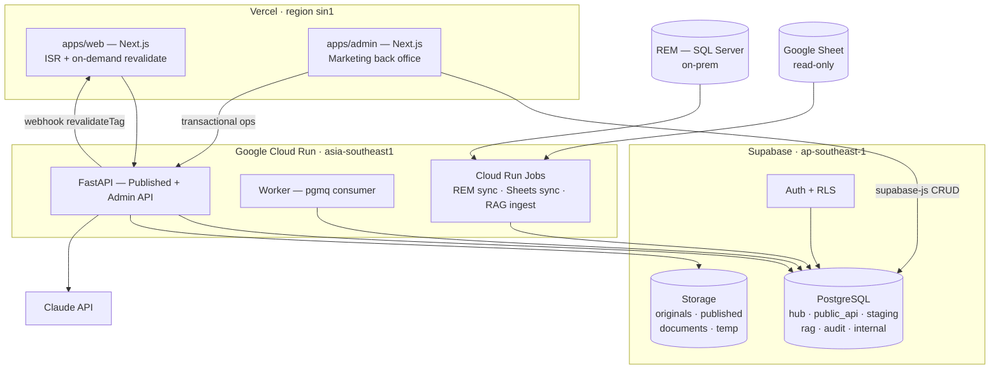

# 10 — Tech Stack

> อ้างอิงข้อกำหนดใน [REQUIREMENTS.md](../REQUIREMENTS.md) · ปรับปรุง 2026-09-14

---

## 1. คำตอบสั้น: FastAPI

**FastAPI ชัดเจน ไม่ใช่ Rust** — เหตุผลเรียงตามน้ำหนัก

| # | เหตุผล | รายละเอียด |
|---|--------|-----------|
| 1 | **งานตัดคำไทยและอ่านเอกสารเป็น ecosystem ของ Python ล้วน** | `RAG-10` บังคับให้ตัดคำไทยก่อน index เพราะ PostgreSQL ไม่มี text-search configuration สำหรับภาษาไทย → ต้องใช้ PyThaiNLP (`newmm`) และงานอ่าน brochure ต้องใช้ PyMuPDF / pdfplumber / OCR ถ้าใช้ Rust ต้อง FFI หรือเขียนใหม่ทั้งหมด **ข้อนี้ข้อเดียวก็ตัดสินแล้ว** |
| 2 | **workload เป็น I/O-bound ไม่ใช่ CPU-bound** | เวลาหมดไปกับ round-trip ไป Postgres, fetch ไฟล์, และเรียก LLM — ข้อได้เปรียบด้านความเร็วของ Rust ไม่โผล่ออกมาเลย `NFR-01` (p95 < 500 ms) ทำได้สบายทั้งคู่ |
| 3 | **REM เป็น SQL Server** | Python มี `pyodbc` / `pymssql` ที่โตเต็มที่ ฝั่ง Rust (`tiberius`) ใช้ได้แต่ ecosystem บางกว่ามาก |
| 4 | **เหลือเวลา 16 วันถึง MVP** | FastAPI แถม OpenAPI schema + Pydantic validation มาให้ฟรี ซึ่งตรงกับ `API-06` (response envelope) และใช้ generate TypeScript client ให้ frontend ได้เลย |
| 5 | **ตรรกะส่วนใหญ่อยู่ใน Postgres อยู่แล้ว** | `ARCH-07` บังคับว่าการกรอง published ต้องอยู่ที่ view และ grant ไม่ใช่ที่โค้ด → ชั้น API บางมาก ภาษาที่ใช้จึงยิ่งมีผลน้อย ซึ่งเป็นเหตุผลให้เลือกอันที่เขียนเสร็จเร็วกว่า |

**Rust จะชนะเมื่อไร** — เมื่อมี hot path ที่เป็น CPU-bound จริง (transcode รูปจำนวนมาก, rerank หนัก ๆ) หรือทีมเป็น Rust-native อยู่แล้ว
ในระบบนี้งาน CPU หนักมีอย่างเดียวคือการแปลงรูป ซึ่ง **ไม่ควรเขียนเอง** (ใช้ Supabase image transformation)

> นี่เป็นการตัดสินใจที่ย้อนกลับได้ ถ้าวันหน้ามี endpoint ที่ร้อนจริง ค่อยเอา service เล็ก ๆ ที่เขียนด้วย Rust ไปวางหลัง API เดิม โดยไม่ต้องรื้ออะไร

### ทางเลือกที่พิจารณาแล้วไม่เลือก

| ทางเลือก | ทำไมไม่เลือก |
|----------|--------------|
| ใช้ PostgREST ของ Supabase เป็น public API ตรง ๆ | ขึ้นรูป `meta` envelope (`API-06`), `as_of` resolution (`API-04`), change feed (`API-09`) และ webhook (`API-10`) ไม่ได้ · **แต่ใช้กับ admin CRUD ได้ดี** ดู §4 |
| เขียน API ด้วย TypeScript บน Vercel ทั้งหมด | งาน RAG/ไทย/PDF เป็น Python อยู่ดี สุดท้ายก็ได้สองภาษาเท่ากัน แต่เสียข้อดีที่ API กับ job แชร์ SQL และ Pydantic model ชุดเดียวกัน |

---

## 2. ภาพรวม



**กฎเรื่อง region:** Supabase, Cloud Run และ Vercel functions ต้องอยู่ Singapore ทั้งหมด
ถ้า DB อยู่คนละทวีปกับ API ค่า p95 500 ms ตาม `NFR-01` จะพังทันทีโดยไม่เกี่ยวกับภาษาที่เลือก

---

## 3. Database — Supabase PostgreSQL

| รายการ | ค่า |
|--------|-----|
| Region | `ap-southeast-1` (Singapore) |
| Extensions | `pgvector`, `pg_trgm`, `ltree`, `pg_cron`, `pgmq`, `pg_stat_statements` |
| Migrations | **Supabase CLI + ไฟล์ SQL ธรรมดา** — ไม่ใช้ Alembic |
| Auth | Supabase Auth, role เป็น JWT claim แล้วบังคับด้วย RLS |

**ทำไมไม่ใช้ Alembic:** ดีไซน์นี้มี view, function, RLS policy และ CHECK constraint เยอะมาก
(`ARCH-07`, `ARCH-09`, `PROMO-13`, `RAG-04`) ซึ่งเป็น SQL ล้วน การมี migration สองระบบจะทำให้ schema จริงกับ ORM model
ไม่ตรงกันภายในไม่กี่สัปดาห์ → **ใช้ SQL migration ชุดเดียวเป็นความจริง**

### ตรรกะที่ต้องอยู่ใน Postgres ไม่ใช่ใน Python

| ตรรกะ | รูปแบบ | ข้อกำหนด |
|-------|--------|----------|
| กรอง published / ยังไม่หมดอายุ | view ที่ฝัง `now()` ไว้ใน WHERE | `ARCH-07`, `ARCH-09` |
| Promotion resolution | SQL function `public_api.resolve_promotions(entity_type, entity_id, as_of)` | `PROMO-40` |
| ห้าม publish เมื่อไม่มี EndDate | CHECK constraint | `PROMO-13` |
| ห้าม promo/price เข้า RAG | CHECK constraint | `RAG-04` |
| `is_primary` มีได้ 1 ต่อ role | partial unique index | `ASSET-04` |
| สิทธิ์ของ consumer | `REVOKE`/`GRANT` ระดับ schema | `SEC-06` |

ผลคือชั้น FastAPI ทำแค่ **ขึ้นรูป response, จัดการ transaction, และคุยกับระบบภายนอก**

---

## 4. Backend — FastAPI

```
Python 3.12
fastapi + uvicorn            API
pydantic v2                  response envelope + validation
asyncpg                      queries (raw SQL, ไม่ใช้ ORM หนัก)
sqlalchemy 2.0 (async)       เฉพาะ admin CRUD ที่ซ้ำซาก
httpx                        mirror-on-ingest, REM/Sheets adapters
pymssql หรือ pyodbc          REM (SQL Server)
google-api-python-client     Google Sheets (read-only)
pythainlp                    ตัดคำไทยสำหรับ lexical index
pymupdf + pdfplumber         อ่าน brochure
anthropic                    Claude API
pytest + testcontainers      tests
ruff + pyright               lint + types
```

### แบ่งงานระหว่าง supabase-js กับ FastAPI

| ประเภทงาน | ผ่านทางไหน | เหตุผล |
|-----------|------------|--------|
| Admin CRUD ธรรมดา (แก้ชื่อ, แก้ field) | **supabase-js ตรงไปที่ PostgREST** | ประหยัดเวลาเขียน boilerplate มาก และ RLS คุมให้อยู่แล้ว |
| **Publish / rollback** | **FastAPI เท่านั้น** | เป็น transaction หลายขั้น (`VER-03`, `VER-04`) |
| **Mirror-on-ingest** | **FastAPI เท่านั้น** | fetch ภายนอก + checksum + เขียน storage (`ASSET-06`) |
| **Public API** | **FastAPI เท่านั้น** | ต้องมี envelope, `as_of`, change feed, webhook |
| Sync jobs | Cloud Run Jobs | long-running |

> เงื่อนไขที่ทำให้แบ่งแบบนี้ปลอดภัย: **invariant ทุกข้ออยู่ใน DB constraint** ไม่ใช่ใน application code
> ถ้าไม่ทำตามนั้น การมีสองทางเขียนจะกลายเป็นช่องโหว่ทันที

### Deployment

| ส่วน | ที่ไหน |
|------|--------|
| API | Cloud Run (asia-southeast1), min instances 1 เพื่อเลี่ยง cold start |
| Worker | Cloud Run service แยก · image เดียวกัน คนละ entrypoint · consume `pgmq` |
| Batch jobs | Cloud Run Jobs + Cloud Scheduler (REM sync รายคืน, Sheets sync รายวัน, RAG ingest, link health รายสัปดาห์) |
| REM connectivity | ต้องมี VPC connector + VPN/Interconnect ไป on-prem — **เป็น infra dependency ที่ยังไม่ยืนยัน (`Q-02`)** |

> **สร้าง mock adapter หลัง interface เดียวกันตั้งแต่วันแรก** เพื่อไม่ให้งานทั้งหมดติดรอ network ไปหา REM

**เลือกงานเข้า queue อย่างไร:** งานที่มีตารางเวลาแน่นอนและรันนาน → Cloud Run Jobs (สังเกตการณ์ง่าย ไม่ต้องดูแล broker)
งานที่เกิดจาก event และสั้น (mirror รูป 1 ใบ, reindex เอกสาร 1 ชิ้น) → `pgmq` ใน Postgres เดิม ไม่ต้องเพิ่มระบบใหม่

---

## 5. Frontend — Next.js บน Vercel

> Vercel คือที่โฮสต์ ส่วน framework ที่แนะนำคือ **Next.js 15 App Router**

```
monorepo (pnpm workspaces + Turborepo)
├─ apps/web        เว็บสาธารณะ — ISR
├─ apps/admin      back office ของ Marketing
├─ packages/ui     design system ร่วม (Tailwind + shadcn/ui)
├─ packages/api    TypeScript client — generate จาก OpenAPI ของ FastAPI
└─ packages/types  shared types
```

**ข้อดีที่ได้ฟรี:** `openapi-typescript` generate client จาก schema ของ FastAPI → ถ้า backend เปลี่ยน field แล้ว frontend ไม่ได้แก้ **TypeScript จะ error ตอน build** ไม่ใช่ไปพังบน production

### Cache invalidation — จุดที่ต้องทำให้ถูก

นี่คือส่วนที่ตอบ `API-11` และ `API-12` ซึ่งเป็นข้อกำหนดที่มีความเสี่ยงทางกฎหมายติดมาด้วย

```ts
// apps/web — webhook รับจาก Hub
// tag ต่อ entity: project:{id} · promotion:{id} · brand:{id}
revalidateTag(`promotion:${id}`)   // เรียกเมื่อได้ promotion.expired / activated

// หน้าโปรโมชั่น — TTL ต้องไม่ข้ามเที่ยงคืนเวลาไทย
// เพราะ temporal_status คำนวณจากวันที่ คำตอบที่ cache ไว้จะผิดทันทีที่ข้ามวัน
export const revalidate = false   // พึ่ง tag เป็นหลัก
const ttl = Math.min(300, secondsUntilBangkokMidnight())
```

| เรื่อง | เลือกอะไร | เหตุผล |
|--------|-----------|--------|
| Region ของ function | `sin1` | ใกล้ Supabase และ Cloud Run |
| รูปภาพ | **Supabase image transformation** ไม่ใช่ Vercel Image Optimization | ระบบเดียว คิดค่าใช้จ่ายรวมกับ storage และตรงกับ `ASSET-12` ที่ให้บันทึก recipe ไว้ · ตั้ง custom loader ของ `next/image` ชี้ไป Supabase |
| Runtime | Node (ไม่ใช่ Edge) สำหรับหน้าที่คุย DB | ต้องใช้ driver เต็ม |

### Admin UI

| ความต้องการ | เครื่องมือ |
|-------------|-----------|
| ฟอร์ม + validation | react-hook-form + zod |
| ตาราง | TanStack Table |
| **Tree editor ของเฟส/ตึก/ชั้น** (`CONT-20`) | dnd-kit |
| เรียงรูป drag-drop | dnd-kit — **ตัดได้ตาม descope lever ข้อ 3** เหลือกรอกตัวเลข |
| แก้ content section | markdown textarea + preview สำหรับ MVP · rich editor ไว้ทีหลัง |
| Auth | Supabase Auth → role ใน JWT → RLS |

---

## 6. RAG

### Vector store — pgvector ในฐานเดียวกัน ไม่ใช้ vector DB แยก

เหตุผลที่ไม่ใช้ Pinecone / Qdrant / Weaviate: `RAG-05` บังคับว่า**ต้อง filter ด้วย metadata ก่อน vector search**
ถ้าแยกฐาน จะต้องยิงสองรอบแล้วเอามา intersect ซึ่งทั้งช้าและกรองได้ไม่แม่น
เก็บใน Postgres เดียวกันทำให้ filter กับ ANN อยู่ใน query เดียว

```sql
create index on rag.knowledge_chunks
  using hnsw (embedding vector_cosine_ops);
-- pgvector 0.8+ มี iterative index scan ซึ่งช่วยมากเวลามี filter แคบ
set hnsw.iterative_scan = 'relaxed_order';
```

### Hybrid retrieval (`RAG-10`)

```
1. ตัดคำไทยด้วย PyThaiNLP newmm → join ด้วยช่องว่าง → to_tsvector('simple', ...)
2. pg_trgm index บนชื่อและรหัส (จับ "แบบ A2", "เฟส 3" ที่ vector มักพลาด)
3. ยิงสองทาง: vector cosine + lexical BM25-ish
4. รวมผลด้วย Reciprocal Rank Fusion ใน SQL
5. metadata pre-filter บังคับทุกครั้ง: project, model, content_domain, language, effective window
```

### Embedding model — ยังไม่ฟันธง ให้ eval ตัดสิน

**Anthropic ไม่มี embeddings endpoint** จึงต้องใช้ผู้ให้บริการอื่น ตัวเลือกที่ควรทดสอบ:
Cohere `embed-multilingual-v3` · OpenAI `text-embedding-3-large` · Google multilingual embedding · BGE-M3 (self-host)

**ผมไม่แนะนำตัวใดตัวหนึ่งโดยไม่มีตัวเลข** เพราะคุณภาพภาษาไทยต่างกันมากและ benchmark สาธารณะไม่ตรงกับ domain อสังหาฯ
วิธีที่ถูกคือ: สร้าง golden set ตาม `RAG-17` (ต้องทำอยู่แล้ว) → ทดสอบ 2 ตัว → เลือกจาก recall@5 จริง

> **ข้อควรระวัง:** เปลี่ยน embedding model = ต้อง reindex ทั้งหมด `RAG-08` จึงบังคับให้เก็บ `embedding_model` ต่อ chunk อยู่แล้ว
> ให้ออกแบบ pipeline ให้ reindex ทั้งชุดได้ตั้งแต่แรก อย่าทำให้มันเป็นงานใหญ่

### Generation — Claude

| รายการ | ค่า |
|--------|-----|
| โมเดลหลัก | **Claude Opus 5** — `claude-opus-5` · context 1M · $5 / $25 ต่อ 1M token |
| Thinking | `thinking: {type: "adaptive"}` · คุมความลึกด้วย `output_config: {effort: ...}` |
| SDK | `anthropic` (Python) |
| ตัวเลือกลดต้นทุน | Claude Sonnet 5 — `claude-sonnet-5` · $2 / $10 — **เป็นการตัดสินใจของทีม ไม่ใช่ default** |

**Prompt caching เป็นตัวลดต้นทุนที่ใหญ่ที่สุดของ chatbot** — system prompt กับ tool definition นิ่ง ให้ cache ไว้
แล้ววาง context ที่เปลี่ยนทุก request (คำถาม, retrieved chunks) ไว้หลัง breakpoint สุดท้าย
ตรวจว่าได้ผลจริงด้วย `usage.cache_read_input_tokens` — ถ้าเป็น 0 ตลอดแปลว่ามีอะไรทำให้ cache พังเงียบ ๆ

**Batch API ลดค่าใช้จ่าย 50%** — ใช้กับงานที่ไม่ต้องตอบทันที เช่น รัน golden set, งาน extract เนื้อหาเป็นชุด

**Tool use คือกลไกที่บังคับ routing** — ตาราง routing ใน requirement แปลงเป็น tool definition ตรง ๆ:
`get_promotions(project_id, as_of)` · `get_model_specs(project_id, bedrooms, ...)` · `get_availability(project_id)` · `search_knowledge(query, project_id)`
`RAG-11` (ห้ามตอบราคา/ห้องว่าง/โปรฯ จาก RAG) จึงถูกบังคับด้วยการออกแบบ tool ไม่ใช่ด้วยคำสั่งใน prompt

> Chatbot อยู่คนละ repo (`sena_ai_chatbot_mkt`) — Hub มีหน้าที่ให้ retrieval endpoint กับ structured tool ส่วน conversation loop เป็นของ repo นั้น

---

## 7. Observability, CI/CD, Testing

| ด้าน | เครื่องมือ |
|------|-----------|
| Error tracking | Sentry (ทั้ง FastAPI และ Next.js) |
| Logs | Cloud Logging แบบ structured JSON |
| DB metrics | Supabase dashboard + `pg_stat_statements` |
| Uptime | synthetic check บน `/v1/projects` ทุก 5 นาที |
| CI | GitHub Actions — ruff, pyright, pytest, ตรวจ migration drift, `pnpm build` |
| DB preview | Supabase branching ต่อ PR |
| Web preview | Vercel preview deployment ต่อ PR |

### เทสต์ที่ต้องเป็นอัตโนมัติ ไม่ใช่ตรวจด้วยตา

`A-07` และ `A-08` ระบุชัดว่าต้องพิสูจน์ด้วยการต่อเป็น role จริง ไม่ใช่ code review:

```python
# conftest.py — connection ที่สองที่ต่อเป็น service_consumer
async def test_consumer_cannot_read_hub(consumer_conn):
    for schema in ("hub", "staging", "internal", "rag"):
        with pytest.raises(asyncpg.InsufficientPrivilegeError):
            await consumer_conn.fetch(f"select 1 from {schema}.projects limit 1")

async def test_expired_promotion_disappears_without_any_job(consumer_conn, db):
    await db.execute("update hub.public_promotions set ends_at = now() - interval '1 second' where code = $1", "TEST")
    rows = await consumer_conn.fetch("select 1 from public_api.promotions where code = $1", "TEST")
    assert rows == []            # ไม่มี cron ไม่มี worker — view จัดการเอง
```

---

## 8. ประมาณค่าใช้จ่ายรายเดือน (คร่าว ๆ)

| รายการ | ประมาณ |
|--------|--------|
| Supabase Pro + compute | $25 + ตามขนาด instance |
| Vercel Pro | $20 ต่อ seat |
| Cloud Run (API min-instance 1 + worker + jobs) | $20–60 |
| Claude API | ตามการใช้งาน — ขึ้นกับจำนวนบทสนทนาและ cache hit rate |
| Embeddings | ค่าใช้จ่ายครั้งแรกตอน index ครั้งเดียว แล้วค่อนข้างต่ำ |

> เป็นตัวเลขคร่าว ๆ สำหรับตั้งงบ ไม่ใช่ข้อผูกพัน ตัวแปรที่ผันผวนที่สุดคือปริมาณการใช้ Claude API

---

## 9. สรุปการตัดสินใจ

| หัวข้อ | เลือก | ความเชื่อมั่น |
|--------|-------|--------------|
| Backend language | **Python + FastAPI** | สูง — Thai NLP เป็นตัวตัดสิน |
| ORM | **ไม่ใช้ ORM หนัก** · asyncpg + SQL · SQLAlchemy เฉพาะ CRUD | สูง |
| Migration | **Supabase CLI + SQL** | สูง |
| Admin CRUD | **supabase-js ตรงไป PostgREST** · งาน transaction ผ่าน FastAPI | กลาง — ประหยัดเวลามาก แต่ต้องมี DB constraint ครบจริง |
| Frontend | **Next.js 15 App Router บน Vercel** monorepo | สูง |
| Vector store | **pgvector ในฐานเดียวกัน** | สูง — `RAG-05` บังคับ |
| Embedding model | **ยังไม่ตัดสิน** — ให้ golden set ตัดสิน | ตั้งใจเว้นไว้ |
| LLM | **Claude Opus 5** (`claude-opus-5`) | สูง |
| Backend hosting | **Cloud Run asia-southeast1** | กลาง — Fly.io Singapore ก็ใช้ได้ ขึ้นกับว่าองค์กรอยู่ cloud ไหน |
| Job runner | **Cloud Run Jobs + Cloud Scheduler** · `pgmq` สำหรับ event สั้น | กลาง |
