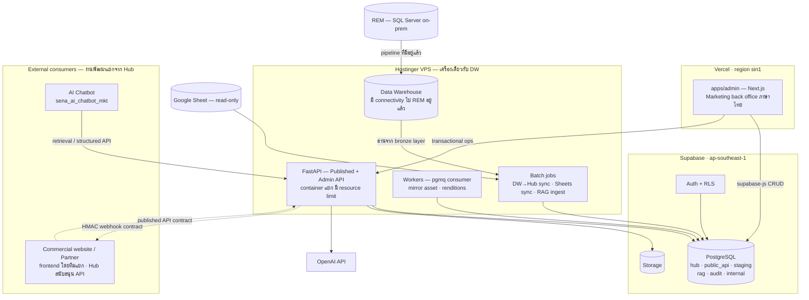
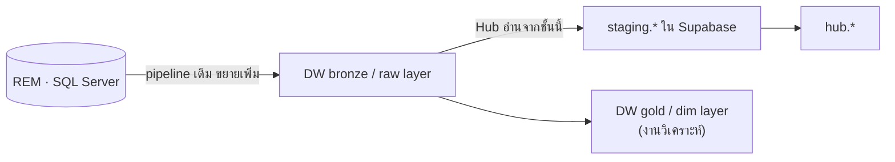

# 10 — Tech Stack

> อ้างอิงข้อกำหนดใน [REQUIREMENTS.md](../REQUIREMENTS.md) · ปรับปรุงขอบเขต 2026-09-15

> **ขอบเขตและกำหนดส่งปัจจุบัน (15 ก.ย. 2026):** [REQUIREMENTS.md](../REQUIREMENTS.md) และ [07-delivery-plan.md](07-delivery-plan.md) มีผลเหนือข้อเสนอ stack และกำหนด MVP เดิม Phase 1 (ก.ย.–ต.ค.) มีเฉพาะ SENA residential 7 โครงการ: internal pilot 30 ก.ย. → core SENA Hub 16 ต.ค. → SENA AI pilot 30 ต.ค. 2026
> Solar อยู่ Phase 2 หลัง 31 ต.ค. 2026 และธุรกิจอื่นที่ไม่ใช่ residential อยู่นอก Phase 1; ไม่ต้องสร้าง BU workspace, chatbot ข้าม BU, product model กลาง หรือ adapter ของ BU อื่นใน Phase 1
> **ขอบเขตเว็บไซต์:** Hub มี frontend เฉพาะ Admin ภาษาไทย และรับผิดชอบข้อมูล Marketing/enterprise ของ SENA ที่เผยแพร่ได้, field mapping, API documentation/sample payloads/test access และ change feed/webhook integration support ฝั่ง Hub ให้ทีมเว็บไซต์ ส่วน commercial frontend, rendering/routing/cache implementation, hosting และ go-live เป็นของทีมเว็บไซต์แยก; chatbot ยังอยู่ repo แยก

---

## 1. คำตอบสั้น: FastAPI

**FastAPI ชัดเจน ไม่ใช่ Rust** — เหตุผลเรียงตามน้ำหนัก

| # | เหตุผล | รายละเอียด |
|---|--------|-----------|
| 1 | **งานตัดคำไทยและอ่านเอกสารเป็น ecosystem ของ Python ล้วน** | `RAG-10` บังคับให้ตัดคำไทยก่อน index เพราะ PostgreSQL ไม่มี text-search configuration สำหรับภาษาไทย → ต้องใช้ PyThaiNLP (`newmm`) และงานอ่าน brochure ต้องใช้ PyMuPDF / pdfplumber / OCR ถ้าใช้ Rust ต้อง FFI หรือเขียนใหม่ทั้งหมด **ข้อนี้ข้อเดียวก็ตัดสินแล้ว** |
| 2 | **workload เป็น I/O-bound ไม่ใช่ CPU-bound** | เวลาหมดไปกับ round-trip ไป Postgres, fetch ไฟล์, และเรียก LLM — ข้อได้เปรียบด้านความเร็วของ Rust ไม่โผล่ออกมาเลย `NFR-01` (p95 < 500 ms) ทำได้สบายทั้งคู่ |
| 3 | **REM เป็น SQL Server** | Python มี `pyodbc` / `pymssql` ที่โตเต็มที่ ฝั่ง Rust (`tiberius`) ใช้ได้แต่ ecosystem บางกว่ามาก |
| 4 | **ส่งมอบเป็นสาม milestone ตามแผนปัจจุบัน** | FastAPI แถม OpenAPI schema + Pydantic validation มาให้ฟรี ซึ่งตรงกับ `API-06` (response envelope) และใช้ generate TypeScript client ให้ frontend ได้เลย; 30 ก.ย. เป็น internal pilot ไม่ใช่ MVP ทั้งระบบ |
| 5 | **ตรรกะส่วนใหญ่อยู่ใน Postgres อยู่แล้ว** | `ARCH-07` บังคับว่าการกรอง published ต้องอยู่ที่ view และ grant ไม่ใช่ที่โค้ด → ชั้น API บางมาก ภาษาที่ใช้จึงยิ่งมีผลน้อย ซึ่งเป็นเหตุผลให้เลือกอันที่เขียนเสร็จเร็วกว่า |

**Rust จะชนะเมื่อไร** — เมื่อมี hot path ที่เป็น CPU-bound จริง (transcode รูปจำนวนมาก, rerank หนัก ๆ) หรือทีมเป็น Rust-native อยู่แล้ว
ในระบบนี้งาน CPU หนักมีอย่างเดียวคือการแปลงรูป ซึ่ง **ไม่ควรเขียนเอง** (ใช้ Supabase image transformation)

> นี่เป็นการตัดสินใจที่ย้อนกลับได้ ถ้าวันหน้ามี endpoint ที่ร้อนจริง ค่อยเอา service เล็ก ๆ ที่เขียนด้วย Rust ไปวางหลัง API เดิม โดยไม่ต้องรื้ออะไร

### ทางเลือกที่พิจารณาแล้วไม่เลือก

| ทางเลือก | ทำไมไม่เลือก |
|----------|--------------|
| ใช้ PostgREST ของ Supabase เป็น public API ตรง ๆ | ขึ้นรูป `meta` envelope (`API-06`), `as_of` resolution (`API-04`), change feed (`API-09`) และ webhook (`API-10`) ไม่ได้ · **แต่ใช้กับ admin CRUD ได้ดี** ดู §4 |
| เขียน API ด้วย TypeScript บน Vercel ทั้งหมด | งาน RAG/ไทย/PDF เป็น Python อยู่ดี สุดท้ายก็ได้สองภาษาเท่ากัน แต่เสียข้อดีที่ API กับ job แชร์ SQL และ Pydantic model ชุดเดียวกัน |

---

## 2. ภาพรวม



**กฎเรื่อง region:** Supabase, Vercel functions และ VPS ที่รัน API ควรอยู่ Singapore หรือใกล้เคียงให้มากที่สุด
ถ้า DB อยู่คนละทวีปกับ API ค่า p95 500 ms ตาม `NFR-01` จะพังทันทีโดยไม่เกี่ยวกับภาษาที่เลือก
→ **ต้องยืนยันก่อนว่า VPS ของ Hostinger อยู่ภูมิภาคไหน** ถ้าอยู่ยุโรปหรือสหรัฐ ต้องพิจารณาย้าย API (ไม่ใช่ job) มาใกล้ Supabase

---

## 3. Database — Supabase PostgreSQL

| รายการ | ค่า |
|--------|-----|
| Region | `ap-southeast-1` (Singapore) |
| Extensions | `pgvector`, `pg_trgm`, `ltree`, `pg_cron`, `pgmq`, `pg_stat_statements` |
| Migrations | **Supabase CLI + ไฟล์ SQL ธรรมดา** — ไม่ใช้ Alembic |
| Auth | Supabase Auth, role เป็น JWT claim แล้วบังคับด้วย RLS |

**ทำไมไม่ใช้ Alembic:** ดีไซน์นี้มี view, function, RLS policy และ CHECK constraint เยอะมาก
(`ARCH-07`, `ARCH-09`, `PROMO-13`, `RAG-04`) ซึ่งเป็น SQL ล้วน การมี migration สองระบบจะทำให้ schema จริงกับ ORM model
ไม่ตรงกันภายในไม่กี่สัปดาห์ → **ใช้ SQL migration ชุดเดียวเป็นความจริง**

### ตรรกะที่ต้องอยู่ใน Postgres ไม่ใช่ใน Python

| ตรรกะ | รูปแบบ | ข้อกำหนด |
|-------|--------|----------|
| กรอง published / ยังไม่หมดอายุ | view ที่ฝัง `now()` ไว้ใน WHERE | `ARCH-07`, `ARCH-09` |
| Promotion resolution | SQL function `public_api.resolve_promotions(entity_type, entity_id, as_of)` | `PROMO-40` |
| ห้าม publish เมื่อไม่มี EndDate | CHECK constraint | `PROMO-13` |
| ห้าม promo/price เข้า RAG | CHECK constraint | `RAG-04` |
| `is_primary` มีได้ 1 ต่อ role | partial unique index | `ASSET-04` |
| สิทธิ์ของ consumer | `REVOKE`/`GRANT` ระดับ schema | `SEC-06` |

ผลคือชั้น FastAPI ทำแค่ **ขึ้นรูป response, จัดการ transaction, และคุยกับระบบภายนอก**

---

## 4. Backend — FastAPI

```
Python 3.12
fastapi + uvicorn            API
pydantic v2                  response envelope + validation
asyncpg                      queries (raw SQL, ไม่ใช้ ORM หนัก)
sqlalchemy 2.0 (async)       เฉพาะ admin CRUD ที่ซ้ำซาก
httpx                        mirror-on-ingest, REM/Sheets adapters
pymssql หรือ pyodbc          REM (SQL Server)
google-api-python-client     Google Sheets (read-only)
pythainlp                    ตัดคำไทยสำหรับ lexical index
pymupdf + pdfplumber         อ่าน brochure
openai                       OpenAI API (หรือ AzureOpenAI)
pytest + testcontainers      tests
ruff + pyright               lint + types
```

### แบ่งงานระหว่าง supabase-js กับ FastAPI

| ประเภทงาน | ผ่านทางไหน | เหตุผล |
|-----------|------------|--------|
| Admin CRUD ธรรมดา (แก้ชื่อ, แก้ field) | **supabase-js ตรงไปที่ PostgREST** | ประหยัดเวลาเขียน boilerplate มาก และ RLS คุมให้อยู่แล้ว |
| **Publish / rollback** | **FastAPI เท่านั้น** | เป็น transaction หลายขั้น (`VER-03`, `VER-04`) |
| **Mirror-on-ingest** | **FastAPI เท่านั้น** | fetch ภายนอก + checksum + เขียน storage (`ASSET-06`) |
| **Public API + integration support ฝั่ง Hub** | **FastAPI เท่านั้น** | envelope, `as_of`, change feed, webhook พร้อม field mapping, เอกสาร, sample payloads และ test access สำหรับทีมเว็บไซต์ |
| Sync jobs | Hostinger VPS (เครื่องเดียวกับ DW) | long-running |

> เงื่อนไขที่ทำให้แบ่งแบบนี้ปลอดภัย: **invariant ทุกข้ออยู่ใน DB constraint** ไม่ใช่ใน application code
> ถ้าไม่ทำตามนั้น การมีสองทางเขียนจะกลายเป็นช่องโหว่ทันที

### Deployment — Hostinger (เครื่องเดียวกับ DW)

| ส่วน | รันที่ไหน | หมายเหตุ |
|------|-----------|----------|
| Batch jobs | **Hostinger VPS** — DW→Hub sync, Sheets sync, RAG ingest, link health | ใช้เครื่องและ ops ที่มีอยู่แล้ว ไม่ต้องเพิ่ม vendor |
| Workers (event สั้น) | **Hostinger VPS** — consume `pgmq` | mirror asset, สร้าง rendition, reindex เอกสารเดี่ยว |
| API | **Hostinger VPS** — container แยก **ที่มี resource limit แข็ง** | ดูข้อควรระวังด้านล่าง |
| Admin ภาษาไทย | Vercel `sin1` | `apps/admin` เท่านั้น |

**รันด้วย Docker Compose + systemd** (หรือ scheduler ตัวที่ DW ใช้อยู่แล้ว — ถ้ามี Airflow/Dagster/cron อยู่ ให้ใช้ตัวเดิม อย่าเพิ่มตัวที่สอง)

### ข้อควรระวังของการอยู่เครื่องเดียวกับ DW

| ความเสี่ยง | ทำไมสำคัญ | การป้องกัน |
|-----------|-----------|-----------|
| **แย่ง CPU/RAM กับ DW ETL** | RAG ingest (parse PDF + OCR + embedding) กินทรัพยากรหนัก ถ้าชนกับหน้าต่าง ETL ของ DW จะกระทบงานที่มีอยู่เดิม | ตั้ง `mem_limit` / `cpus` ต่อ container ใน Compose · จัดตารางให้ RAG ingest อยู่คนละหน้าต่างกับ ETL |
| **Blast radius — job เจ๊งลาก DW ไปด้วย** | process ที่ OOM บนเครื่องที่ไม่มี limit จะทำให้ทั้งเครื่องล่ม รวมถึง DW ที่งานอื่นพึ่งอยู่ | container แยกต่อ service + hard limit · ตัว RAG/OCR ให้ limit แน่นที่สุด |
| **API ล่มพร้อม DW** | ถ้า API อยู่เครื่องเดียวกัน เวลา DW มีปัญหา Admin และ consumers อาจเรียกข้อมูลไม่ได้ | ตรวจ uptime และการกู้คืน API; ถ้าทรัพยากรไม่พอให้แยก API ไป VPS อีกตัว การ cache ของเว็บไซต์ภายนอกไม่ใช่มาตรการที่ Hub รับประกัน |
| **ไม่มี autoscale** | โหลดพุ่งแล้วขยายไม่ได้ | จำกัดทรัพยากร batch และ rate limit ต่อ consumer; ทดสอบโหลด read API โดยตรงตาม NFR-01 |

> **ต้องรู้ก่อนตัดสินขั้นสุดท้าย:** VPS ตัวนี้ **กี่ vCPU / RAM เท่าไร / ดิสก์เหลือเท่าไร / อยู่ภูมิภาคไหน**
> ถ้า RAM ต่ำกว่า 8 GB ไม่ควรเอา API ไปอยู่รวม ให้แยก VPS เล็กอีกตัว

---

## 4.5 REM เข้าผ่าน DW ไม่ต่อตรง ⭐

ข้อมูลใหม่ที่เปลี่ยนการออกแบบ: **DW มี pipeline ที่ดึงจาก REM อยู่แล้ว** (ปัจจุบันนำเข้า `Sys_REM_PromotionContract`
และ `Sys_REM_Master_Promotion`) และ job ของ Hub จะรันบนเครื่องเดียวกับ DW



**ผลที่ตามมา 3 ข้อ**

1. **Hub ไม่ต้องเปิด connection ไป REM เอง** → ปัญหา VPN/VPC ที่เคยระบุไว้เป็นตัวบล็อก (`Q-02`) หายไป
2. **ขยาย pipeline เดิมของ DW แทนการสร้างทางเชื่อมที่สอง** — สิ่งที่ต้องเพิ่มคือ `Sys_Prom_Promotion`, `Sys_Prom_PromotionDetails`, `Sys_Prom_PromotionUnits` ซึ่งตรงกับที่ audit เสนอไว้พอดี · การมีจุดเชื่อม REM สองจุดจะขัดกับ `ARCH-01` (หนึ่ง field มีเจ้าของระบบเดียว)
3. **ต้องอ่านจาก bronze/raw ไม่ใช่ gold/dim** ⚠️ — ถ้าอ่านจาก gold ความหมายที่ DW ตีความไว้จะติดมาด้วย แล้ว `ARCH-02` จะกลายเป็น *"mirror สิ่งที่ DW ตีความว่าเป็น REM"* ไม่ใช่ mirror REM จริง

> ตัวอย่างที่เจอมาแล้วว่าทำไมข้อ 3 สำคัญ: คอลัมน์ `Project ID` ในชีตรายงานโฆษณาไม่ได้เก็บ ProjectID ของ REM
> แต่เก็บรหัสแคมเปญ ([09 §2.4](09-ads-registry-integration.md)) — ชั้นที่ผ่านการตีความแล้วมีความหมายเพี้ยนได้เสมอ

**ข้อควรระวังเรื่องความสด:** DW น่าจะรันรายคืน ซึ่งตรงกับ `REM-01` (nightly) อยู่แล้ว
แต่ถ้าวันหน้าต้องการใกล้ real-time จะถูกจำกัดด้วยรอบของ DW → ถ้าจำเป็นค่อยเพิ่มเส้นตรงเฉพาะ entity ที่ต้องการ

---

## 5. Admin frontend ภาษาไทย — Next.js บน Vercel

> Vercel คือที่โฮสต์ Admin ส่วน framework ที่แนะนำคือ **Next.js 15 App Router**; ไม่มี public website app ในงานส่งมอบนี้

```
apps/admin/
└─ src/
   ├─ app/          หน้าจอ Admin ภาษาไทย
   ├─ components/   Admin UI (Tailwind + shadcn/ui)
   └─ lib/api/      TypeScript client/types จาก OpenAPI ของ FastAPI
```

`openapi-typescript` generate client จาก schema ของ FastAPI เพื่อให้ Admin ตรวจพบ field ที่เปลี่ยนตอน build; เก็บ UI/client/types ภายใน Admin app ก่อน ยังไม่ต้องแยก shared packages หรือเพิ่ม Turborepo สำหรับ frontend เดียว

### Consumer contract — expiry, TTL และ webhook

Hub ยังคงรับผิดชอบ `API-10`–`API-12`: published views ตัดข้อมูลหมดอายุตามเวลา, promotion responses มี TTL ไม่เกิน 300 วินาทีและ `cache_expires_at` ไม่ข้ามเที่ยงคืน Asia/Bangkok, webhook ลงลายเซ็น HMAC และแจ้ง expiry ภายใน 60 วินาที

Hub จัดเตรียม field mapping, API documentation, sample payloads และ test access ให้ทีมเว็บไซต์ พร้อมช่วยตรวจการใช้ change feed/webhook ผ่าน consumer harness: response ก่อน/หลัง expiry, TTL และขอบเขตเวลา, HMAC และการรับ webhook รวมถึง TTL ใน cache จำลอง งานนี้เป็น integration support ฝั่ง Hub; โค้ด rendering/routing/cache และการเปิด commercial frontend เป็นความรับผิดชอบทีมเว็บไซต์และไม่ใช่เงื่อนไขผ่าน acceptance ของ Hub

| เรื่อง | เลือกอะไร | เหตุผล |
|--------|-----------|--------|
| Region ของ Admin function | `sin1` | ใกล้ Supabase |
| Asset preview / rendition | **Supabase image transformation** | ใช้ใน Admin และ asset API พร้อมบันทึก recipe ตาม `ASSET-12`; ไม่มีงาน image loader ของเว็บไซต์ภายนอก |
| Admin runtime | Node สำหรับ server-side operations | ใช้กับ Admin เท่านั้น |

### Admin UI

| ความต้องการ | เครื่องมือ |
|-------------|-----------|
| ฟอร์ม + validation | react-hook-form + zod |
| ตาราง | TanStack Table |
| **Tree editor ของเฟส/ตึก/ชั้น** (`CONT-20`) | dnd-kit |
| เรียงรูป drag-drop | dnd-kit — **ตัดได้ตาม descope lever ข้อ 3** เหลือกรอกตัวเลข |
| แก้ content section | markdown textarea + preview สำหรับ MVP · rich editor ไว้ทีหลัง |
| Auth | Supabase Auth → role ใน JWT → RLS |

---

## 6. RAG

### Vector store — pgvector ในฐานเดียวกัน ไม่ใช้ vector DB แยก

เหตุผลที่ไม่ใช้ Pinecone / Qdrant / Weaviate: `RAG-05` บังคับว่า**ต้อง filter ด้วย metadata ก่อน vector search**
ถ้าแยกฐาน จะต้องยิงสองรอบแล้วเอามา intersect ซึ่งทั้งช้าและกรองได้ไม่แม่น
เก็บใน Postgres เดียวกันทำให้ filter กับ ANN อยู่ใน query เดียว

```sql
create index on rag.knowledge_chunks
  using hnsw (embedding vector_cosine_ops);
-- pgvector 0.8+ มี iterative index scan ซึ่งช่วยมากเวลามี filter แคบ
set hnsw.iterative_scan = 'relaxed_order';
```

### Hybrid retrieval (`RAG-10`)

```
1. ตัดคำไทยด้วย PyThaiNLP newmm → join ด้วยช่องว่าง → to_tsvector('simple', ...)
2. pg_trgm index บนชื่อและรหัส (จับ "แบบ A2", "เฟส 3" ที่ vector มักพลาด)
3. ยิงสองทาง: vector cosine + lexical BM25-ish
4. รวมผลด้วย Reciprocal Rank Fusion ใน SQL
5. metadata pre-filter บังคับทุกครั้ง: project, model, content_domain, language, effective window
```

### Embedding model — OpenAI (สอดคล้องกับ LLM)

เมื่อ LLM เป็น OpenAI อยู่แล้ว การใช้ embedding ของเจ้าเดียวกันเป็นค่าเริ่มต้นที่สมเหตุสมผล — key เดียว บิลเดียว vendor เดียว
`text-embedding-3-large` (3072 มิติ ปรับลดได้) เป็นตัวตั้งต้น

**แต่ยังต้องวัดกับภาษาไทยจริงก่อนล็อก** — สร้าง golden set ตาม `RAG-17` (ต้องทำอยู่แล้ว) แล้วเทียบ recall@5 กับอย่างน้อยอีกหนึ่งตัว
(BGE-M3 self-host เป็นตัวเทียบที่ดีเพราะฟรีและแข็งกับภาษาไทย) ถ้าผลไม่ต่างกันมาก ให้เลือก OpenAI เพราะ ops ง่ายกว่า

> **ข้อควรระวัง:** เปลี่ยน embedding model = reindex ทั้งหมด `RAG-08` จึงบังคับให้เก็บ `embedding_model` ต่อ chunk
> ให้ออกแบบ pipeline ให้ reindex ทั้งชุดได้ตั้งแต่แรก และเก็บ `dimensions` ไว้ด้วยเพราะ index ของ pgvector ผูกกับจำนวนมิติ

### Generation — OpenAI

บริษัทซื้อ **OpenAI (ChatGPT Luna 5.3)** ไว้แล้ว จึงใช้ตัวนั้น

> ⚠️ **หมายเหตุความถูกต้อง:** ผมไม่มีข้อมูลที่เชื่อถือได้เกี่ยวกับโมเดลชื่อนี้ (น่าจะออกหลังข้อมูลที่ผมมี)
> จึง **ไม่ระบุ context window, ราคา, หรือความสามารถของมันในเอกสารนี้** เพื่อไม่ให้มีตัวเลขที่แต่งขึ้นไปอยู่ในสเปก
> ให้ทีมเติมจากเอกสารทางการของ OpenAI · ส่วนที่ออกแบบไว้ด้านล่างไม่ขึ้นกับตัวเลขเหล่านั้น

```
openai            Python SDK (ใช้ AzureOpenAI client ถ้า deploy ผ่าน Azure)
```

**ออกแบบให้เปลี่ยนโมเดลได้โดยไม่รื้อ** — ชื่อโมเดลอยู่ใน config ไม่ใช่ในโค้ด และหุ้มด้วย adapter บาง ๆ ตัวเดียว
เหตุผลไม่ใช่เพื่อรองรับหลายเจ้า แต่เพราะ**เวอร์ชันโมเดลของเจ้าเดียวกันก็เปลี่ยนบ่อย** และ `RAG-08` ต้องบันทึกว่าคำตอบมาจากโมเดลไหน

| สิ่งที่ต้องยืนยันก่อนเขียนโค้ด | กระทบอะไร |
|-------------------------------|-----------|
| **มี API access จริงหรือเป็นแค่ seat ของ ChatGPT** | ⚠️ **สำคัญที่สุด** — ChatGPT Enterprise (ที่นั่ง) กับ OpenAI API (คีย์) เป็นคนละผลิตภัณฑ์และคนละสัญญา ถ้าซื้อแค่ที่นั่ง จะเอามาต่อ chatbot ไม่ได้ |
| deploy ผ่าน OpenAI ตรง หรือ Azure OpenAI | เปลี่ยน client class, endpoint, และวิธี auth |
| รองรับ function/tool calling และ parallel tool calls ไหม | **การ routing ทั้งหมดพึ่งข้อนี้** (`RAG-11`) ถ้าไม่รองรับต้องเปลี่ยนวิธี orchestrate |
| รองรับ structured output / JSON schema ไหม | ใช้บังคับรูปแบบคำตอบและการแนบ citation |
| context window เท่าไร | กำหนดว่าใส่ chunk ได้กี่ชิ้น และต้องมี rerank ไหม |
| มี prompt caching ไหม และคิดราคาอย่างไร | ตัวลดต้นทุนที่ใหญ่ที่สุดของ chatbot |
| rate limit / quota ที่ซื้อไว้ | กำหนดว่าต้องมีคิวหรือ throttle ฝั่งเราไหม |

**Tool use คือกลไกที่บังคับ routing** — ตาราง routing ในสเปกแปลงเป็น function definition ตรง ๆ:
`get_promotions(project_id, as_of)` · `get_model_specs(project_id, bedrooms, ...)` · `get_availability(project_id)` · `search_knowledge(query, project_id)`
`RAG-11` (ห้ามตอบราคา/ห้องว่าง/โปรฯ จาก RAG) จึงถูกบังคับด้วย**การออกแบบ tool** ไม่ใช่ด้วยคำสั่งใน prompt

**งานที่ไม่ต้องตอบทันทีให้ใช้ batch endpoint** ถ้าแพ็กเกจที่ซื้อมีให้ — เช่นรัน golden set, งาน extract เนื้อหาเป็นชุด

> Chatbot อยู่คนละ repo (`sena_ai_chatbot_mkt`) — Hub มีหน้าที่ให้ retrieval endpoint กับ structured tool ส่วน conversation loop เป็นของ repo นั้น

---

## 7. Observability, CI/CD, Testing

| ด้าน | เครื่องมือ |
|------|-----------|
| Error tracking | Sentry (FastAPI และ Next.js Admin) |
| Logs | Cloud Logging แบบ structured JSON |
| DB metrics | Supabase dashboard + `pg_stat_statements` |
| Uptime | synthetic check บน `/v1/projects` ทุก 5 นาที |
| CI | GitHub Actions — ruff, pyright, pytest, ตรวจ migration drift, build `apps/admin` และ consumer contract harness |
| DB preview | Supabase branching ต่อ PR |
| Admin preview | Vercel preview deployment ของ `apps/admin` ต่อ PR |

### เทสต์ที่ต้องเป็นอัตโนมัติ ไม่ใช่ตรวจด้วยตา

`A-07` และ `A-08` ระบุชัดว่าต้องพิสูจน์ด้วยการต่อเป็น role จริง ไม่ใช่ code review:

```python
# conftest.py — connection ที่สองที่ต่อเป็น service_consumer
async def test_consumer_cannot_read_hub(consumer_conn):
    for schema in ("hub", "staging", "internal", "rag"):
        with pytest.raises(asyncpg.InsufficientPrivilegeError):
            await consumer_conn.fetch(f"select 1 from {schema}.projects limit 1")

async def test_expired_promotion_disappears_without_any_job(consumer_conn, db):
    await db.execute("update hub.public_promotions set ends_at = now() - interval '1 second' where code = $1", "TEST")
    rows = await consumer_conn.fetch("select 1 from public_api.promotions where code = $1", "TEST")
    assert rows == []            # ไม่มี cron ไม่มี worker — view จัดการเอง
```

---

## 8. ประมาณค่าใช้จ่ายรายเดือน (คร่าว ๆ)

| รายการ | ประมาณ |
|--------|--------|
| Supabase Pro + compute | $25 + ตามขนาด instance |
| Vercel Pro — Admin เท่านั้น | $20 ต่อ seat |
| Hostinger VPS | **มีอยู่แล้ว** — อาจต้องอัปเกรดถ้า RAM ไม่พอ |
| OpenAI API | ตามสัญญาที่บริษัทซื้อไว้ |
| Embeddings | ค่าใช้จ่ายครั้งแรกตอน index ครั้งเดียว แล้วค่อนข้างต่ำ |

> เป็นตัวเลขคร่าว ๆ สำหรับตั้งงบ ไม่ใช่ข้อผูกพัน ตัวแปรที่ผันผวนที่สุดคือปริมาณการใช้ LLM

---

## 9. สรุปการตัดสินใจ

| หัวข้อ | เลือก | ความเชื่อมั่น |
|--------|-------|--------------|
| Backend language | **Python + FastAPI** | สูง — Thai NLP เป็นตัวตัดสิน |
| ORM | **ไม่ใช้ ORM หนัก** · asyncpg + SQL · SQLAlchemy เฉพาะ CRUD | สูง |
| Migration | **Supabase CLI + SQL** | สูง |
| Admin CRUD | **supabase-js ตรงไป PostgREST** · งาน transaction ผ่าน FastAPI | กลาง — ประหยัดเวลามาก แต่ต้องมี DB constraint ครบจริง |
| Admin frontend | **Next.js 15 App Router ภาษาไทย บน Vercel** · `apps/admin` | สูง |
| Vector store | **pgvector ในฐานเดียวกัน** | สูง — `RAG-05` บังคับ |
| REM access | **ผ่าน bronze layer ของ DW ไม่ต่อตรง** | สูง — ตัดปัญหา VPN และเหลือจุดเชื่อมเดียว |
| Embedding model | **OpenAI `text-embedding-3-large`** เป็นค่าตั้งต้น · ยืนยันด้วย golden set | กลาง |
| LLM | **OpenAI — ตามที่บริษัทซื้อไว้** หุ้มด้วย adapter, ชื่อโมเดลอยู่ใน config | กำหนดโดยองค์กร |
| Job / worker hosting | **Hostinger VPS เครื่องเดียวกับ DW** | สูง — ใช้ของที่มีอยู่ |
| API hosting | **Hostinger เช่นกัน แต่ container แยกและมี resource limit** · แยก VPS ถ้า RAM < 8 GB | กลาง — รอสเปกเครื่อง |
| Job runner | **scheduler ตัวที่ DW ใช้อยู่แล้ว** · `pgmq` สำหรับ event สั้น | กลาง |
