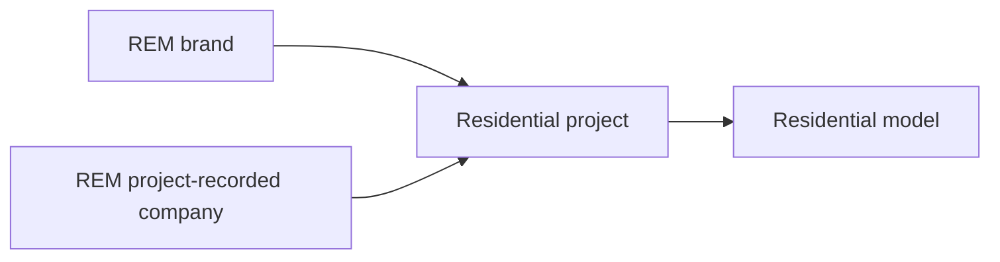

# Brand and project mapping

Decision date: 16 September 2026. Scope: SENA residential. This records the source research and the local implementation contract; it does not certify a production DW integration.

## Source evidence

The local `sena_idea_mkt_data_warehouse` checkout was inspected at commit `32f2c2a` (10 September). Its `ingestion/project_dimension_contract.py` selects separate `BrandID` and `CompanyID` from `dbo.Sys_Master_Projects`. `transformation/models/marts/rem/dim_project.sql` preserves them as `rem_brand_id` and `company_id`.

The saved 7 September audit in `docs/audit/add01_company_non_project_business_discovery_2026-09.md` reports 14 brands linked through projects to multiple companies and 13 companies linked through projects to multiple brands. The evidence appendix gives Niche MONO (`000003`) as 18 projects across nine companies. These are current project-recorded associations at that observation, not legal brand ownership or effective-dated history. Names alone are unsuitable keys: the audit found duplicate brand names and a blank-name record. Preserve REM IDs as strings, including leading zeros.

The audited brand dictionary is `dbo.Sys_Master_Brands`, including `BrandID`, `BrandName`, `BrandNameEng`, aliases, short name, brand code, deletion flag and source timestamps. The inspected project relay does not ingest that dictionary; `docs/ADD01_MARKETING_IDENTITY_DATA_CONTRACT.md` states this gap explicitly. Commercial-sheet brand labels are not a replacement for a source master. The source project company is referenced by `dbo.Sys_Admin_Companies.CompanyID`.

The existing local DW tunnel accepted a connection, but the configured PostgreSQL authentication failed during the initial review. A subsequent explicit read-only REM brand fetch succeeded on **16 September 2026 at 13:23 Bangkok time** using the DW repository's existing REM connection from the Windows machine. It returned **38 distinct BrandIDs**: 36 marked not deleted, one deleted, and one with unknown deletion status. Brand `35` has no Thai name and unknown deletion status; the Thai name บ้านบูรพา occurs under two different IDs. This verifies the current brand dictionary only; the project/company relationship counts above remain the saved 7 September observations.

The timestamped JSON and UTF-8 CSV reference snapshots are stored under ignored `.local/rem-brands/20260916T062325Z.*`. IDs are preserved as strings, including `000003` and `000006`. No DW/REM data or configuration was changed, and these reference rows were not inserted into the Hub's selectable source list or published. The full dictionary includes out-of-scope brands, so production/local intake must first select approved residential project IDs and their exact REM BrandIDs. A source flag of “not deleted” alone is not proof of residential applicability or marketing approval. Unknown deletion flags must not default to active.

Recurring ingestion still requires extending the DW's versioned project snapshot contract with the brand dictionary and its exact schema/checksum tests. The one-off read does not install or schedule that pipeline. Hub `source_snapshot_at` should record the actual extraction time; source create/modify timestamps must retain their original values and require a confirmed timezone before conversion.

## Mapping and ownership

Each project has one source brand field and one source company field. Multiple companies may occur across projects of one brand. No company-to-brand ownership edge is inferred. Missing source references are retained for review and cannot be treated as publishable mappings.

REM owns source IDs, original names and structural relationships; DW carries their evidence into Hub. Hub owns public names/descriptions, slugs and logo selection. Selecting a project brand must match the staged REM BrandID; this implementation provides no arbitrary marketing reassignment. Corrections need source stewardship or a separately approved override policy. Source deletion is distinct from a failed or incomplete sync.

The 17 September field-level mapping, project-model versus unit terminology, and Phase 2 non-REM policy are recorded in [13 — Source identity and field ownership](13-source-field-ownership.md). The source observations above retain their original dates.

Admins create Hub brand records from staged source brands and resolve missing-brand requests. Editors/admins edit brand drafts and bind shared images; publishers alone approve asset rights and publish/withdraw/rollback. Admin is an editor-capable role, not a publisher bypass. No screen creates or edits a REM master record.

## Publication contract

A brand needs a Thai public name, description, slug, active draft status and a primary logo with Thai alternative text and current approved rights. Optional roles are `logo_white`, `logo_mono` and `favicon`. The original file remains in the shared asset registry, with the same upload validation and rights workflow as project images.

A project publication captures the approved brand version/content. Draft brand changes and later brand publications do not replace the brand data inside an older project release. Consumer eligibility also checks current brand availability, source agreement and rights for logos in the referenced snapshot. Withdrawal or invalid rights makes dependent content unavailable without rewriting immutable versions. Restoring a valid brand can restore eligibility; changing project content still requires an explicit project release.

Brand and project publication are separate operations in this local slice. Coordinated multi-entity atomic releases, webhooks/cache invalidation, live DW brand/company intake, historical ownership and branding overrides still need implementation/acceptance under the main requirements.

## Local examples

`DEMO-BRAND-01` is a prepared published synthetic brand; `DEMO-001` and `DEMO-002` reference it but have different synthetic companies. `DEMO-BRAND-02` and `DEMO-003` let staff practise brand creation and project selection. Every name, logo and mapping is fabricated. The prepared project remains a draft until a user publishes it. No real source inventory is imported by the local bootstrap.
