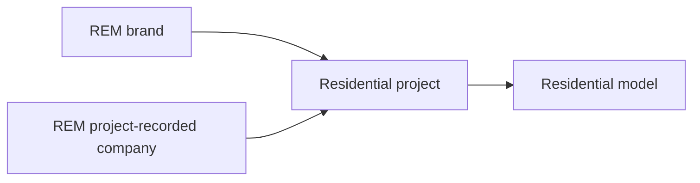

# Brand and project mapping

Decision date: 16 September 2026. Scope: SENA residential. This records the source research and the local implementation contract; it does not certify a production DW integration.

## Source evidence

The local `sena_idea_mkt_data_warehouse` checkout was inspected at commit `32f2c2a` (10 September). Its `ingestion/project_dimension_contract.py` selects separate `BrandID` and `CompanyID` from `dbo.Sys_Master_Projects`. `transformation/models/marts/rem/dim_project.sql` preserves them as `rem_brand_id` and `company_id`.

The saved 7 September audit in `docs/audit/add01_company_non_project_business_discovery_2026-09.md` reports 14 brands linked through projects to multiple companies and 13 companies linked through projects to multiple brands. The evidence appendix gives Niche MONO (`000003`) as 18 projects across nine companies. These are current project-recorded associations at that observation, not legal brand ownership or effective-dated history. Names alone are unsuitable keys: the audit found duplicate brand names and a blank-name record. Preserve REM IDs as strings, including leading zeros.

The audited brand dictionary is `dbo.Sys_Master_Brands`, including `BrandID`, `BrandName`, `BrandNameEng`, aliases, short name, brand code, deletion flag and source timestamps. The inspected project relay does not ingest that dictionary; `docs/ADD01_MARKETING_IDENTITY_DATA_CONTRACT.md` states this gap explicitly. Commercial-sheet brand labels are not a replacement for a source master. The source project company is referenced by `dbo.Sys_Admin_Companies.CompanyID`.

The existing local DW tunnel accepted a connection, but the configured PostgreSQL authentication failed during the initial review. A subsequent explicit read-only REM brand fetch succeeded on **16 September 2026 at 13:23 Bangkok time** using the DW repository's existing REM connection from the Windows machine. It returned **38 distinct BrandIDs**: 36 marked not deleted, one deleted, and one with unknown deletion status. Brand `35` has no Thai name and unknown deletion status; the Thai name บ้านบูรพา occurs under two different IDs. This verifies the current brand dictionary only; the project/company relationship counts above remain the saved 7 September observations.

The timestamped JSON and UTF-8 CSV reference snapshots are stored under ignored `.local/rem-brands/20260916T062325Z.*`. IDs are preserved as strings, including `000003` and `000006`. No DW/REM data or configuration was changed, and these reference rows were not inserted into the Hub's selectable source list or published. The full dictionary includes out-of-scope brands, so production/local intake must first select approved residential project IDs and their exact REM BrandIDs. A source flag of “not deleted” alone is not proof of residential applicability or marketing approval. Unknown deletion flags must not default to active.

Recurring ingestion still requires extending the DW's versioned project snapshot contract with the brand dictionary and its exact schema/checksum tests. The one-off read does not install or schedule that pipeline. Hub `source_snapshot_at` should record the actual extraction time; source create/modify timestamps must retain their original values and require a confirmed timezone before conversion.

## Mapping and ownership

Each project has one source brand field and one source company field. Multiple companies may occur across projects of one brand. No company-to-brand ownership edge is inferred. Missing source references are retained for review and cannot be treated as publishable mappings.

REM owns source IDs, original names and structural relationships; DW carries their evidence into Hub. Hub owns public names/descriptions, slugs and logo selection. Selecting a project brand must match the staged REM BrandID; this implementation provides no arbitrary marketing reassignment. Corrections need source stewardship or a separately approved override policy. Source deletion is distinct from a failed or incomplete sync.

The 17 September field-level mapping, project-model versus unit terminology, and Phase 2 non-REM policy are recorded in [13 — Source identity and field ownership](13-source-field-ownership.md). The source observations above retain their original dates.

Admins create Hub brand records from staged source brands and resolve missing-brand requests. Editors/admins edit brand drafts and bind shared images; publishers alone approve asset rights and publish/withdraw/rollback. Admin is an editor-capable role, not a publisher bypass. No screen creates or edits a REM master record.

## Publication contract

A brand needs a Thai public name, description, slug, active draft status and a primary logo with Thai alternative text and current approved rights. Optional roles are `logo_white`, `logo_mono` and `favicon`. The original file remains in the shared asset registry, with the same upload validation and rights workflow as project images.

A project publication captures the approved brand version/content. Draft brand changes and later brand publications do not replace the brand data inside an older project release. Consumer eligibility also checks current brand availability, source agreement and rights for logos in the referenced snapshot. Withdrawal or invalid rights makes dependent content unavailable without rewriting immutable versions. Restoring a valid brand can restore eligibility; changing project content still requires an explicit project release.

Brand and project publication are separate operations in this local slice. Coordinated multi-entity atomic releases, webhooks/cache invalidation, live DW brand/company intake, historical ownership and branding overrides still need implementation/acceptance under the main requirements.

## Local examples

`DEMO-BRAND-01` is a prepared published synthetic brand; `DEMO-001` and `DEMO-002` reference it but have different synthetic companies. `DEMO-BRAND-02` and `DEMO-003` let staff practise brand creation and project selection. Every name, logo and mapping is fabricated. The prepared project remains a draft until a user publishes it. No real source inventory is imported by the local bootstrap.

## Brand review UX — 2 October 2026 design before code

Preserve the current role checks, API routes/write bodies, source ownership,
immutable versions and audit rules. The existing staff-only versions response
needs its already-authorized frozen payload included for exact comparisons;
read it under the existing caller role/RLS. This is an additive response field,
not a new source of publication authority. Never substitute the current draft
for an unavailable historical snapshot.

Compare the saved draft's public name and description (all locales), slug, status
and logo set with the exact selected published version. Ignore source/audit
metadata and additional live asset metadata when comparing frozen content.
Show `มีการแก้ไขรอเผยแพร่` alongside the existing publication state on list/detail.
Publish review shows current versus proposed values; first publish shows the
complete proposed content. Rollback compares current content with the selected
historical version. Mark changed fields with Thai text as well as existing tokens.
Every publish/withdraw/rollback reason is visibly required; whitespace alone
cannot enable confirmation. Existing server validation remains authoritative.

List filters are overlapping facets: all brands; ready at 100% with a changed
draft or no publication history (`รอเผยแพร่`); not ready (`ยังไม่พร้อม`);
currently available (`เผยแพร่แล้ว`); and previously published but unavailable
(`หยุดแสดง`). A published brand with ready edits belongs to both relevant facets,
so counts need not sum to the total. Withdrawal history distinguishes stopped
brands from never-published drafts. A withdrawn brand whose publication pointer
was cleared remains stopped: do not infer an edit or use the latest history row
as its former publication, since a rollback might have selected another version.
Shared read state supplies the list and the
publisher's brand-menu pending count. Failed snapshot reads are shown as unknown
with retry, never counted as unchanged or silently reported as zero.

Publishers/viewers review text and a draft website-style logo/name/description
preview. Editors/admins retain the existing form and primary save action, with
a sticky save bar while dirty. Display four logo slots: required primary and
optional white, monochrome and favicon, each with an empty/rights state. Keep
upload, binding and rights approval controls within their current permissions.
Use the REM brand ID in the header and a compact read-only source summary below
the title. Admin requests and their pending count precede the brand grid.

Keep the readiness/publish card sticky with room for the floating assistant at
1366×768. On narrow screens, a menu button opens an accessible modal drawer with
the same role-filtered groups; content starts immediately. Preserve a single
assistant panel and its two entry points, focus return, Escape, reduced-motion
tokens and context. Reserve bottom space and measure sticky save-bar clearance
so persistent controls do not cover text/actions. Reuse the current Emerald &
Champagne semantic colors and typography without new dependencies.

Contrast measured from `styles/tokens.css` using sRGB relative luminance:

| Brand review text/background tokens | Ratio |
|---|---:|
| `warning-strong` / `warning-soft` (pending changes) | 6.84:1 |
| `gold-strong` / `surface-warm` (changed fields) | 4.77:1 |
| `brand-ink` / `action` (selected filter) | 8.05:1 |
| `sidebar` / `gold-light` (menu count) | 8.46:1 |

Verify Edge at 1366×768 and 390×844, including saved-draft badges, first/publish/
rollback comparisons, facet counts, required reasons, role-specific text/controls,
four logo slots, admin requests, drawer keyboard behavior and assistant clearance.
Run admin typecheck/build, API regression coverage for frozen payload permissions,
and the full Edge UI suite before explicit-path commit and push.

The implemented readiness column starts beside the detail header, remains sticky
across both tabs on desktop, and precedes the content tabs on mobile. Its body
does not inherit the project page's two-column mobile layout. The assistant
keeps existing save-bar clearance and additionally moves above the brand publish
controls only when their rectangle intersects its normal position. Computing
from that normal position avoids alternating between overlap and clearance.

The mobile drawer uses the browser's modal dialog behavior, including background
inertness, Escape and focus return. Native Edge may move focus into browser chrome
at the document boundary; returning with Tab must enter the drawer, and background
content must remain unfocusable while it is open.

Verification on 2 October 2026 (local synthetic database; Edge):

| Command | Actual result |
|---|---|
| `npm.cmd run typecheck --prefix apps/admin` | Exit 0; `tsc --noEmit` |
| `npm.cmd run build --prefix apps/admin` | Exit 0; Next.js production build completed |
| `uv --cache-dir .cache/uv run --project apps/api --env-file apps/api/.env pytest apps/api/tests` | 1,071 passed, 10 skipped, 1 warning in 221.83 seconds |
| `npm.cmd run test:db` | Exit 0; SQL/RLS, concurrency and DW fixture checks passed; fixture runner 2 passed, 0 failed |
| `$env:PLAYWRIGHT_CHANNEL='msedge'; npm.cmd run test:ui` | 149 passed in 7.2 minutes, exit 0 |

The brand API subset also passed all 71 tests. The final Edge suite covers
1366×768 and 390×844, saved-draft badges, exact publication/rollback comparisons,
required reasons, overlapping counts, unknown snapshots, logo slots, admin
requests, role restrictions, mobile drawer focus and intermediate-scroll
publish/assistant clearance. Read-only screenshot checks used the prepared
synthetic brand with its long Thai name. An earlier run exposed test-locator and
navigation-timing issues; these were corrected before the final passing suite.

The build retains the existing Google Sans fallback-metric warning; the API
warning is the existing Starlette `BlockingPortal` deprecation. No migration,
external provider call or real source-system write was needed.
