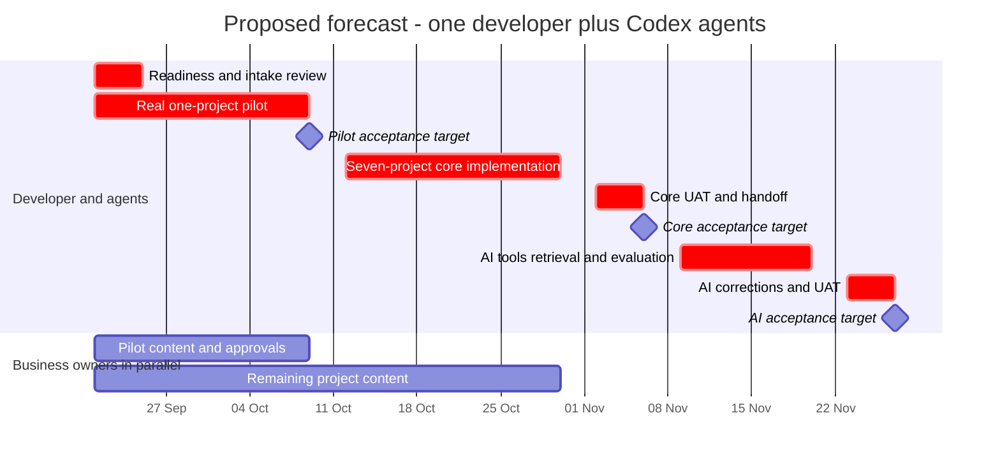

# 15 — Status, decisions and KPI delivery forecast

**As of 18 September 2026 (Asia/Bangkok).** The business owner confirmed **one full-time developer, assisted by Codex and agents**. Agents can help implement, test, document and review independent tasks; they are not an additional committed full-time developer and cannot replace business approvals.

**State at the planning review:** the local back-office foundation worked with synthetic data, and the first two real projects had a technically reviewed source snapshot. Real intake, business approval, shared-environment acceptance and production rollout were pending. No overall completion percentage was claimed. Subsequent progress is recorded below.

**Subsequent progress, 18 September at 13:28 Bangkok:** KUBON/B_PO were staged in the local database: 2 projects, 2 brands, 2 companies and 96 models, with original evidence retained. Exact replay and source/API isolation were verified. That staging event created no real Hub drafts, mapping confirmations or publications. See the [staging result](14-pilot-intake-kubon-b-po.md#local-staging-update--18-september). Section 2 preserves the earlier planning-review baseline; the local staging step did not establish recurring DW delivery or business acceptance.

**Latest scope and progress update, 18 September at 15:09 Bangkok:** the user replaced that current intake selection with **HYABC only**. Its fresh direct REM snapshot is staged locally, and HYABC/FLEXI are now unpublished drafts with **13 unconfirmed model mappings**, brand `25` and source company `HSP`. Existing KUBON/B_PO drafts and staging remain unchanged in the workspace but are outside the current pilot plan. **Current selection is 1 of 7; six further selections remain pending.** See [HYABC evidence and local status](16-pilot-intake-hyabc.md). Section 2 preserves the original review baseline; the issues, work breakdown and KPI evidence below reflect the current selection. Baseline and proposed forecast dates are unchanged.

**Schedule status:** the original September/October baseline assumed two developers and is now at risk. The dates below are a **proposed planning scenario**, not an approved change to the business deadline or a measured effort estimate. Re-estimate at the **25 September** readiness review after decomposing the remaining pilot work and confirming dependencies. Functional scope and acceptance gates remain unchanged.

## 1. Decisions and reasons

| Decision | Why we chose it | Delivery consequence |
|---|---|---|
| SENA residential first, seven pilot projects | A bounded catalogue lets us validate real operations before introducing other business models. | Solar, EV, LivNex and generic BU workspaces remain Phase 2. Phase 2 starts after Phase 1 acceptance and after October; November is not a promised Solar launch. |
| Build the Thai back office and rich data platform; the separate website team builds commercial websites | Our responsibility is reliable data and content supply. | APIs, assets, content contracts and integration support are in scope; commercial frontend, hosting and website go-live are not Hub acceptance gates. |
| Thai staff interface and default Thai content, with locale-capable storage | All internal users are Thai-speaking; consumers may need supplied multilingual content. | Deliver Thai workflows now; do not add a translation-production programme. |
| REM owns enterprise identity and facts; Hub owns public presentation | Preserve approved enterprise codes while letting Marketing maintain customer-facing information. | Mirror ProjectID, BrandID and model identity through DW. Keep Hub/public IDs separate and preserve source strings, including leading zeros. Do not edit REM facts in Hub. |
| Projects link to their source brand; source company is a separate relationship | A brand is not the same thing as a legal company. | Maintain brand content and approved logos without inferring company ownership from the brand. |
| Business Unit Type means the model/floor-plan code, keyed by `(ProjectID, ModelID)` | The owner clarified examples such as A1-1, A2-1 and B1-1. | Preserve complete codes, including L/R suffixes. Do not substitute ModelTypeID, the separate UnitTypeID, or inventory UnitID. |
| REM operational offers and Hub public promotions are separate | Historical or open-ended operational records are not automatically suitable advertising. | Hub authors and approves public promotions, including campaigns with no REM offer; enforce validity, explicit open-ended approval/review and withdrawal when a cited offer becomes invalid. |
| Publish approved versions for websites and AI | Drafts, expired promotions and revoked assets must not become customer-facing facts. | Require permissions, confirmed mappings, rights, readiness, atomic release, withdrawal/rollback and cache invalidation. |
| Preserve original image masters | Different consumers need different crops and sizes without destroying the source. | Upload/library/rights controls exist locally. In-app crop tools and automatic rendition generation can be deferred; any required delivered renditions still follow ASSET-12. AI expansion is deferred. |
| AI follows approved content and structured facts | Better generation cannot repair missing or unapproved source information. | Use structured tools for price, availability, specifications and promotions; RAG for approved narrative/FAQ. AI across all Marketing processes and CRM/CDP personalization are not Phase 1 deliverables. |
| Future businesses may use their own governed catalogue | Some BUs have no REM master. | Phase 2 may use another ERP, owner-governed spreadsheet or Hub catalogue; do not invent REM IDs or build the generic framework now. |

## 2. Evidence at the original planning review

| Workstream | Verified status | What this does not prove |
|---|---|---|
| Scope and source ownership | Documented; business Unit Type meaning resolved | All owners, access and operational policies are not yet confirmed. |
| Local Thai back office | Brand/project/model editing, source selection, human mapping review, uploads/library, rights review, protected reads, audit and individual-entity version/publish/withdraw/rollback implemented | Shared/production authentication and storage, full multi-entity releases and real business acceptance remain incomplete. |
| Local verification | Last recorded on **16 September**: 220 API tests, 12 browser tests, seven SQL/concurrency suites, build/TypeScript and fresh database setup passed | These are local engineering checks with synthetic fixtures, not production UAT. They were not rerun for this status report. |
| Real source review | **2 of 7** pilot projects selected; snapshot contains 2 projects, 2 brands, 2 companies and **96 models** | A direct read-only REM review is not scheduled DW integration. |
| Real intake and approval | **0 of 96 model candidates individually confirmed** in the review package; real Hub import and publication have not occurred | Terminology confirmation is not bulk approval. Unconfirmed identities may be staged, but cannot bypass publication review. |
| Seven-project core and AI | Requirements and gates documented | Promotions, full content/API coverage, ads integration, source synchronization and RAG/chatbot delivery remain to be completed. |

### Historical identities at the planning review

| ProjectID | Project | BrandID / brand | Source company | Models |
|---|---|---|---|---:|
| `KUBON` | โคซี่ รามอินทรา - คู้บอน | `36` / Cozi | `THP` / บริษัท เสนา เอชเอชพี จำกัด | 63 |
| `B_PO` | นิช โมโน บางโพ | `000003` / Niche MONO | `A17` / บริษัท เสนา เอชเอชพี 12 จำกัด | 33 |

Raw project-model ModelArea is 24.00–34.50 for KUBON and 27.00–90.00 for B_PO. **Its authoritative meaning and unit are unverified.** These values must not be labelled usable square metres or used to infer bedrooms/bathrooms. ModelTypeID is `CD` for KUBON and `CON4` for B_PO; these are separate from the floor-plan code.

## 3. Issues, consequences and owners

Responsibilities below are roles to assign, not evidence that named people have accepted them.

| Issue | Consequence / next action | Required owner |
|---|---|---|
| Remaining six pilot projects and content owners are not identified | HYABC is the only current selection; complete the seven-project list and a per-project content/asset checklist. | Marketing / product owner |
| Area meaning/unit and approved model specifications are incomplete | Obtain source-owner confirmation or another approved specification source; collect bedrooms, bathrooms and usable area for every model in the seven-project scope. | REM/data owner + Marketing |
| HYABC's 13 model crosswalks remain unconfirmed; DW unit-table reconciliation is pending | Review each exact project/model mapping and compare the user-run unit-table result against the master keys. The old 96 models are historical work, outside the current pilot plan. | Developer + source/business reviewer |
| Live DW delivery was unavailable during the intake review | Agree and verify the recurring DW delivery contract for brand/company/project/model and offer data, including timestamps, status changes and drift. | IT / DW owner + developer |
| Shared environment and actual user provisioning are not established by current evidence | Provision and verify authentication, storage, permissions, deployment and operational access. Local test identities are not enterprise onboarding. | IT + developer |
| Publication/promotion integration remains unfinished | Implement atomic publish sets, promotion targeting, data/legal approval, open-ended review, source invalidation and expiry/cache/webhook behaviour. | Developer; data owner and Legal for policy/approval |
| Public promotion fields, review cadence and named publisher/legal approver remain open | Resolve before the dependent publication flow can be accepted. Missing approval blocks release, not independent coding. | Data owner + Marketing + Legal |
| Website consumer contact and ads-sheet operating details remain open | Agree required fields/payloads, consumer contract and a dated residential ads evaluation snapshot. | Website integration contact + Marketing |
| AI API access, chatbot ownership and runtime capacity are not confirmed | Resolve in parallel before the AI stage; prepare evaluation questions from approved content. | IT + chatbot owner + Marketing |
| One developer owns integration and delivery | Keep one primary engineering milestone at a time. Use agents for bounded parallel implementation/reviews; keep content collection and approvals with business owners. | Developer / product owner |

The separate REM UnitTypeID field being empty in the historical KUBON/B_PO checks is **not a blocker** for the resolved model identity. The agreed key is `(ProjectID, ModelID)`; those zero-row findings are not claims about HYABC.

## 4. Proposed schedule for the KPI/Gantt update

Preserve **Baseline finish**, **Forecast finish**, **Actual acceptance date** and **Status** as separate chart fields. Do not overwrite the original baseline or report a demo as accepted delivery.

| Milestone | Original baseline | Proposed working target | Current status | Completion evidence |
|---|---|---|---|---|
| Scope/access/intake readiness | 18 Sep | Review 25 Sep | Partially achieved | Seven IDs, owners, access/promotion decisions and field/gap checklist; dependencies assigned and pilot work estimated |
| One real project internal pilot | 30 Sep | **9 Oct** | Local foundation ready; real integration pending | Full pilot gate, including approved brand/model/assets/promotion and publish → API → withdraw/rollback |
| Seven-project core Hub | 16 Oct | **6 Nov** | Scope defined; substantial implementation and intake remain | Core gate and Marketing UAT; website data/API handoff accepted |
| SENA residential AI pilot | 30 Oct | **27 Nov** | Design/requirements stage | Approved core corpus, tools, evaluation thresholds and Thai-first UAT accepted |

These targets assume external data/content/approval work runs in parallel, the developer can focus full time, and required access is provided. Agent assistance is not assigned a numeric productivity multiplier. The proposal allows roughly three weeks for the first real pilot, four for core completion and three for AI; these are **initial planning allowances**, not measured task estimates. Holidays, leave and external response times still need to be applied. If the developer must also collect and approve all content, reforecast.

Keep **30 September as a progress demonstration** if its original acceptance gate cannot pass. The original 16/30 October goals remain visible as at-risk baseline targets. Completing all seven projects and the AI pilot by 30 October should not yet be entered as an unconditional KPI commitment for this capacity.

### Work breakdown

| ID | Proposed window | Work / output | Main responsibility | Dependency |
|---|---|---|---|---|
| W1 | 21–25 Sep | Confirm owners, six additional IDs, HYABC area/specification evidence, promotion policy and access; review its staged draft mappings and reconcile the DW unit result | Developer + DW/Marketing/Legal | HYABC review package and drafts; access needed for live delivery |
| W2 | 21 Sep–9 Oct | Finish real intake, shared auth/storage, pilot promotion, atomic release and one-project acceptance | Developer + agents; owners approve | W1's required data/access/approvals; existing local foundation |
| C1 | 21 Sep–9 Oct | Pilot content, approved logo/photos/floor plan, disclaimer, minimum model specifications and promotion terms | Marketing + source owner + Legal | Pilot selection and intake checklist; runs alongside W1/W2 |
| C2 | 21 Sep–30 Oct | Remaining project content/assets/specifications and approvals in small batches | Marketing + project owners | Remaining six IDs and assigned owners; runs alongside engineering |
| W3 | 12–30 Oct | Full content model, bulk import/URL mirroring, DW reconciliation, full promotion resolution, ads mapping and API/change-feed/webhook contracts | Developer + agents; external teams supply data | Accepted pilot for rollout; usable content batches |
| W4 | 2–6 Nov | Seven-project UAT, security/expiry/cache evidence, operational handover and website data-contract acceptance | Developer + Marketing/publisher + website contact | W3 and complete required C2 content |
| W5 | 9–20 Nov | Published-only knowledge ingestion, structured tools, citations, indexing reconciliation, evaluation and handoff | Developer + agents + chatbot owner | Core acceptance; API access and approved corpus |
| W6 | 23–27 Nov | Correct evaluation failures, repeat affected checks, Thai-first UAT and AI pilot acceptance | Developer + Marketing + chatbot owner | W5 and all hard quality/security gates |

**HYABC is the selected first project.** Its staged identities and unpublished drafts do not satisfy the pilot acceptance gate; complete required data and approvals next. KUBON/B_PO remain preserved local work, outside the current intake plan. AI access and test-question preparation can start early, but an accepted AI release depends on accepted core data.

The readiness row is part of pilot work, not a second full-time engineering stream. The dates are calendar windows; weekends/holidays are not a commitment to work extra days. Downstream dates move when required predecessor acceptance or external inputs move.

## 5. Measurable KPI gates

| Gate / measure | Acceptance target | Current evidence |
|---|---|---|
| Project selection | 7 exact REM ProjectIDs and assigned content owners | HYABC selected: 1 of 7; six additional IDs and complete owner roster pending |
| Source mapping | 100% of published projects/models have confirmed crosswalks | 13 HYABC model-master candidates reviewed technically and present as unconfirmed drafts; 0 confirmed; separate DW unit-table count pending |
| Pilot delivery | 1 real project, approved brand, at least 1 model with bedrooms/bathrooms/usable area, required assets/disclaimer and 1 data/legal-approved promotion; full permissions/release/withdraw/rollback/cache flow | Not accepted |
| Core business usability | Marketing independently creates and publishes 7/7 projects; required specifications complete for every model in the seven projects | Not accepted |
| Publishing integrity | 12 edits across 4 entities publish atomically and roll back; consumer access excludes internal/draft/archived/expired data; brand gate A-22 passes | Individual-entity behaviour checked locally; full core gate pending |
| Asset and promotion contract | Hub-mirrored consumer assets; rights checks; all six promotion target scopes; include/exclude and source withdrawal | Partial local assets foundation; full contract pending |
| Expiry delivery | Controlled expiry webhook arrives within 60 seconds; cache never retains expired data past cache_expires_at or the 300-second maximum TTL | Not demonstrated end to end |
| Ads mapping | All snapshot rows classified; at least 90% of residential rows resolved, including unresolved residential rows in the denominator; active-ad/expired-promotion alert | Not implemented/accepted |
| Website data handoff | Approved representative payloads, stable IDs, source/version/freshness and locale metadata; API/auth/cache/change-feed/webhook guide; required gaps resolved | Pending review and acceptance; no commercial website launch dependency |
| Read API performance | Read endpoints respond in under 500 ms at p95 for the pilot dataset (NFR-01) | Acceptance measurement pending |
| AI evaluation coverage | 7 projects × 8 question types; at least 20 adversarial, 15 cross-project and 10 English questions, plus residential scope-boundary checks | Required set and implementation pending |
| AI quality | recall@5 ≥0.90; citation precision ≥0.95; groundedness ≥0.95; no-answer correctness ≥0.90; cross-project leakage and volatile-answer rate both zero; zero orphan chunks | Not evaluated |

Core acceptance requires **all non-RAG P0 requirements except the expressly deferred AI dependencies in REQUIREMENTS §1.3**, plus **A-01–A-16 and A-19–A-22**. This KPI table summarizes rather than replaces the full requirements. The AI gate includes A-17/A-18, continued A-19/A-20 compliance and all required RAG quality gates. Test counts are supporting engineering evidence, not a project completion percentage.

## 6. Execution and forecast control

1. **Current engineering step completed locally:** HYABC's reviewed identities are staged and its matching FLEXI brand/project drafts exist, with 13 unconfirmed models and no publication. KUBON/B_PO's existing work is preserved outside the current plan. The snapshot uses its own review contract and is not passed to the DW relay loader. Next, review mappings, reconcile the user-run DW unit query and obtain approved specifications/content while completing the remaining pilot integration.
2. In parallel, obtain model specification evidence, required content and named business reviewers; confirm shared environment and DW delivery. Missing area semantics must not be filled by guessing.
3. Finish one complete approved project workflow before expanding rollout. Start promotion/atomic-release work while data owners prepare content.
4. Use agents for independent implementation, focused verification and review; the developer integrates and reviews changes. Keep schema/API contract decisions coordinated.
5. Review status weekly. On 25 September, replace planning allowances with the decomposed pilot estimate and actual dependency dates. Retain 9/23 October as progress reviews even if acceptance targets shift.
6. If a mandatory gate fails, record the blocker, owner and revised dependent forecast. Defer optional crop automation, convenience UI and advanced AI before changing mandatory acceptance. If October remains a fixed business deadline, an explicit scope/resource decision is needed; do not silently redefine the seven-project/AI delivery as a demo.
7. Finish with business acceptance, consumer handoff and operational ownership, not merely a successful build. Phase 2 planning follows Phase 1 acceptance.

Suggested KPI wording: **Deliver a governed SENA residential content platform for seven projects, with approved Marketing data/assets/promotions, secure website-ready APIs, and a separately accepted AI pilot. Track accepted project count, required data completeness, publication controls, integration acceptance and AI quality against baseline and forecast dates.**

## References

- [Requirements and formal acceptance](../REQUIREMENTS.md)
- [Original delivery baseline and gates](07-delivery-plan.md)
- [Implemented local behaviour and verification limits](11-local-development.md)
- [Brand/project/company mapping](12-brand-project-mapping.md)
- [Source-field ownership and model identity](13-source-field-ownership.md)
- [Historical KUBON/B_PO intake](14-pilot-intake-kubon-b-po.md)
- [Current HYABC intake and remaining gaps](16-pilot-intake-hyabc.md)
