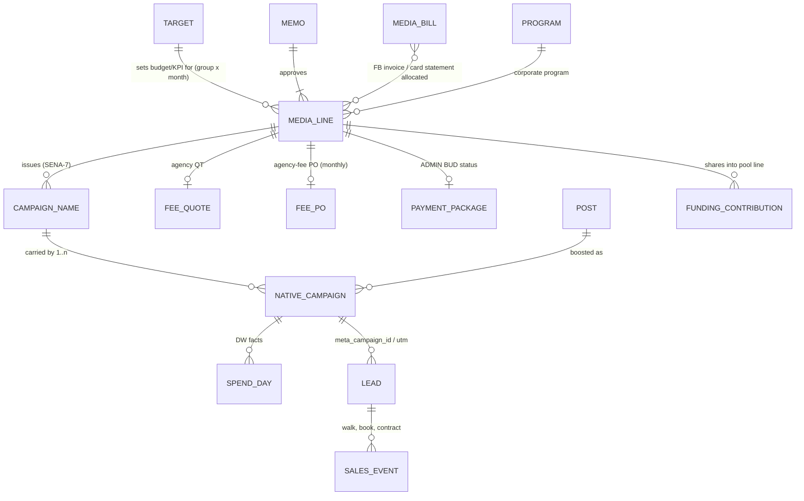
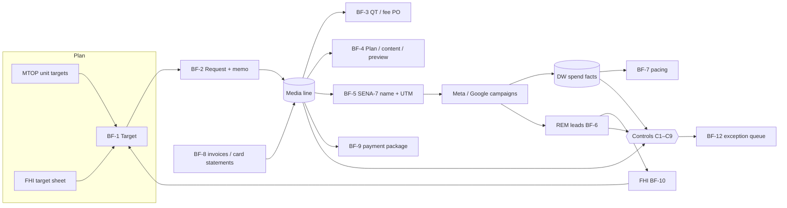

# 20 — Marketing operations: end-to-end business flows and how to wire them

Date: 29 September 2026. Status: **proposed design**; nothing is built or changed. It
extends [19 — campaign naming registry](19-campaign-naming-registry.md). Evidence comes from
read-only reviews of the DW bronze/gold tables, the `INVOICE Ads` ledger and the
`Media Plan-FanpageSENA 2026` workbook (DW audit
`docs/audit/campaign_name_2026_review_2026-09-28.md`, section "Cross-source wiring test").

## 1. The problem in one picture

Today, eight separate records describe the same advertising money. Each team keeps its own
copy, and nothing joins them except people retyping codes.

| # | Record (tool) | Owner | Grain | Keys it carries | In DW? |
|---|---|---|---|---|---|
| 1 | MTOP unit targets → `Option 3 - Forecast from MTOP Unit` (tab in INVOICE Ads) | Marketing / BUD | project × month | project name EN | No |
| 2 | FHI target sheet (project group pipeline) | Marketing | group × month | group code | Yes — `gold.fhi_project_target_monthly` |
| 3 | Budget memo (paper / e-memo) | BUD → 4 approvers; Online | memo | `MO<YYMM><NNN>` (BUD), `M.COM<NNN>_<BE yy>` (corporate) | **Nowhere** — only typed into campaign names |
| 4 | Corporate media plans + content post log (`Media Plan-FanpageSENA 2026`) | Content / corporate | program × period; boosted post | memo, program, pillar, post link | No |
| 5 | Agency quotation and agency-fee PO | Agency; SENA Idea; procurement | project × month × agency | `QT…`/`BST…`, `BK-PO<YYMM>-<NNNN>` | No (ledger only) |
| 6 | Campaigns on Meta / Google | Agency / in-house | campaign × day | campaign ID; name with group code, BUD, memo, agency, PO | Yes — bronze `mads__*`, `gads__*` |
| 7 | `INVOICE Ads` ledger | Marketing / Idea / ADMIN BUD | REM project (phase) × month × agency | ProjectID, group code, BUD, agency, QT, PO, FB invoice no., billing periods | No |
| 8 | REM leads → walk → book → contract | Sales | lead / event | project, `utm_campaign`, `meta_campaign_id` | Yes — FHI marts |

Manual copies of DW outputs: `Performance form` (content workbook) and `ชีต2` scorecard
(ledger). These are replaced by DW outputs, not wired.

**The keys already overlap. Nobody has joined them yet.** Measured on 29 September:

| Join | Key | Result |
|---|---|---|
| Campaign → master | group code in name ↔ `gold.dim_project_group` | 58/58 codes valid (2026) |
| Campaign spend → ledger row | (group code, month, agency) | 44–47 keys matched per month; matched totals within +1.6% (May), −5.2% (Jul), −3.7% (Aug) |
| Ledger ↔ campaign mismatch | same amount, different code or agency | 4–8 keys per month, e.g. `H-SGHM-RSTTN` ↔ `H-SGHM-BNK29` 82,957 exactly: a **correction crosswalk** |
| Lead → campaign | `meta_campaign_id` ↔ DW campaign ID | 14,430 of 27,015 REM leads since May (53%); Google IDs never captured |
| Ledger fee → fee rates | media × rate × 1.07 | Exact (Samrong August: 88,621.05 × 12% × 1.07 = 11,378.95) |
| Target → ledger → forecast | group × month budget | Three copies: FHI target ≈ THB 4.7–5.1m/month, ledger budget 5.3–5.5m, MTOP forecast per project |

## 2. The spine: one "media line" that everything hangs from

Every flow reads or writes one shared unit. The **media line** is what the ledger row already
is: **one promoted scope × one calendar month × one agency** (project lines), or **one
program × period** (corporate lines).



Line key: `(scope_code, month, agency)`. For ledger rows, `scope_code` is the `Formatted Mapping`
group code (phase rows such as `BPSK1`/`BPSK2` are children of one group line). For corporate
lines it is `CORP-<pillar>` or the program.

Three properties make this spine work **with the data we already have**, before any new tool:

1. **Deterministic for legacy data.** The group code and agency are already in 92% of spend
   and in every ledger row, and the month comes from the spend date. No memo or registry is
   needed to join spend to its line. The memo and registry make the join *verifiable*, not *possible*.
2. **Multi-month campaigns split correctly.** Each spend day belongs to the line of its
   calendar month. An always-on campaign therefore contributes to the June line, then the July line, and
   the monthly agency-fee PO lives on each month's line. That's why the PO does not belong in the name.
3. **Outcomes attach at two levels.** Leads with a Meta campaign ID roll up campaign → line.
   All leads, walks and books roll up to group × month, where FHI already works.

## 3. Business flows

Priority: **P0** = must exist for the wiring to work; **P1** = needed to run without
spreadsheets; **P2** = automation.

| ID | Flow | Priority | Cadence | Accountable | Creates / updates |
|---|---|---|---|---|---|
| BF-0 | Master data and code stewardship | P0 | On change | Registry steward (P'Note / Online) | Scope codes, BUD, agencies, pillars, ad accounts, crosswalk |
| BF-1 | Target and budget planning | P0 | Monthly (annual base) | Marketing + BUD | TARGET (group × month): units, leads, CPL, budget |
| BF-2 | Budget request and memo approval | **P0** | Monthly / per program | BUD requests; 4 approvers; Online records | MEMO + MEDIA_LINEs (budget, KPI, agency) |
| BF-3 | Agency quotation and fee PO | P0 | Monthly per line | Agency; SENA Idea; procurement | FEE_QUOTE, FEE_PO on the line |
| BF-4 | Media plan, content and creative approval | P1 | Per program / post | Content team; agency | PROGRAM, POST, preview approval |
| BF-5 | Campaign naming, setup and launch | **P0** | Per campaign | Online issues; agency builds | CAMPAIGN_NAME, UTM, native-ID binding |
| BF-6 | Lead capture and attribution | P0 | Continuous | Web/CRM owners; DW | LEAD → campaign → line |
| BF-7 | Daily delivery and pacing monitor | P1 | Daily | Online; agency | Pacing and exception alerts |
| BF-8 | Month-end media billing | P0 | Monthly (billing periods) | BUD admin | MEDIA_BILL allocated to lines |
| BF-9 | Agency-fee invoice and payment package | P0 | Monthly, deadlines 19th/20th | SENA Idea coordinator; ADMIN BUD | Fee invoice check, PAYMENT_PACKAGE, finance handoff |
| BF-10 | Performance review and agency scorecard (FHI) | P0 | Weekly / monthly | Marketing | FHI per group, CPL per line/agency |
| BF-11 | Re-plan and budget revision | P1 | Monthly / ad hoc | BUD + Online + approvers | Revised lines (superseding), new memo if required |
| BF-12 | Exceptions and corrections | P0 | Daily queue | Steward + line owner | Resolved findings, approved crosswalk entries |

### BF-0 Master data and code stewardship
- **Why:** every join depends on codes, and today three places disagree. For example, the ledger books
  Grand Home Rangsit as `H-SGHM-RSTTN`, but the campaigns use `H-SGHM-BNK29`. `C-MIBF-BNGPU` and
  `C-MIGD-BNGPU` conflict too.
- **Steps:** import groups/phases from DW (`dim_project_group`, bridges) → the steward adds
  non-project scopes (`ZONE-`, `BRAND-`, `CORP-<pillar>`, `BU-`), BUD codes (incl. `SID`), agencies,
  ad accounts (account → brand/agency) → publish the vocab to the Name_Builder / Hub.
- **Crosswalk:** approved `(wrong code, month range, agency) → correct line` rows fix legacy names
  without renaming campaigns. The first entries are the pairs in the audit.
- **Control:** a code is used in a name or line only if it is active in the registry.

### BF-1 Target and budget planning
- **Today:** MTOP unit targets → `Option 3` tab (walk/book ratios, leads per book, target CPL)
  → media budget → gross including fee and VAT. The FHI target sheet repeats budget/lead/CPL
  KPIs per group, and the ledger repeats the budget again.
- **To be:** one TARGET record per group × month, with forecast inputs and lineage. The Hub computes
  the proposal (units → books → walks → leads → media = leads × CPL → gross =
  media × (1 + fee_rate × 1.07) using `dim_agency_fee_monthly`). BUD adjusts it, and the result feeds both FHI
  and the memo request.
- **Feedback:** actual ratios from BF-10 (lead→walk, walk→book, CPL) replace static assumptions next month.
- **Control C1:** target budget = Σ approved line budgets for the group-month (difference shown, not forced).

### BF-2 Budget request and memo approval — must have
- **Why:** the owner confirmed on 29 September that BUD memos are tracked nowhere but in campaign
  names, and about 85% of 2026 spend carries no memo. Without a register there is no
  approval coverage, no budget-vs-actual per approval, and no audit trail.
- **Steps:** BUD requests lines (group/phase, month, agency, budget, KPI; prefilled from BF-1)
  → Online consolidates into a memo → the four approvers (คุณเชอรี่, พี่ติ่ม, พี่หนึ่ง, คุณแพร)
  sign outside the system → Online records the memo no. (`MO<YYMM><NNN>` / `M.COM<NNN>_<BE yy>`),
  the signed PDF and the date → lines become `APPROVED`.
- **Rules:** one memo may approve many lines and months; a line has exactly one applicable
  approved revision; the memo amount = Σ its lines (gross); revisions supersede and never add up.
- **Interim (no Hub):** add a `เลข Memo` column to every ledger row, filled when the memo is
  signed. This one column links the ledger, names and approvals.
- **E-memo system.** SENA runs a separate E-memo system, and the approvals happen there. The September
  REM catalog scan found no marketing memo or budget-approval table: `Sys_FI_Payment_MEMO_999` is
  a 10-row finance payment table, `Sys_ACC_Budget`/`Sys_ACC_ChartOfBudget` are empty, and the
  `*_FlowApprove` tables approve unit plans, base prices and title deeds. That scan covered only the
  528 of 1,477 REM objects with project/company columns, so confirm with IT. The Hub should
  **mirror** E-memo rather than re-record approvals:

  | Option (ask IT, in order of preference) | Hub behaviour |
  |---|---|
  | API or webhook on status change | `ads.memo` upserted automatically; approvers and dates copied; PDF linked |
  | Read-only DB view / scheduled export (CSV/Excel) | Nightly import job into Hub staging, then match to lines |
  | Nothing machine-readable | Online types the memo no. and uploads the signed PDF (current fallback) |

  Fields needed: memo no., subject, requesting BUD, amount (gross; media/fee split if present),
  status, each approver with decision time, approval date, document link. The memo number is
  the join key to lines, names and the ledger. The Hub never approves a memo itself. The DW ingests
  the Hub copy (`hub` source), not E-memo directly, so there is one owner of the mapping.

### BF-3 Agency quotation and fee PO
- **Steps:** after memo approval the agency issues a quotation per line (`QT2026080040`
  BrandStrom, `BST2607036` Media Option, `QT6908…` KIN, …) → SENA Idea checks the fee =
  planned media × rate × 1.07 → procurement issues the agency-fee PO for that month
  (`BK-`, `JSA-`, `BPR-`, `SENX-`, `BPC-` prefixes = issuing company).
- **Control C2:** fee on QT = media × rate × 1.07 within rounding; one QT and one PO per line per
  month; PO issued by day N of the month (N to agree). September shows 52 QTs but only 2 POs,
  so the ageing needs to be visible.

### BF-4 Media plan, content and creative approval
- **Corporate:** a program (e.g. `Corp_JulAlwaysOn`, THB 100k, `M.COM033_69`) → post lines
  (pillar, content name, days, budget; 12 boosts in July) → post published (link) → boosted
  as a campaign named from the line → `Preview Ads` approval deck.
- **Agency:** the media plan/brief is attached to the line; creative preview approval before launch.
- **Artwork:** the 65 MB workbook comes from images pasted into cells. Store artwork once in
  the Hub asset library (doc [02](02-data-model.md)) or a Drive folder, and keep only a link in the plan.
  This removes the export problem and allows reuse.
- **Budget pool vs subject:** keep "which money" (program/memo line) separate from "what it
  promotes" (scope), as in the content file's `ใช้เงินก้อนไหน` column (doc [09](09-ads-registry-integration.md) §4).

### BF-5 Campaign naming, setup and launch — must have
- **Steps:** an approved line → SENA-7 name + UTM issued (doc 19) → launch pack to the agency →
  the agency builds the campaign with the exact name → returns the account and campaign IDs → the DW sees the
  first spend → binding confirmed.
- **Name built from the line:** Name_Builder reads the line (ledger row), so group, BUD, memo,
  agency and launch-month PO are copied, never retyped. This connects naming to finance.
- **Control C5:** every spending campaign has a valid SENA-7 name, and its line exists and is approved.
  Unregistered spend → BF-12.

### BF-6 Lead capture and attribution
- **Now:** Meta lead forms carry `meta_campaign_id` (82% of FB Lead Gen leads). The join to DW
  campaigns works for 14,430 leads since May. Google leads carry no campaign ID. Website/LINE
  leads rely on UTM.
- **To be:** a lead → campaign (ID first, exact `utm_campaign` second, labelled) → line →
  memo. Group-level FHI stays the authority for all leads, including unattributed ones.
- **Fixes:** capture `utm_id`/`google_campaign_id` (Google ValueTrack `{campaignid}`) on web forms;
  keep UTMs through redirects; report attribution coverage separately (C7).

### BF-7 Daily delivery and pacing
- **Line pacing:** month-to-date DW spend vs line media budget, expected by days elapsed;
  leads vs KPI; CPL vs target CPL. Alerts for overspend >110% of pace, no delivery on an
  approved line after N days, and spend on a line with no approval.
- **Replaces** agency screenshots and the manual `Performance form`.

### BF-8 Month-end media billing
- **Inputs:** Meta invoices (FB-INV no., per ad account), FB/Google/TikTok credit-card statements
  with their own billing periods (e.g. Google 21st–21st, FB 23rd–25th), and the FB overseas bank fee
  (1,700/month, outside the marketing budget).
- **Steps:** BUD admin records each bill → allocates it to lines by DW daily spend within the
  bill's period and account → ledger actual media = Σ allocated bills.
- **Control C3:** allocated bill total vs DW spend for the same account and period (±1–2% FX/rounding).
  Line actual vs DW spend for the calendar month is informative only, because billing periods differ.
  June BrandStrom rows (ledger 9k vs DW 277k for Bangna) are exactly what this control catches.

### BF-9 Agency-fee invoice and payment package
- **Steps:** the agency invoices the fee against the PO → SENA Idea checks it against the QT (the remainder
  column) → the Online team ticks "checked" with its evidence deck → ADMIN BUD sets the payment status →
  the package goes to the Idea coordinator by the **19th** and accounting (floor 11, คุณซา) by the **20th**
  (ONLINE PAYMENT FLOW deck).
- **Control C9:** every running line of month M has a fee invoice, media bills, evidence and a
  status by the 19th of M+1. Lateness is shown per BUD and agency.

### BF-10 Performance review and agency scorecard
- **Existing:** FHI (`gold.fhi_project_monthly_summary`) already computes leads, lead quality,
  walk/book, CPL/CPW/CPB, FHI score and targets per group × month. `ชีต2` retypes it by hand.
- **Add:** a line-level view (agency × group × month) with DW spend, the ledger/bill actual, fee,
  **all-in cost** (media + fee + bank fee) and attributed leads, so each agency is scored on its own
  lines. When one group has two agencies, group-level FHI can't separate them.

### BF-11 Re-plan and budget revision
- **Triggers:** pacing alert, KPI miss, new promotion, underspend.
- **Rules:** a revision supersedes the line (same key, new revision); if the gross exceeds the memo, a
  new or amended memo is needed (BF-2); moving money between lines is a pair of revisions; the history stays visible.

### BF-12 Exceptions and corrections
One queue, owned per finding type:

| Finding | Source control | Owner |
|---|---|---|
| Unregistered spend (campaign with no line) | C5 | Online → agency |
| Code/agency mismatch (ledger vs name vs master) | C3, BF-0 | Steward approves a crosswalk row |
| Spend without an approved memo | C5 + BF-2 | Online + approvers |
| Over pace / over budget | C4 | Online + BUD |
| Missing QT/PO/bill/package by deadline | C2, C9 | SENA Idea / ADMIN BUD |
| Low attribution coverage | C7 | Web/CRM owner |

## 4. Monthly operating calendar

| When | Flow | Output |
|---|---|---|
| M-1, days 10–20 | BF-1 | Group × month targets and proposed budgets |
| M-1, days 20–28 | BF-2 | Memo(s) signed; lines approved |
| M-1, day 25 to M, day 5 | BF-3, BF-4 | QT per line, creative/preview approved, corporate program plan |
| M, day 1 onward | BF-5 | Names issued, campaigns live, IDs bound |
| M, daily | BF-6, BF-7, BF-12 | Leads attributed, pacing, exceptions |
| M, during month | BF-3 | Agency-fee PO per line |
| M+1, days 1–10 | BF-8 | Bills recorded and allocated (billing periods end on the 21st–25th) |
| M+1, by 19th / 20th | BF-9 | Payment package → Idea coordinator → accounting |
| M+1, days 5–15 | BF-10 → BF-1 | Scorecard; actual ratios feed next month's plan |

## 5. Automated controls (DW)

| ID | Check | Join key | Tolerance / rule |
|---|---|---|---|
| C1 | Target vs approved line budgets vs memo amount | group × month; memo | Exact for memo = Σ lines; target difference reported |
| C2 | Agency fee = planned media × rate × 1.07 | line; agency × month rate | ≤ 1 THB |
| C3 | Bills allocated vs DW spend | account × billing period | ±2% |
| C4 | Line pacing | line × day | 90–110% of expected |
| C5 | Name conformance, line exists, line approved | native campaign → line | 100% of new spend |
| C6 | Code consistency (name vs ledger vs master) | line key | Zero unresolved |
| C7 | Lead attribution coverage | lead → campaign | Report by channel; target set separately |
| C8 | QT/PO ageing | line | QT by M day 5, PO by M day N |
| C9 | Payment package complete | line × month | By 19th of M+1 |

Each check writes one finding row (expected, observed, owner, status) to
`gold.fact_marketing_ops_finding`, which the Hub exception queue reads (BF-12).

## 6. Where each piece lives



| Capability | Phase 0 — DW only (no process change) | Phase 1 — Sheet tweaks | Phase 2 — Hub `ads` module |
|---|---|---|---|
| Line register | Build `dim_media_line` from ledger month tabs (bind by header text; positions differ by month) | Standard ledger template for all months; add `เลข Memo` column | `ads.media_line` + memo register replace the ledger |
| Memo | Parse from names where present | Memo column in ledger | BF-2 approval screen |
| Names | Tolerant parser; spend → line by (code, month, agency) + crosswalk | Name_Builder generates SENA-7 **from a ledger row** | Hub issues names |
| Bills / payment | Read ledger actual/bill/status columns | Same | `ads.media_bill`, `ads.payment_package` |
| Corporate plans | Ingest plan and post-log text (skip images) | Artwork as links; post log gets post ID | Program/post in Hub |
| Leads | ID/name join coverage | UTM `utm_id` on web forms | Same, surfaced per line |
| Controls | C1–C9 as findings | Same | Exception queue UI |

**Phase 0 DW objects:** bronze `<key>__ledger_month` (one snapshot per month tab), `<key>__mtop_forecast`,
`<key>__corp_plan_line`, `<key>__content_post`. Silver staging with header-text binding. Gold `dim_media_line`,
`bridge_native_campaign_media_line` (method: `REGISTRY`, `NAME_KEY`, `CROSSWALK`,
`UNRESOLVED`), `fact_media_line_monthly` (budget, fee, planned media, bill actual, DW spend, leads
attributed), `fact_marketing_ops_finding`. The source keys must be added to the DW source registry
first (proposal: `adinv` for the ledger, `mplan` for the media-plan workbook). Store invoice files
only as links. Exclude the `draft` tab's credit-card last-4 column. Both Sheets are
Google-hosted internal finance/planning data with no customer PII; record them like the existing
AgencyFee source.

## 7. Repository boundary

Moved on 29 September 2026: the registry, naming and flow design now live in this repo (`docs/19`,
`docs/20`, `docs/ads/`, `tools/name_builder/`). The DW repo keeps data evidence and the data contract
(`docs/MARKETING_OPS_INTEGRATION.md` there).

| Concern | Repo | Why |
|---|---|---|
| Registry data model, approvals mirror, name issuing, launch pack, bills, payment status, exception UI | `sena_digital_hub_mkt` | People plan, approve and issue here; the Hub is the system of record |
| Interim Sheet UI (Name_Builder Apps Script) | `sena_digital_hub_mkt/tools/name_builder` | The Hub's front end until the `ads` module exists |
| Ingestion of platforms, REM, ledger/media-plan Sheets, Hub registry snapshot | `sena_idea_mkt_data_warehouse` | dlt → bronze; source registry and secrets live there |
| Name parser, media-line marts, controls C1–C9, FHI | `sena_idea_mkt_data_warehouse` | Observed data, reconciliation, history |
| Evidence audits of DW data | `sena_idea_mkt_data_warehouse/docs/audit` | Reproducible from DW queries |

The two repos meet only through data contracts:

```text
Hub ads.* (Supabase Postgres) --read-only role, dlt--> DW bronze.hub__*  (source key `hub`)
DW gold marts (line actuals, findings) --stage script--> Hub staging (same pattern as scripts/stage-gold-project.py)
E-memo --API/export--> Hub ads.memo  (never directly to DW)
```

## 8. Decisions needed

1. **Adopt the media line (scope × month × agency) as the shared unit**, and make the ledger row
   its interim home until the Hub replaces it.
2. **Add the `เลข Memo` column to the ledger now.** It's the cheapest way to create the memo register.
3. **Ledger template freeze:** one column layout for every month tab, so the loader binds reliably.
4. **Crosswalk authority:** who approves a code/agency correction (proposed: P'Note as steward, line
   owner confirms).
5. **Approve Phase 0 ingestion** of `INVOICE Ads` and `Media Plan-FanpageSENA 2026` (source keys,
   read-only service access, refresh cadence).
6. **Artwork out of cells** into the asset library or Drive links.
7. **PO deadline N** and the QT/PO ageing thresholds for C8.
8. **Google lead attribution:** add `{campaignid}` to Google final URL suffixes and capture it on forms.
9. **E-memo access:** ask IT whether E-memo offers an API/webhook, a read-only view or an export, and
   whether marketing budget memos (`MO…`, `M.COM…`) are in it.
