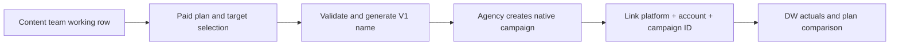

# Working file_for content team: Digital Hub and campaign naming handoff

> Moved from `sena_idea_mkt_data_warehouse/docs/` on 29 September 2026; this is now the only maintained copy. Content-sheet findings are superseded by the full workbook review in [19 §2.1](../19-campaign-naming-registry.md).


**Scope update, 24 September:** the user clarified that this is SENA's internal content-team sheet, not an inventory of agency work, and selected an ads-only scope. Its findings remain useful evidence, but its editorial handoff is optional. The [paid campaign registry design](SENA_ADS_CAMPAIGN_REGISTRY_DESIGN.md) governs the current proposal; campaigns do not require a content-sheet row.

Study date: 24 September 2026. Inputs: the user's pasted rows 36–54, the clarification that one row usually becomes one native Ads Manager campaign, the local naming-builder workbook, official destination pages, and a read-only DW check. No live Google Sheet was accessed or changed. No workbook, campaign or production model was modified.

**Recommendation:** use this sheet as the editorial input to the Digital Hub. Link each paid promotion to a structured media plan, then generate its canonical campaign name from the actual advertised target and buying settings. Preserve the content team's familiar program names and captions as metadata.

## What the sheet actually describes

The supplied rows combine editorial content, funding references, publication planning and a requested paid boost. They do not yet contain a complete set of buying settings. The normal grain is one content row → one paid campaign/boost flight, with explicit exceptions for repeated boosts or campaigns containing multiple posts.

Keep these concepts distinct:

| Concept | Examples in these rows | Role in the Hub |
|---|---|---|
| Funding bucket / reference | `AugAlwaysOn`, `SepAlwaysOn`, `M.COM036_69`, `M.COM043_69` | Budget ownership and approval/reconciliation. Confirm the business meaning of each memo code; do not assume it is a PO or infer agency. |
| Editorial program | `Corp_AugAlwaysOn`, `Corp_SepAlwaysOn` | The content program under which a post is commissioned. It does not establish the advertised project scope. |
| Content series/category | `AlwaysOnContent`, `LowCarbon`, `BrandAndProject` | Editorial organization. The existing categories mix themes, brands and businesses, so retain the raw value. |
| Initiative / offering | StayEasy, Mother's Day, RentNex Invest | A program, occasion or offering. It can span properties. |
| Advertised target | PITI Sukhumvit 101, COZI, SOLAR, LIVNEX, RENTNEX, SENA corporate | The entity used for canonical naming and association. Marketers must select the intended scope explicitly. |
| Creative / published post | Caption, artwork, Facebook post URL | The material being promoted; one post may be reused in later flights. |
| Paid campaign/flight | Boost dates, budget, intended objective, audience, buying account | The execution plan that will acquire a native campaign ID. |

**Corporate funding can support a project campaign.** Row 50 is the clearest example: its program is `Corp_SepAlwaysOn`, but its offer, caption and destination identify PITI Sukhumvit 101. Its target should therefore be the verified group `C-PITI-SK101` when that is the confirmed paid brief. The program remains a separate reporting dimension.

## Review of all 19 supplied rows

The following are recommended classifications from the supplied brief and destination context, not completed media approvals. Objective, audience, agency, account and exact target selection still belong to the paid-media owner. Years are inferred as 2026 from the conversation, caption and memo context; store full dates explicitly on import. Amounts are treated as THB from the DW/business context and as planned flight budgets, not actual spend; the sheet should confirm currency and budget basis.

| Row | Content / program | Recommended scope | Identifier or decision required |
|---|---|---|---|
| 36 | StayEasy1 | Initiative spanning projects; F if promoting the initiative without specified property targets, D if a selected multi-group offer | Store `initiative=STAY_EASY`. Confirm scope. `CORP-SENA-STAYEASY` would need a controlled-topic registry addition; do not invent a property ID. |
| 37 | GURU Solar: future homes | F, Solar-related | `BU-SOLAR` for business promotion; `CORP-SENA-SOLAR` for corporate education. Confirm the intended scope. |
| 38 | NICHE × Mother's Day | E, brand awareness candidate | `BRAND-NICHE-BRANDING`; add NICHE to the reviewed brand-slug registry. Occasion is separate metadata. |
| 39 | COZI × Mother's Day | E, brand awareness candidate | `BRAND-COZI-BRANDING`; no project is specified. |
| 40 | LivNex1 | F, LivNex program/business | `BU-LIVNEX`, or corporate LivNex topic if that is the approved brief. |
| 41 | SENA 1H/2026 business results | F, corporate / investor relations | `CORP-SENA-IR`; the editorial category `BrandAndProject` does not describe its allocation target. |
| 42 | GURU Solar: designing from today's lifestyle | F, Solar-related | Same Solar scope decision as row 37. |
| 43 | SENA Kith value message | E, brand candidate | `BRAND-SENA-KITH-BRANDING`; confirm no particular property is intended. |
| 44 | LivNex2 | F, LivNex program/business | Same target selection principle as row 40. |
| 45 | LivNex3 | F, LivNex program/business | Same target selection principle as row 40. |
| 46 | StayEasySep1 | Initiative spanning projects | Same scope decision as row 36; a new paid flight receives a new plan ID. |
| 47 | GURU Solar: more than panel count | F, Solar-related | Same Solar scope decision as row 37. |
| 48 | LivNexSep1 | F, LivNex program/business | `BU-LIVNEX` candidate; confirm the buying brief. |
| 49 | RentNex rental comparison | F, RentNex business | `BU-RENTNEX`; keep it separate from LIVNEX. |
| 50 | PITI Sukhumvit 101 offer and registration CTA | A, one project group | `PG-C-PITI-SK101`; current REM member is `BUNVI`. The caption does not specify a phase. |
| 51 | Four pet-friendly COZI condos | D if advertising those four project groups; E if the approved purpose is broad brand awareness | Collect the four exact group IDs for D. Do not substitute every project currently listed on the COZI website. |
| 52 | LivNexSep2 | F, LivNex program/business | `BU-LIVNEX` candidate; confirm the buying brief. |
| 53 | SENA Solar × pets | F, Solar-related | Pet-themed creative does not establish a property target. Confirm BU versus corporate Solar scope. |
| 54 | RentNex Invest infographic | F, RentNex business with INVEST offering | `BU-RENTNEX`, `offering=INVEST`. This is distinct from SENA investor relations and is not a new project group. |

No explicit single-phase or joint-phase B/C cases appear in this sample. Brand catalogs and program landing pages can provide a suggested scope, but cannot prove which property groups a paid campaign targets.

Official destination context supports the distinctions above: [StayEasy](https://campaign.sena.co.th/senaeasy-stayeasy/) spans projects; [Solar](https://senasolarenergy.com/) is a service business; [LivNex](https://livnex.sena.co.th/) spans participating properties. [RentNex](https://rentnex.senxgroup.com/) and [RentNex Invest](https://rentnex.senxgroup.com/invest/) represent different offerings of the same business, while [PITI Sukhumvit 101](https://pitisukhumvit101.sena.co.th/) is a dedicated property destination. The [NICHE](https://www.sena.co.th/brands/niche), [COZI](https://www.sena.co.th/brands/cozi) and [SENA Kith](https://www.sena.co.th/brands/sena-kith) pages are brand catalogs. Some direct page fetches timed out; official indexed content supplied the supporting context. The row 51 Facebook post could not be retrieved, so its four property identities remain unverified.

## What this explains in the DW

Read-only check: 24 September 2026 at 02:56:44 UTC. The source facts currently reach 22 September for both Meta and Google. Seventeen Meta campaigns match `Corp_(Aug|Sep)AlwaysOn`. Content labels, dates and memo references provide plausible matches for rows 36–52, but the source sheet has no native campaign IDs to establish an exact join.

| Sheet evidence | Observed DW evidence | Consequence |
|---|---|---|
| Row 50: PITI project offer, 18–22 September, planned 5,000 | Native campaign `120248169384900225`: `2026__Sales__Corp_SepAlwaysOn_BrandAndProject_M.COM043_69-PITI SUKHUMVIT 101`; source spend 4,988.31; no approved project/group IDs | Strong candidate match. The rows already in allocation are UNMAPPED because only CORPORATE_SENA is detected. The exact target ID is missing from the name. This is a potential project-allocation omission, not evidence that every Corp campaign should remain nonproject. |
| Rows 38/39: NICHE/COZI Mother's Day | Candidate suffixes `MOMNiche` / `MOMCozi` have CORPORATE_SENA only, with no explicit brand or project IDs | A controlled target field would preserve brand meaning independently of the creative nickname. |
| Row 42 and 47: Solar content | Candidate suffixes `GURUSolarDont` / `SolarHeart` have CORPORATE_SENA only; their concatenated strings do not satisfy current Solar alias boundaries | Store SOLAR explicitly. Do not infer the business only from free-text creative names. |
| Rows 40/44/45: memo `M.COM036_69` | Candidate LivNex1/2/3 campaign names contain `M.COM033_69` | Reconcile the funding reference. It is unsuitable as an exact campaign join key. |
| Row 39: planned end 17 August | Candidate MOMCozi source facts extend to 18 August | Review actual scheduling, reporting timezone or plan revision; the date difference does not itself prove overspend. |
| Row 51: COZIpet, planned start 22 September | Native campaign `120248230623830225` appears in source facts on 22 September; no project/brand IDs and no matching allocation row at this snapshot | Separate missing target metadata from allocation refresh lag. Do not call an absent allocation row a completed UNMAPPED result. |

The PITI group was verified live in both current master representations: `C-PITI-SK101` → `BUNVI`. Spend above is source-observed spend, not an approved plan-to-actual reconciliation. Confirm each candidate using the actual native campaign ID before writing links or changing allocation.

The checked Gold/Silver schema does not expose a Meta creative-to-post bridge under the inspected post/creative field names. A Facebook post URL or `pfbid…` string identifies content, not an Ads Manager campaign. Do not derive campaign IDs from post URLs.

## Minimal content-team and media-owner handoff

Keep the editorial worksheet recognizable. Add a system-assigned `content_id`, a `paid_promotion_required` flag and a link to the paid plan. These can be hidden/protected or shown as a short Hub link. Preserve source workbook/tab identity and imported raw values so corrections can be traced. Row 36 is a display order, not a durable ID: inserting or sorting rows must not change identity.

Use one linked paid-plan record per requested campaign/boost flight by default. It can appear as a second sheet or as a panel in the Hub; it does not require a complex new application. The existing naming builder becomes the generation step for that record.



| Owner | Fields to maintain | Timing |
|---|---|---|
| Content team | Program/funding reference, raw category, content title/caption, artwork URL, planned publication date, destination URL, public post URL when published, requested boost dates/budget | Editorial drafting and paid-promotion request. Existing sheet columns cover most of this. |
| Marketer / media owner | Target scope + master entity selection; objective; audience; platform/tactic; agency; buying-account selection; execution type; budget basis/currency; approved flight dates/budget | Complete when preparing the paid brief. Missing buying fields remain visibly pending rather than defaulting from a caption. |
| Hub / naming builder | Immutable `paid_plan_id`, validated target identifier, inclusive duration, launch month, reserved sequence, canonical name, applicable tracking output, readiness result | Generate from approved metadata. A row may be valid content while not yet ready for paid launch. |
| Agency / platform integration | Native account/campaign ID; optional ad/post/creative IDs; actual start/end/status and status timestamp | Link after native campaign creation, before importing actuals against the plan. |

Account/campaign IDs are not prerequisites for writing a content draft. A native campaign ID does not exist before the campaign is created. The execution link is required before claiming a verified plan-to-actual match. Marketer objective/audience/agency are not supplied by the pasted rows, even if a likely existing campaign's name exposes its historical objective.

If one post is boosted again, retain `content_id`/post reference and create another `paid_plan_id`. If an exception splits a plan across native campaigns, register each execution explicitly. A native campaign key must not receive its full spend on two plan rows. Shared-campaign cases require ad-level facts or an explicit allocation policy before per-post actual spend is shown.

### Map the existing columns

| Existing column | Hub meaning / adjustment |
|---|---|
| Post order | Preserve as source display order. Generate stable IDs separately; never use ROW() as a key. |
| Month | Preserve the source label. Store full publication and boost dates; derive content month and paid flight month separately. |
| Funding bucket | Store `funding_bucket` independently of target scope. |
| Campaign | Store `editorial_program` / umbrella campaign, e.g. `Corp_SepAlwaysOn`. The generated native campaign name is another field. |
| Content Type + URL in one cell | Preserve raw cell and separate category/series from `landing_url`. `AlwaysOnContent` is not an image/video format. Add actual format only when useful to the creative workflow. |
| Channel | Preserve `Facebook` as intended surface; use `META` for the buying platform. Placements can be selected separately by the media owner. |
| Post Name | Human-readable title/caption; retain Thai and full copy outside the machine name. |
| Artwork | Asset URL(s); an empty cell can be acceptable when an existing published post supplies the creative. |
| Content team's publication date | `planned_publish_date`; actual publication time is a separate observation. |
| Number of days | Derive as boost end − boost start + 1 for inclusive date-only plans. |
| Period Boost | Split into typed `planned_boost_start` and `planned_boost_end`. Store the planning timezone, normally Asia/Bangkok here, and align actual reporting to the account timezone. |
| Link Post | Public post URL/ID. Keep artwork and destination URLs in separate fields. |
| Budget | Proposed flight amount. Confirm lifetime versus daily basis, currency and whether fees/tax are included; keep media spend separate from fee-inclusive funding. |
| Memo | Raw financial/approval reference. Do not derive target, objective or agency from it. |
| Ad Status | Preserve `source_status_raw` with its observation timestamp. Keep planning workflow and platform delivery status separate. |

### Checks revealed by these rows

- The 19 proposed budgets sum to **114,000**: August **72,000**, September **42,000**, treated as THB under the stated context assumption. These are not actual-spend totals.
- All 19 durations match their inclusive start/end dates. Store dates instead of parsing free text indefinitely; do not infer a daily budget from total divided by days without selecting a budget basis.
- On 24 September, rows **46–50** still say Active after their planned end dates. Flag a status/schedule reconciliation. The pasted status has no timestamp, so it is not proof of live delivery.
- Row **50** puts a Google Drive folder in Link Post. Keep it as an asset reference. For an existing-post boost, obtain the actual selectable public/native post; for a new unpublished ad, a public post URL may be inapplicable.
- Row **51** needs exact member selections for a four-group promotion. Do not infer equal spend weights from four properties or turn a brand page's current catalog into the campaign's target list.
- Rows **53–54** start after the source-fact cutoff used in this study. Their absence from the candidate query does not imply that the campaigns were never created.

## How the campaign-name template should use these fields

Keep the existing structure:

```text
IDENTIFIER__OBJECTIVE__PLATFORM__TACTIC__AUDIENCE__YYYYMM__AGENCY__NNN__V1
```

The generator uses selected target IDs for IDENTIFIER, approved media inputs for objective/audience/agency, boost-start month for YYYYMM, and a centrally reserved sequence. Retain objective in position 2 for current Meta parsing. Thai post names, memo codes, budget amounts, live status and editorial program names stay in the linked plan. V1 therefore needs no extra free-text suffix for these rows.

For example, row 50's input becomes `identifier=PG-C-PITI-SK101`, `platform=META`, `tactic=SOCIAL`, `flight_month=202609`; objective, audience, agency and sequence remain pending until supplied by the media owner. A complete name should not be emitted as launch-ready while those inputs are missing. Row 39 uses the candidate identifier `BRAND-COZI-BRANDING`. Row 54 uses `BU-RENTNEX` with INVEST held in the plan metadata.

Keep `paid_plan_id` in the Hub/native campaign registry rather than adding a tenth V1 field. Once linked, `(source_system, native_account_id, native_campaign_id)` is the exact key to DW spend. If a future business requirement needs a plan token inside the name, introduce a reviewed versioned grammar instead of changing V1 silently.

URLs are conditional outputs. Website campaigns use the canonical name as `utm_campaign` and captured native IDs/account IDs as specified in the [formal taxonomy](SENA_ADS_NAMING_TAXONOMY.md). Engagement-only existing-post promotion, a native instant form, or a post without an external click destination can legitimately have no landing UTM. Post URLs and Drive URLs are not substitutes for a destination URL. Use native campaign/API attribution for those cases.

For a future DW extension, approved plan targets can supply explicit registry associations after native IDs are linked. Retain origin/version/effective dates and surface disagreements with legacy regex signals. A draft sheet edit or a fuzzy name match must not silently rewrite historical allocations. This registry integration is proposed; the current deployed name-based models do not ingest these plans.

## Findings in the current naming-builder workbook

Inspected read-only: `outputs/marketing_dashboard_discovery/SENA_Campaign_Naming_Builder_Template_v1.xlsx`. Its current purpose is generating names/URLs from manually entered taxonomy fields; it is not yet the linked editorial/paid-plan record described above. Inspection read XML/formula definitions without recalculating or saving the workbook.

| Area | Finding / required correction before treating it as launch-ready |
|---|---|
| `Campaign_Builder!A4:R4` | No stable content/plan IDs, separate funding fields, boost dates/budget, native account/campaign input or execution type. Add the paid handoff fields without forcing editorial authors to fill every media field. |
| `Campaign_Builder!N5:N38` | VALID checks basic presence/length, not master membership, scenario/identifier consistency, version, uniqueness or platform/tactic rules. Relabel it as a basic check until semantic validation exists. |
| `Campaign_Builder!P5:R38` | Meta/TikTok account placeholders (`{{account.id}}`, `__ACCOUNT_ID__`) are not established by the approved contract; Google leaves `sena_account_id=` empty. Require explicit native account input and surface Google custom-parameter setup. |
| Platform-specific URL outputs | All three platform outputs are generated regardless of selected platform. Return only the applicable output and support tracking-not-applicable cases. |
| Scenario notes | Some cells present proposed BRAND/CORPORATE/BUSINESS_NONPROJECT buckets as current statuses. Current raw FHI status is UNMAPPED for approved nonproject-only identities. Phase signals do not establish phase-level spend splits. |
| Master phase/project IDs | Some supplied REM IDs contain `_`, `/` or non-ASCII text, which V1's allowed characters cannot represent. Examples include `B_PO`, `PH7/2`, `K2K_4`, `B1/2`. Use a reviewed exception/alias policy and never strip characters automatically. |
| Formula coverage / fee provenance | Formulas stop at row 38 while some dropdown ranges extend to row 40. Fee rates need source/effective-date confirmation before use in plan-versus-budget calculations. |

The smallest useful next implementation is a linked paid-handoff view, explicit target selection and corrected validation/tracking outputs. This study does not require a new naming version or a wholesale replacement of the content team's sheet.

Evidence: user-pasted planning rows; the local workbook; [existing naming rules](https://github.com/Keetawon/sena_idea_mkt_data_warehouse/blob/master/transformation/models/intermediate/marketing/int_marketing__campaign_name_signals.sql); [current identity model](https://github.com/Keetawon/sena_idea_mkt_data_warehouse/blob/master/transformation/models/marts/marketing/dim_marketing_campaign_identity.sql). Read-only SQL results and normalized planning checks are stored locally under `outputs/marketing_dashboard_discovery/content_team_study_20260924/`. Normalized English post labels are analysis labels, not replacements for the raw Thai captions.
