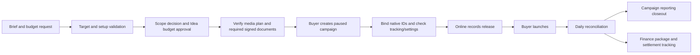

# SENA paid campaign registry, naming, validation and reconciliation

> Moved from `sena_idea_mkt_data_warehouse/docs/` on 29 September 2026; this is now the only maintained copy. **Naming (§5) superseded by [19 — SENA-7](../19-campaign-naming-registry.md); flows extended by [20](../20-marketing-operations-flows.md).** Controls, roles and reconciliation rules remain the reference.


Design date: 24 September 2026. Status: proposed design; no application, production model, campaign or approval has been changed.

**Current first phase:** the user selected a Google Sheets registry before Hub migration and deferred API publishing. The [Sheets field specification](SENA_REGISTRY_GOOGLE_SHEETS_FIELD_SPEC.md) defines the smaller manual pilot; the controls below remain the target operating contract.

Follow-up: the user confirmed BUD-admin reconciliation coordinated by Idea and requested both paid-ad creation and organic publishing from the Hub. See the [publishing extension](SENA_DIGITAL_HUB_PUBLISHING_DESIGN.md). This document remains the paid-campaign contract; the extension adds linked organic records and a later API execution stage.

## 1. Decisions and evidence

**Build one registry for paid campaigns run by agencies or in-house buyers. SENA Idea approves the budget.** The internal `Working file_for content team` is an optional reference, not a required campaign source or a complete inventory of advertising.

The registry records intended scope and authorization. Platform account/campaign IDs identify execution. The warehouse records observed delivery and spend. Finance documents establish billed amounts and settlement. These sources answer different questions and must remain distinguishable.

Evidence used:

- All observed DW history (DW audit `campaign_naming_all_time_2026-09-23.md`, cited by the original study but not committed to either repo): 1,193 native campaigns, 1,206 name variants and THB 28.615m in the allocation table at the audit cutoff. THB 6.802m was unallocated; 2024 legacy names dominate that amount. This is all history available in the DW, not proof of complete platform history.
- [Internal planning study](DIGITAL_HUB_CONTENT_CAMPAIGN_HANDOFF.md): corporate funding labels can hide a real project objective. The PITI example has a verified project group, but its current name only supplies a corporate signal. It remains a candidate sheet-to-campaign match until its native key is confirmed.
- Existing parser, campaign identity, allocation models and the local naming-builder workbook were inspected. The parser can accept a group while overlooking an invalid phase; the workbook's current `VALID` formula is not sufficient semantic validation.
- [ONLINE PAYMENT FLOW](https://docs.google.com/presentation/d/1YqIY_J-x-Z-fMJJj2vuFTgUUty9o5IMTonWkpGCdsos/edit): all nine slides read through authenticated browser access and read-only export. Slide 5 dates the update to 10 June 2569 (2026); slide 6 describes launch evidence; slides 7–8 describe payment. The deck was not edited.

**Confirmed by the user:** Idea has budget approval authority; agencies and internal teams both exist; BUD admin performs invoice/card reconciliation coordinated by Idea; one content row usually becomes one native campaign when that sheet is used. The initial paid-campaign scope now has a separately documented organic-publishing extension.

**Documented in the deck:** BUD requests monthly budget including fee/VAT; BUD and Online review the media plan; signed memo and signed agency-fee PO precede Online's release to the agency. Procurement and accounting retain their respective roles. Pool campaigns must be identified during budget planning.

**Proposed policy:** project scope/offer approval belongs to an authorized BUD representative; corporate/brand/BU scope approval belongs to its designated SENA business owner. This is configurable by scope and does not transfer budget authority away from Idea. Treat `Online` as an operational role to be assigned to named staff, not as a synonym for every content/designer/admin employee in Idea.

Slide 7 assigns media-cost breakdown to Idea's coordinator; updated slide 8 assigns it to BUD admin. The user confirmed the updated BUD-admin route, coordinated by Idea. Keep named assignments configurable. The deck's deadlines remain documented process dates; configure exact operational due dates before launch.

## 2. Ownership and permission boundaries

| Role | Responsibility | Authority boundary |
|---|---|---|
| Campaign requester: BUD, Idea or assigned agency | Draft the brief and proposed media plan | Drafting does not approve spending |
| One accountable SENA campaign owner | Own target accuracy, handoffs and unresolved exceptions | Required on every campaign; remains accountable when buying is outsourced |
| Authorized scope owner | Confirm promoted group/phase, offer, objective and destination intent | BUD is the proposed default for property campaigns; route other scopes explicitly |
| SENA Idea budget approver | Approve the funding, amount, basis, period and material budget revisions | Named authorized staff/delegates, not blanket rights for all Idea users |
| Online/media coordinator | Validate buying setup, review evidence, record release; review performance and agency compensation | Cannot manufacture signed-document approval by ticking a box |
| Agency or in-house buyer | Create the approved platform campaign, return native IDs, launch after release, explain drift | Can propose changes; cannot approve its own SENA budget or alter master IDs |
| Registry/master steward | Maintain controlled dictionaries, investigate mappings and publish reviewed corrections | Technical validity is not commercial approval |
| Idea admin coordinator | Collect and route finance evidence and complete payment packages | Document coordination is distinct from budget approval |
| BUD admin | Reconcile project/platform costs and process documented PR/receiving handoffs | User-confirmed route from slide 8; financial cost sharing is not advertising target assignment |
| Procurement / accounting | PO workflow / payment and settlement respectively | Existing systems remain authoritative; Hub records references and status |

Assignments can be combined in one authorized person, but each decision retains its own purpose and timestamp. Scope approver, Idea budget approver and buyer must be explicitly resolved before release; an unresolved route is pending, never auto-approved. Agency visibility is restricted to its assigned campaigns and evidence. Assignment changes do not automatically grant platform or financial-system access.

## 3. Registry grain and minimum records

**One campaign record means one intended native campaign in one advertising account on one platform.** A cross-platform promotion uses separate campaign records linked by an optional program/initiative. An umbrella budget or a memo can cover many campaigns. Neither is a native campaign identity.

The permanent code, for example `AC000123`, is issued centrally and never reused. Before creation the native campaign ID is empty. After binding, `(source_system, source_account_id, source_campaign_id)` is unique and immutable; IDs are text. One native key cannot belong to two registry campaigns. A copied native campaign needs a new registry code even if its creative and budget are identical.

| Logical record | Minimum fields and constraints |
|---|---|
| Campaign | Immutable code; platform; buying account; accountable SENA owner; assigned buyer; business objective; tactic; destination mode; optional program/content reference; canonical released name; native key when verified |
| Brief revision | Revision number; typed target scope; offer/destination intent; snapshot of approved platform, buying account, business/native objective, tactic, destination mode and applicable tracking configuration; scheduled dates; business timezone; master snapshot/reference; submitted/approved timestamps; immutable approved payload and hash |
| Target rows | Foreign key to the immutable brief revision; exact marketing group IDs and optional REM member IDs, with each phase linked to its own parent group; or an exact brand/BU/corporate entity. No comma-separated free-text target field |
| Budget period/revision | Service period; currency; requested and approved media, fee and tax components; gross total; budget basis; funding contributions; Idea approval decision; effective date and superseded revision |
| Approval/release evidence | Decision type; authorized actor/delegation; route version; exact brief/budget revision; document versions and covered lines; signature verification; decision time; release time; reason |
| Native binding and observations | Verified native key; verifier/source receipt; first observed time; actual platform name, settings, status and source cutoff. Reuse DW observations rather than copying a second spend ledger into the Hub |
| Reconciliation findings | Control, affected campaign/period, expected/observed values, owner, evidence, severity, status, resolution and publication run |

These are logical responsibilities, not a requirement for a separate service or screen per row. For the first release, native binding can be columns on the campaign record, with a uniqueness constraint and audited corrections.

Campaign summary fields are projections of the approved revision where applicable. Editing a mutable summary must never bypass the approved payload/hash or silently change released execution settings.

**Always-on campaigns:** retain the same code/native campaign when scope is unchanged. Add a newly approved budget period rather than creating a second record for the same native execution. Do not add superseded budget revisions together. Count spend once by service date, even when several planning records or documents refer to it.

**Funding pools:** record an Idea-approved envelope with currency, period, billing legal entity and explicit covered lines, then campaign commitments against that envelope. A single memo's full budget must not be copied as an independent cap onto every campaign. Multiple funding contributions to one campaign must sum to its approved media component; each pool's commitments must remain within its available approved amount. Corporate funding is independent of the promoted entity.

## 4. Target validation: intent, membership and observed execution

The Hub should ask the marketer **what the campaign promotes**, then constrain the choices. It should not ask them to type an ID or infer approval from a name, landing page, caption, memo or fee PO.

| Scenario | Required target selection | Deterministic validation | Reporting meaning |
|---|---|---|---|
| A — one group | Exactly one group; group-wide selection | Group exists and is eligible; no explicit phase restriction | 100% media spend to that group |
| B — one phase | One group and exactly one explicit member | Member exists and belongs to this exact group | Group gets 100%; preserve phase intent; no invented phase spend allocation |
| C — joint phases | One group and at least two distinct explicit members | Every member belongs to that same group | Group gets 100%; no automatic equal split between phases |
| D — multiple groups | At least two distinct exact groups, with optional phase restrictions per group | Validate each group and each parent/member pair; require shared-spend treatment | Recognized shared spend; group allocation requires a separately approved method |
| E — brand | Exactly one registered brand; no property target rows | Valid brand entity and explicit brand-only intent | Recognized brand spend |
| F — corporate or BU | Exactly one typed corporate or BU entity; no property target rows | Valid entity; topic/initiative stored separately | Recognized corporate or business spend |

For the initial standard, a campaign with several brands but no defined property targets uses an explicitly reviewed corporate umbrella scope and records the brands as context. If that misrepresents the brief, flag unsupported scope for review instead of forcing it into E or selecting an arbitrary property.

Validation must check:

1. **Exact identity:** preserve leading zeroes, suffixes, case and punctuation in master IDs. A display label is not a key. `36` and `000036` cannot be assumed identical.
2. **Exact membership:** validate each group/phase pair, not whether a phase belongs to any group mentioned somewhere in a name. Reject unknown phases even when their group is valid.
3. **Applicable master:** record the reference version and membership used at approval. Revalidate before release. A later master change raises an exception; it must not silently rewrite approved historical scope.
4. **Current DW compatibility:** the present regex uses REM group IDs, while FHI allocation uses the marketing group master. Until the registry resolver is deployed, valid deployment requires consistent resolution in both. Future authoritative marketing mappings must be explicit; do not permanently equate the two namespaces by assumption.
5. **Commercial intent:** an authorized owner confirms the selected scope/offer. For A, do not convert every current group member into an assertion that every phase was individually advertised.
6. **Execution evidence:** verify account, native objective/setup, destination and delivered ad evidence against the approved intent. API/name/URL evidence can detect disagreement but cannot prove the meaning of every creative. Agency attestation and reviewer evidence cover the remaining judgment.

Examples: `C-FLEX-STCRN` contains `HYABC` and `HY2DE` in the reviewed master; B must choose one, C both. The PITI offer can target `C-PITI-SK101` even when funded by a corporate pool. “Four pet-friendly COZI condos” requires the four intended group IDs for D; the COZI brand website is not sufficient to choose them. Solar/LivNex can be BU campaigns, corporate topics, or offers attached to a specific property; the approved paid brief determines the target.

## 5. Naming: generated label plus permanent code

### Recommended registry-backed V2

```text
TARGET_LABEL__OBJECTIVE__PLATFORM__TACTIC__CAMPAIGN_CODE__V2
PH-C-FLEX-STCRN-HY2DE__LEADS__META__SOCIAL__AC000123__V2
```

Exactly six nonempty fields, double underscore delimiter, uppercase ASCII, maximum 150 characters as an internal convention. Objective stays second to preserve the existing Meta positional signal. The Hub generates the whole string; agencies copy it. Budget, memo, PO, month, audience, current agency and captions remain structured metadata. They do not need to change identity when a budget rolls forward or an agency changes.

| Field | Contract |
|---|---|
| TARGET_LABEL | A: `PG-<group>`; B: `PH-<group>-<member>`; C: `MP-<group>`; D: `CL`; E: `BRAND-<registered-slug>`; F: `CORP-SENA` or `BU-<registered-slug>` |
| OBJECTIVE | Controlled business intent: `LEADS`, `TRAFFIC`, `SALES`, `AWARENESS`, `ENGAGEMENT`, `CONVERSION`. Store actual platform objective separately and validate compatibility |
| PLATFORM | `META`, `GOOGLE`, `TIKTOK`; must match the selected buying account |
| TACTIC | Controlled platform-compatible choices from V1: Meta `SOCIAL`; Google `SEM`, `SEMMAXCLICK`, `PMAX`, `DISPLAY`, `VIDEO`, `DEMANDGEN`; TikTok `VIDEO`. These are business labels, not a promise that every platform supports identical optimization settings |
| CAMPAIGN_CODE | Centrally assigned `AC` followed by at least six decimal digits; unique globally, never reused; not a sheet row number or `MAX()+1` formula |
| VERSION | Literal `V2`; version selects the resolver/validator |

The label is a human-readable summary. Full phase lists for C and full group lists for D live in the approved target rows. A list does not have to fit in a campaign name. Preserve one real shared buying campaign when that is the approved media strategy.

For a master ID containing characters unsuitable for the label (actual examples include underscores, slashes and Thai characters), the steward assigns a unique typed ASCII alias and preserves the exact raw ID. Do not strip characters or invent an agency-local abbreviation. The alias registry must distinguish group and phase namespaces and must not recycle aliases. V2 resolution uses the campaign code and native binding, not partial regex matching of the alias.

Example lexical check only:

```regex
^[A-Z0-9]+(-[A-Z0-9]+)*__(LEADS|TRAFFIC|SALES|AWARENESS|ENGAGEMENT|CONVERSION)__(META|GOOGLE|TIKTOK)__(SOCIAL|SEM|SEMMAXCLICK|PMAX|DISPLAY|VIDEO|DEMANDGEN)__AC[0-9]{6,}__V2$
```

Semantic checks still verify the exact generated label, target rows, platform/tactic, unique code and length. Passing this expression does not approve a campaign.

### Compatibility and rollout

V2 is a **new proposed standard requiring a registry-aware DW resolver**. In particular `CL`, shorter C labels and brand/BU labels must not fall through to the legacy group regex. Until that resolver is tested and enabled, use the existing [V1 specification](SENA_ADS_NAMING_TAXONOMY.md) only for supported cases, or hold unsupported cases for review. Do not start using V2 merely because its string looks valid.

This revises V1's recommendation to split a long target list solely to fit a name. With a registry, the target list belongs in structured rows and buying decisions can follow the media brief. V1's month/agency/sequence are retained for existing names, not adopted as durable identity in V2.

Freeze released canonical names. A platform rename creates a name-drift finding; it does not automatically change target assignment. An agency handover changes the effective assignment. A materially different target or objective creates a new native campaign and registry code for new execution. Reviewed historical corrections use explicit effective dates and evidence, not bulk renaming.

### Agency examples after V2 is enabled

These are proposed templates with illustrative, unissued registry codes. Each platform execution has its own code. Brand/BU dictionary entries and TikTok ingestion must be enabled and verified before production use. For C, store `HYABC` and `HY2DE`; for D, store `C-COZI-BTSSM` and `C-COZI-RITKB` in target rows.

| Scenario | Meta | Google Ads | TikTok |
|---|---|---|---|
| A | `PG-C-COZI-BTSSM__LEADS__META__SOCIAL__AC000101__V2` | `PG-C-COZI-BTSSM__LEADS__GOOGLE__SEM__AC000102__V2` | `PG-C-COZI-BTSSM__LEADS__TIKTOK__VIDEO__AC000103__V2` |
| B | `PH-C-FLEX-STCRN-HY2DE__LEADS__META__SOCIAL__AC000104__V2` | `PH-C-FLEX-STCRN-HY2DE__LEADS__GOOGLE__SEM__AC000105__V2` | `PH-C-FLEX-STCRN-HY2DE__LEADS__TIKTOK__VIDEO__AC000106__V2` |
| C | `MP-C-FLEX-STCRN__LEADS__META__SOCIAL__AC000107__V2` | `MP-C-FLEX-STCRN__LEADS__GOOGLE__PMAX__AC000108__V2` | `MP-C-FLEX-STCRN__LEADS__TIKTOK__VIDEO__AC000109__V2` |
| D | `CL__LEADS__META__SOCIAL__AC000110__V2` | `CL__LEADS__GOOGLE__PMAX__AC000111__V2` | `CL__LEADS__TIKTOK__VIDEO__AC000112__V2` |
| E | `BRAND-COZI__AWARENESS__META__SOCIAL__AC000113__V2` | `BRAND-COZI__AWARENESS__GOOGLE__VIDEO__AC000114__V2` | `BRAND-COZI__AWARENESS__TIKTOK__VIDEO__AC000115__V2` |
| F | `CORP-SENA__AWARENESS__META__SOCIAL__AC000116__V2` | `CORP-SENA__AWARENESS__GOOGLE__VIDEO__AC000117__V2` | `CORP-SENA__AWARENESS__TIKTOK__VIDEO__AC000118__V2` |

BU alternatives use `BU-SOLAR`, `BU-LIVNEX` or `BU-RENTNEX` with a newly issued code and verified entity. The registry's buyer field accepts the controlled agency dictionary (`BRANDSTROM`, `COMBAY`, `MEDIAOPTION`, `KIN`, other registered agencies, `INHOUSE`). Assignment does not have to be embedded in the immutable name.

**Do:** select targets, copy generated values, return native IDs, request revisions before changing scope/budget, preserve the issued code. **Do not:** infer a target from `Corp`, paste a memo code into the target field, abbreviate a second phase, reuse a code for a copied campaign, or label an unresolved group list as brand-only to make validation pass.

## 6. UTM and attribution contract

For website destinations, generate parameters from the registered campaign and verified account. Preserve source click identifiers and existing legitimate destination parameters when appending tracking.

| Field | Value |
|---|---|
| `utm_source` | Meta `facebook`; Google `google`; TikTok `tiktok` |
| `utm_medium` | Meta/TikTok `paid_social`; Google `cpc` as SENA's controlled convention |
| `utm_campaign` | Exact immutable generated campaign name |
| `utm_id` | Native campaign ID as text |
| `sena_campaign_code` | Registry code, for example `AC000123` |
| `sena_account_id` | Verified buying account ID normalized to the DW's platform-specific format |

`facebook` denotes Meta buying, including Instagram placement; placement remains separate. Agencies are not UTM sources. Do not put budget, memo, tax or approval information into public URL parameters.

Generate the account ID as a verified literal unless a platform-supported substitution is confirmed. Native campaign-ID substitution must be tested for that platform. Do not trust unverified `account.id` or account-placeholder macros in the existing workbook. Before release, confirm the resolved values through a test destination, redirects, form submission and ingestion. For an unpublished campaign, produce final tracking after native creation/binding, then finish launch validation.

Normalize the verified Meta account prefix and Google customer-ID separators to the existing DW convention without altering the underlying ID; preserve leading zeroes and all IDs as text. Google officially supplies `{campaignid}` through [ValueTrack](https://support.google.com/google-ads/answer/6305348?hl=en), and TikTok documents `__CAMPAIGN_ID__` in its [UTM guidance](https://ads.tiktok.com/resources/help/article/track-offsite-web-events-with-utm-parameters?lang=en). Preserve auto-tagging and click IDs; store captured manual parameters explicitly rather than assuming every GA4 campaign dimension will echo them. Meta substitution remains subject to actual-click verification, or use the verified native ID literally.

The captured native key, source/account/campaign, resolves to the registry. The registry code is a second consistency check; if both are captured and disagree, flag conflict rather than choosing whichever produces a match. A copied URL with an old code must not attribute leads to the new campaign automatically. Record attribution method and ambiguity when only one identifier survives.

Instant forms, messages and engagement-only campaigns have a different destination mode; website UTM checks are explicitly not applicable. Native lead/form/ad/campaign linkage needs its own tested path. The current FHI lead aggregation does not provide universal campaign-level attribution, and current GA4 campaign-ID fallback lacks adequate account/source scoping. Complete that work separately before claiming end-to-end campaign attribution. TikTok is not in the observed ingestion path.

The defensible target is deterministic resolution of valid captured registered keys. Browser privacy, redirects, missing fields and offline journeys mean no naming rule can guarantee attribution of every lead. Report key-capture and resolution coverage separately from spend reconciliation.

## 7. Approval and release workflow



Document collection and paused creation may overlap after the relevant approval; launch readiness requires all gates. Do not require a native campaign ID to submit a brief for approval.

For the deck's agency workflow, release requires:

1. Valid, approved target/brief revision and Idea-approved applicable budget period.
2. Agreed media-plan/quotation version and explicit coverage of project, channel, period, legal entity and amounts.
3. Verified **signed Fee & Media Memo** and **signed agency-fee PO** covering the release. Upload alone is not verification. One consolidated document can cover multiple campaigns through its covered lines.
4. Verified native account/campaign binding, settings/destination checks and applicable tracking test.
5. Named Online release decision referencing the exact revisions and documents, before the buyer launches.

For in-house execution, agency-only documents may be marked inapplicable with an authorized reason; other applicable approvals/evidence still apply. The documented unsigned payment-stage PO is a different item from the signed prelaunch agency-fee PO. Never use a single `po_received` flag for both.

The Hub records and checks evidence; it does not replace external executive signatures, procurement approval or accounting payment. Idea's organizational budget authority and the signed-document process are both represented without claiming that a Hub click supplies a missing signature.

Keep independent status dimensions:

| Dimension | Examples |
|---|---|
| Brief | `DRAFT`, `SUBMITTED`, `CHANGES_REQUESTED`, `APPROVED`, `CANCELLED`, `CLOSED` |
| Budget decision by period | `PENDING`, `APPROVED`, `REJECTED`, `SUPERSEDED` |
| Release | `NOT_READY`, `READY`, `RELEASED`, `REVOKED` |
| Native delivery | Platform-observed scheduled/active/paused/ended/unknown, with observation time |
| Reconciliation | `PENDING_DATA`, `MATCHED`, `EXCEPTION`, `RESOLVED` |
| Finance package | Collected/verified/reconciled/submitted/settlement-pending/cleared |

An active native campaign can have an unreleased or unapproved brief. Show that breach explicitly rather than converting platform `ACTIVE` into approval. In the MVP these are workflow controls and monitoring, not enforced platform launch locks or automatic pause commands.

### Changes after approval

| Change | Treatment |
|---|---|
| Notes or optional content link | Audit edit; no repeat approval |
| Budget increase, period extension, funding/legal-entity change | New budget revision; Idea approval and affected document verification; no silent overwrite |
| Budget reduction or redistribution | Record a revision; route by approved delegated limits and document consequences, not an assumed right to move money |
| New month, same always-on scope | New approved budget period on the same campaign/native key |
| Different advertised target or business objective | New campaign/code/native execution for future activity; retain old history |
| Correct an erroneous historic mapping | Reviewed correction with effective period, evidence and before/after report; no silent backcast |
| Pause to protect budget | Authorized buyer can pause; log action. Resume needs the still-valid budget/scope/release conditions |
| Agency handover | Effective assignment and evidence handoff; retain code and name. New native execution still gets a new record |

Approvals reference immutable revision hashes, approver authority at decision time and document versions. A later approval does not erase earlier unauthorized spend. When only daily spend is available, a midday approval cannot establish how much was spent before it: mark that day temporally ambiguous unless finer source evidence resolves it.

## 8. Daily reconciliation: population, checks and resolution

Reconcile the union of registry campaigns, native campaign inventory, source facts and downstream allocation facts. Never inner-join away unregistered campaigns, missing allocations, zero-spend entries or nonproject campaigns.

Current feeds are not a complete inventory of every scheduled/zero-spend native campaign. Display observed coverage until a campaign-inventory feed is added. Missing data is unknown, not zero. Track extraction attempts and expected account/date coverage, not just the latest date containing spend.

| Control | Question | Owner and action |
|---|---|---|
| Freshness/completeness | Have all required stages completed for this platform/account/date? | Data operator; pending pipeline work precedes declaring a mapping failure |
| Identity | Is every observed native key uniquely bound, and every planned launch observed? | Buyer supplies ID; steward verifies; name match proposes a candidate only |
| Name/setup | Does observed name/code/account/objective/destination agree with the released brief? | Buyer explains/corrects; Online reviews material drift |
| Target | Does the applicable approved target resolve completely and consistently? | Scope owner/steward resolves membership or intent; no partial group acceptance |
| Authorization | Was spending covered by Idea approval, required documents and release at that time? | Idea/Online and campaign owner; preserve breach and remediation receipt |
| Spend/allocation | Do source, normalized fact and allocation totals reconcile at the same completed cutoff? | Data operator; repair missing/duplicate/grain errors before business signoff |
| Budget | Is service-period actual within the comparable approved media cap and funding commitment? | Idea and buyer; explain variance or submit revision, never alter actual spend |
| Tracking | Are required captured native/registry keys valid and consistent? | Buyer/data owner; resolve separately from media allocation |

Each finding records expected/actual, affected period, evidence, assigned owner and next action. Acknowledging an exception is not correcting it. Closure requires a correction receipt or an authorized accepted exception with reason and remaining financial/reporting effect visible. Route alerts only to responsible roles; the design does not send messages or change platform settings automatically.

Compare only common, complete periods and the same account timezone/currency. Keep precise source amounts; round display totals separately. Use a documented tolerance only for a justified conversion/rounding process, not a broad tolerance that hides missing rows.

### Mapping authority and historical behavior

1. For a registered campaign with a verified native binding, use the applicable **approved, effective-dated registry target revision**. A draft/new unapproved revision does not supersede the last approved one. If no applicable approved scope exists, expose `REGISTRY_SCOPE_UNAPPROVED`; do not present regex fallback as approved registry scope.
2. Name mismatch alone is a compliance finding; the latest text does not rewrite approved historical targets. An explicit incompatible target token or verified delivered-scope contradiction creates `TARGET_CONFLICT`; withhold affected new days from project allocation pending review, retain source spend and the approved target as separate evidence. Unknown drift dates require bounded review, not guessed backdating. A reviewed override can retain the approved mapping when the name is the documented mistake.
3. Unregistered legacy campaigns retain their existing regex result and provenance. Legacy `APPROVED_RULE` means approved parser rule, not SENA Idea budget approval. Budget authorization is independently unknown/unverified unless evidence exists.
4. Do not merge registry targets and regex targets into a larger target list. Malformed/unknown V2 codes are exceptions, never a partial legacy-regex success.
5. Record both business-effective time and recorded time, plus the master and publication revision. Historical corrections preserve the prior published result and produce an explicit restatement/delta. A master edit or latest-name rename must not silently reclassify old days.

Within a given published revision, enforce at most one applicable approved target revision for each native campaign/day. Use nonoverlapping effective intervals and explicit supersession for reviewed corrections; ambiguous overlaps block target allocation. Target rows must belong to that exact revision. Retain superseded revisions for as-published reconstruction rather than joining every historic approved revision to the same spend row. Apply equivalent unambiguous revision selection to each budget period before calculating its cap.

If target resolution remains valid but only budget/release is missing, retain the known target classification and flag authorization separately. Do not hide observed unauthorized spend, and do not call it authorized merely because project mapping succeeds.

### Accounting invariants for media facts

Natural base grain: `(source_system, source_account_id, source_campaign_id, source_date)`, with its currency and source lineage. For sources with finer reporting grains, normalize deliberately before comparing campaign totals. Never add campaign, ad-set and ad-level spend together.

Existing FHI contract remains:

```text
spend_amount = COALESCE(allocated_spend_amount, 0)
             + COALESCE(unallocated_spend_amount, 0)
```

Add a separate semantic reporting classification without pretending these are current raw allocation statuses:

```text
observed media spend = project-assigned + recognized shared
                    + recognized nonproject + unresolved mapping
```

Every campaign-day contributes once. Authorization is an orthogonal dimension, not another additive spend bucket. Registered D/E/F can be valid even while today's raw FHI field remains `MULTI_GROUP`/`UNMAPPED`. Report valid-scope coverage separately from single-project allocation coverage.

D remains centrally held shared spend in the MVP. If project-level financial or marketing allocation is later required, introduce an approved effective-dated policy with weights summing to one, deterministic residual rounding and preserved base spend. Financial cost sharing must not silently become marketing attribution weights. Leads' chosen projects do not prove a defensible spend split.

## 9. Month-end financial reconciliation

Keep three totals visible and comparable through explicit adjustments, never summed as if they were three expenses:

| Total | Authority | Meaning |
|---|---|---|
| Performance media actual | Platform-reported DW facts | Media delivered during the service period |
| Billed media cost | Platform invoices/credit notes | Billing-period media charges and separately identified adjustments/tax |
| Cash settled | Card/payment/advance records | Payments against liabilities or advances awaiting clearing |

Platform invoices and card statements often describe the same purchase. Match them using document/transaction references, currency, periods and amounts. Allow partial and many-to-many settlement matches with amount controls. Store an advance as settlement evidence to clear later; it must not generate an extra media fact when a statement arrives. A statement can include other services such as LINE OA, as the deck notes; retain those finance lines without pretending they are Meta/Google/TikTok campaign spend.

The BUD gross budget includes fee/VAT in the deck. Therefore capture approved media, agency fee, tax and gross components explicitly. If the split is unknown, do not divide gross by a guessed fee/VAT factor and present a media cap. Store agency-fee rates, applicable tax treatment and compensation according to verified quotation/TOR/document versions. The deck's 7% fee-VAT notation is a documented input, not a universal tax calculation rule for all costs.

Agency fees and performance compensation have separate documents/calculation evidence and approval. They do not overwrite platform media spend. A verified credit affects the appropriate billed/settlement layer; only a source-reported media adjustment changes that source metric.

A finance record needs document type/issuer/number, billing legal entity, service and billing periods, currency, net/tax/gross/credits, source reference/version and verification. Settlement records need transaction/advance reference, date, currency/amount and clearing status; retain restricted card references rather than full card details in campaign-facing views.

The user-confirmed responsibility route from slide 8 is:

```text
Online exports evidence → Idea admin coordinator → BUD admin reconciliation
→ BUD PR → procurement payment-stage PO → BUD receiving + signed memo
→ complete package to Idea coordinator before the 19th
→ accounting before the 20th → settlement/advance clearing
```

Store exact due dates, actual receipts and policy version. Late paperwork creates an overdue finding. Missing statements remain pending. The Hub does not issue PR/POs, perform ERP receiving, authorize card advances or execute payments.

Financial documents may cover account/project/month rather than individual campaigns. Reconcile at their actual supported grain and retain a reviewed bridge to campaign totals where justified. Do not invent exact campaign-level invoice matches. Finance cost-allocation rows and campaign target rows remain separate.

Campaign reporting can close after complete data and resolved/accepted mapping/budget findings while the finance package remains settlement-pending. Do not mark a campaign paid because its spend reconciles. Later source restatements or billing adjustments reopen the affected review and retain the previously signed-off snapshot.

## 10. Minimum Digital Hub release and DW integration

Start with five views: campaign register/detail; approval inbox; launch checklist/native-ID receipt; reconciliation exceptions; period closeout with finance references. Role-specific filters can serve Idea, BUD and agencies without separate applications. Full creative workflow, asset storage, ERP/payment automation and automated platform launch/pause are outside this first release.

The campaign form should progressively reveal only relevant fields: scope selection first, exact targets next, account/objective/destination, owner/buyer and budget period, then applicable evidence. Generate the name and tracking. Show plain validation messages such as “HY2DE is not a member of the selected group” rather than asking marketers to debug regex.

If Sheets is used temporarily, use protected dropdowns and centrally issued IDs, with controlled submission and snapshotting. Editable cells and `VALID` formulas cannot serve as an approval ledger or an atomic code generator. The existing naming workbook needs semantic validation, complete formulas, selected-platform-only tracking and verified account values before it can be the release interface.

Use the existing warehouse layers:

```text
Hub registry/evidence references → dlt bronze snapshots
→ silver normalized revisions, targets and native bindings
→ gold campaign dimensions, resolved allocation and reconciliation facts
→ serving projections for the Hub/dashboard
```

Reuse master-source normalization for validation; do not create a gold-to-silver feedback dependency. Keep sensitive finance documents/access details outside broadly exposed serving data; publish only the necessary restricted status/summary views. This design does not expand customer-level attribution ingestion or access approvals.

Implementation order:

1. Confirm role assignments/document applicability and finance route; build registry, master-backed validation, budget revisions and evidence receipts.
2. Ingest registry snapshots and run proposed resolution in parallel with current allocation. Preserve today's native keys, raw spend, legacy names and existing rule results.
3. Add explicit V2 dispatch and registry resolution, effective-date history and completeness controls. Test both success and rejection cases below; compare all base spend totals before changing reporting.
4. Enable V2 for a controlled set of new campaigns across supported scopes/platforms. Keep V1/legacy history readable. Enable TikTok only after its ingestion, binding and reconciliation path passes the same controls.
5. Backfill historical registrations only with evidence. Prioritize large unresolved spend; never invent old approvals or pretend adoption retrospectively occurred. Track legacy-unverified separately.

Success measures: registered native-key coverage, approved-release coverage, valid target-scope coverage, unresolved spend amount, time to resolve exceptions, data freshness and finance-package completion. A target of 100% single-project allocation would incorrectly punish legitimate brand/corporate/shared campaigns.

## 11. Acceptance cases before release

| Case | Required result |
|---|---|
| Valid A group | Exactly one group, weight 1, source spend unchanged |
| B with HY2DE under C-FLEX-STCRN | Valid phase intent and one group; no fabricated phase cost |
| B with an unknown phase but valid group | Rejected; cannot pass because the group regex matched |
| Wrong group/phase pair plus another compensating group | Rejected at the pair level |
| C with HYABC and HY2DE | One group, both selected members, no equal phase split |
| Phase ID with slash/underscore/Thai characters | Preserve exact key; use reviewed alias if necessary; no character stripping |
| D with four named properties but only three selected IDs | Incomplete scope; request correction, not brand fallback |
| D with all valid groups | Recognized shared spend once; no default equal weights |
| Corporate-funded PITI project | Funding remains corporate; verified target remains C-PITI-SK101 |
| Genuine COZI brand / Solar BU campaign | Valid nonproject classification; no invented project group |
| Invalid or copied V2 code | Exception; never partial regex allocation |
| Duplicate native binding | Rejected before publication |
| One campaign continuing into the next month | Same native key/code; separate approved budget period; actuals once |
| Budget revision supersedes prior revision | One applicable cap; no addition of old and new caps |
| One memo covers several campaigns | Covered commitments reconcile to its approved lines; full amount not replicated |
| Gross budget without media component | Media-cap comparison unavailable until split is established |
| Missing signed agency-fee PO | Agency release not ready, even when Idea budget approval exists |
| Unsigned payment-stage PO supplied as launch evidence | Wrong document purpose; release still not ready |
| Native active before release | Visible authorization exception; do not discard spend |
| Budget approved midday with only daily facts | Preapproval amount unresolved for that day; no invented intraday precision |
| New source day absent from allocation | Pending pipeline/completeness finding, not an asserted UNMAPPED result |
| Platform name or master membership changes later | History preserved; reviewed drift/restatement workflow |
| Source/account/campaign and tracking registry code disagree | Attribution conflict, not automatic reassignment |
| Invoice + matching card charge + earlier advance | One economic media cost; settlement matching/clearing without duplicated spend |
| Agency compensation or fee credit | Separate verified financial adjustment; original media fact preserved |
| Late source restatement after close | Versioned reopening/delta; prior publication retained |

## 12. Decisions still to configure

The design can proceed with the confirmed organizational budget and reconciliation responsibilities. Before operational launch, name authorized Idea approvers/delegates; assign Online and project/nonproject scope owners; configure payment-package due dates; define documented in-house evidence exceptions, revision delegations and supported agency TOR rules. These are configuration/policy decisions, not reasons to make the internal content sheet mandatory or to postpone the registry design.
