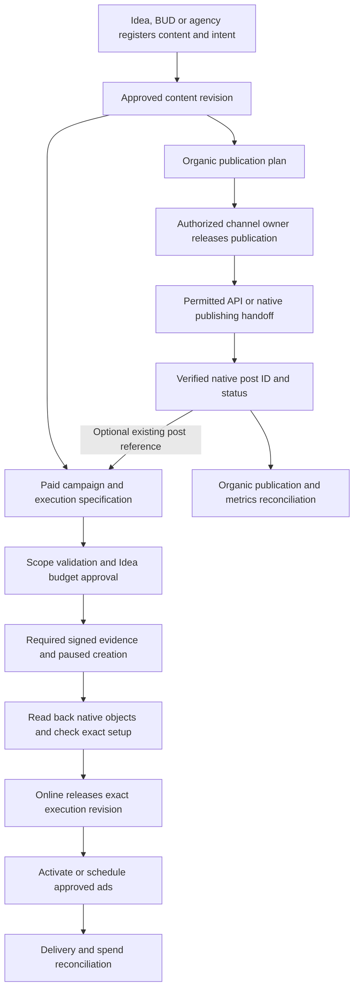

# SENA Digital Hub: registry to organic publishing and paid advertising

> Moved from `sena_idea_mkt_data_warehouse/docs/` on 29 September 2026; this is now the only maintained copy. See [20 — marketing operations flows](../20-marketing-operations-flows.md) for how publishing fits the end-to-end flow.


Design date: 24 September 2026. Proposed extension to the [paid campaign registry](SENA_ADS_CAMPAIGN_REGISTRY_DESIGN.md). No platform accounts, permissions, content or ads were changed. This is an implementation design, not a deployed integration.

**Deferred by the user:** start with the [Google Sheets registry pilot](SENA_REGISTRY_GOOGLE_SHEETS_FIELD_SPEC.md), then migrate into the Hub. This document records a possible later publishing extension; its API execution fields and integrations are not requirements for the pilot.

## 1. Recommendation

The Hub can register approved work, generate platform-specific requests, create supported paid campaigns in a paused state, publish approved organic posts where permitted, and record native IDs automatically. Build this as two linked workflows with shared assets, owners and approval evidence.

Registration alone must not publish a post or start spending. A release authorizes the exact content/settings, account and time. After release, a worker can perform the scheduled action without making the operator re-enter the same data, subject to each platform's supported authorization and user-interaction requirements.

The user has confirmed: SENA Idea approves budgets; BUD admin reconciles invoice/card costs with Idea coordinating; both paid ads and organic posts are desired. Organic publication approval is a separate proposed role assigned to the authorized channel/content owner. A post with no media spend does not require a fictional media budget. Content production costs, if relevant, remain separate.

## 2. Platform feasibility and boundaries

| Destination | Supported direction | Conditions for SENA |
|---|---|---|
| Meta paid ads | Marketing API can create campaign, ad set, creative and ad objects, including paused objects and references to existing posts | Approved app/account/asset access; explicit supported campaign types; validate full hierarchy before activation. [Official SDK](https://github.com/facebook/facebook-python-business-sdk/blob/main/facebook_business/adobjects/adaccount.py) |
| Facebook organic | Publish through the Page API for authorized Pages | Register Page identity and publishing permissions separately from advertising access. Do not assume a read-only DW token grants publishing. [Official Page SDK](https://github.com/facebook/facebook-python-business-sdk/blob/main/facebook_business/adobjects/page.py) |
| Instagram organic | Publish supported media to professional accounts using the Instagram API | Confirm login method, account eligibility, media type and app permissions. Facebook and Instagram placements are distinct publication records. [Meta's API collection](https://www.postman.com/meta/instagram/documentation/6yqw8pt/instagram-api) |
| Google paid ads | Google Ads API creates campaigns and their required resources; paused creation is explicitly recommended | Choose a supported campaign type; configure its budgets, targeting, ads/assets and conversion setup. [Campaign creation](https://developers.google.com/google-ads/api/docs/campaigns/create-campaigns) |
| TikTok paid ads | API for Business creates campaigns, ad groups and ads and updates their status | Separate business-app/advertiser authorization; validate identity/assets and any Spark post authorization. Explicitly disable creation where supported; do not rely on SDK defaults. [Official SDK](https://github.com/tiktok/tiktok-business-api-sdk/blob/main/python_sdk/docs/CampaignCreationApi.md) |
| TikTok organic | API for Business includes owned-account video/photo publishing and publishing-status endpoints | Assess SENA's access to Business Organic Accounts API first. Its existence does not prove account/app eligibility; use native or approved-provider handoff if access is unavailable. Keep this separate from the Direct Post product below |

TikTok's official Business API catalog lists `/business/video/publish/`, `/business/photo/publish/` and `/business/publish/status/`, with account-content publishing permissions. This is the first organic route to assess for SENA; do not generalize another product's restrictions to it. [Business API endpoint catalog](https://business-api.tiktok.com/gateway/docs/index?doc_id=1735713875563521&identify_key=c0138ffadd90a955c1f0670a56fe348d1d40680b3c89461e09f78ed26785164b&language=ENGLISH).

**Separate TikTok Direct Post eligibility:** this product's current guidelines reject internal/team-only upload utilities. They also require an audit for public visibility, creator controls, preview and explicit consent before upload. Do not promise approval for a SENA-only Direct Post client or use private posting as a workaround. This does not establish the eligibility rules of Business Organic Accounts API. [TikTok guidelines](https://developers.tiktok.com/docs/en/content-sharing-guidelines), [Direct Post prerequisites](https://developers.tiktok.com/docs/en/content-posting-api-get-started).

Google Ads does not provide the organic publishing workflow. YouTube or Business Profile publishing would be separate products, scopes and connectors if later selected. No such connector is assumed in this first expansion.

Google's current access documentation states that developer tokens were sunset on 9 September 2026; API access now follows the Google Cloud project used for OAuth credentials. Verify project access and customer-account authorization rather than following an outdated mandatory-token checklist. [Google access migration](https://developers.google.com/google-ads/api/docs/api-policy/developer-token).

Meta developer pages were intermittently inaccessible during research; capabilities were cross-checked in Meta's official SDK and API collection. Exact access tiers and permission requirements must be checked for SENA's chosen app/account configuration during the pilot. No production access was tested in this design exercise.

In particular, Instagram organic authorization does not automatically authorize paid advertising. Meta's Instagram Login route cannot access ads; its publishing connector and Marketing API access must be assessed separately. [Meta Instagram Login documentation](https://www.postman.com/meta/instagram/folder/6raa77c/instagram-api-with-instagram-login).

## 3. Four linked record types

| Record | Example | Grain and purpose |
|---|---|---|
| Content/asset revision | `CT000042`, revision 3 | Approved text, media versions, destination/CTA, owner and optional business target context. Can originate from Idea, BUD or agency; no content-sheet dependency |
| Organic publication | `OP000071` | One planned publication to one platform account, with schedule/timezone, exact content revision, approval, native post ID/permalink and observed status |
| Paid campaign | `AC000123` | One native advertising campaign, following the existing registry's target, funding and approval contract |
| Ad execution item | Campaign child record | Exact ad-set/ad-group and ad/creative specification, optionally linked to an organic publication or existing authorized native post; native child IDs retained |

One content revision can produce Facebook and Instagram publications with separate IDs. One organic post can be promoted by several campaigns over time. One paid campaign can contain several ads using different assets/posts. The post-to-ad relationship is therefore not one-to-one and must not be used to duplicate campaign spend.

Campaigns can also use an unpublished ad creative without an organic publication record. Importing an existing post means verifying its actual platform/account/post key; its URL alone is not an advertising campaign ID.

## 4. Two workflows in one Hub



For organic publication, release means approval of the exact account, content, caption, destination, publication time and applicable platform options. Content edits after release require a new approved revision. Scheduling is only offered where the connector and platform requirements permit it; an in-Hub time picker does not establish that the API supports autonomous posting.

For paid execution, scope approval, Idea budget approval, documented signed evidence and Online release remain distinct. Paused creation produces real platform objects, not merely a local draft. Bind the returned IDs, finish tracking, read back the entire hierarchy and then authorize activation. The release binds an execution revision/hash, allowed media budget and schedule. Native review or account restrictions can still prevent delivery.

Agencies supply or review buying settings and creatives in the Hub. Automation removes repeated data entry while leaving strategy, creative judgment and accountable decisions with the assigned people. Existing Ads Manager execution remains a fallback: import and verify the resulting IDs against the same approved registry revision.

## 5. The missing inputs between a registry and a live ad

A name, project group and budget are not enough to create a working ad. Add a small set of supported execution templates, each with its own required fields:

- Buying account and publishing identity, such as Page/Instagram identity or authorized TikTok identity.
- Native objective, optimization/conversion event, pixel/dataset/form/catalog dependencies where applicable.
- Ad-set/ad-group structure, geographic/audience settings, placements, bids, budget mode, dates and timezone.
- Approved image/video/text versions or verified existing post IDs, destination, CTA and tracking.
- Media budget in the platform's expected units and currency, explicitly separated from agency fees and tax.

**SENA project targeting and platform audience targeting are different fields.** `C-PITI-SK101` tells the warehouse which project is promoted. It does not by itself tell an advertising API which geography, audience, creative or landing page to use. Validation must link the approved business intent to these execution details.

Freeze all execution inputs before release. A changed creative, destination, target setting or material buying configuration requires renewed release; a changed business scope or budget also triggers its relevant approval. Reserve funding commitments atomically so concurrent submissions cannot both consume the same remaining pool budget.

Approval caps and native daily/lifetime budgets are not interchangeable. A scheduler and spend monitor cannot guarantee an exact hard cap when platform spend reporting is delayed. Use suitable native controls where available, documented budget semantics and variance handling; do not promise that a delayed DW alert can prevent every overrun.

## 6. Minimum execution architecture

Use the Hub's existing operational backend/database and one background worker. Add platform-specific operations only for the chosen pilot templates. Do not make a dbt model, DW ingestion job or Google Sheet formula execute publication requests.

```text
Hub approved revision + release
    → durable publishing job
    → backend worker with account-specific API authorization
    → platform
    → native IDs, read-back verification and observed status
    → Hub receipts and existing DW ingestion/reconciliation
```

Required controls:

1. **Exact authorization:** job references account, operation, approved revision/hash and release receipt. Recheck cancellation, approval validity, schedule and account authorization immediately before execution. Changing a Hub role does not automatically grant platform rights.
2. **Duplicate protection:** unique job key by record/revision/account/action/child object; only one worker owns a job. Store native IDs as each step completes. If the API outcome is unknown after timeout, reconcile first; a blind create retry can produce duplicate public posts or ads. A platform request ID is not assumed to provide idempotency without documented behavior.
3. **Partial creation:** resume missing children under the verified paused parent. Keep the parent paused after failure. Never label a partly created campaign as ready or delete unrelated platform objects as cleanup.
4. **Observed state:** separately record queued, creating/uploading, processing/review, created-paused, scheduled, eligible, published/delivering, rejected and failed/unknown. Platform acceptance is not proof of publication or delivery. Verify native IDs/status and use polling or supported webhooks.
5. **Secrets and evidence:** keep credentials in backend secret storage, scoped to approved accounts/operations. Log useful request identifiers, payload hashes, results and actors without tokens. Use an approved asset-serving method; a private Drive folder link is not automatically a usable media upload URL.
6. **External changes:** Ads Manager and native-post edits produce drift findings. Do not continuously overwrite them or silently accept them as a new approved brief. Cancellation is checked again when a queued action becomes due.

Use platform validation modes where available. Google exposes `validate_only` for mutation requests, but it is not an ad-policy approval or a guarantee that a later request succeeds. [Google mutation reference](https://developers.google.com/google-ads/api/reference/rpc/v25/MutateCampaignsRequest).

## 7. Reconciliation and tracking additions

Retain the paid registry's existing media-spend and financial controls. Auto-created native IDs make binding more reliable; they do not eliminate drift, source freshness, billing adjustments or authorization checks.

For organic publishing, reconcile scheduled publications to actual native posts: intended account, content revision, intended/actual time, native ID/permalink and current visibility/status. Organic engagement data needs its own supported ingestion and platform-specific metric definitions. Do not assume a post's total impressions can be added to its paid-ad impressions without overlap.

Organic records do not enter the paid media-spend fact as synthetic zero-spend campaigns. Proposed website-link tracking uses a publication code such as `OP000071`, an organic source value and `utm_medium=organic_social`; keep paid campaign tracking under the existing native campaign/registry contract. Do not put a paid campaign ID on a purely organic link.

When promoting an existing organic post, verify whether paid-specific tracking can be applied for that format. Its original organic URL may persist. Preserve the post-to-ad/native-campaign relationship and surface attribution limitations rather than relabeling all clicks from that shared URL as paid. No naming convention resolves every mixed organic/paid click.

## 8. Pilot recommendation

1. Start with one authorized Facebook Page and one Meta advertising account. Support one organic post format and one agreed paid campaign template. Use test assets/accounts where available; obtain an explicit release before any real public post or spend.
2. Prove the full cycle: approved revision → organic native ID or paused campaign hierarchy → read-back verification → release → observed result → DW reconciliation. Test cancellation, timeout recovery, partial creation, changed revisions and rejected media.
3. Add Instagram and one Google campaign type after the first connector works. Add TikTok paid ads only after advertiser access, identity requirements and its missing DW ingestion path are ready.
4. Assess TikTok Business Organic Accounts API access. Use native/approved-provider handoff until eligibility and granted publishing scopes are established. The Hub can still own planning, approvals and the final post receipt; an internal Direct Post client is not the assumed fallback.

Before live operation, determine who owns each account, what access SENA can authorize, which pilot campaign/post types are needed and who can release each action. No live app registration, access expansion, upload, publication or spend is authorized merely by this design discussion.

## 9. API cost check — 24 September 2026

Scope: direct platform APIs for paid campaign management and organic publishing. This is a public-document pricing check, not a negotiated SENA account quote. No paid service was purchased or enabled.

| API | Verified pricing position | Budget treatment |
|---|---|---|
| Google Ads API | Google's official onboarding documentation explicitly says API calls/usage, enabling the API and OAuth credential creation have no fees | **THB 0 direct API usage fee**. Advertising and any separately used billable cloud services remain outside this figure |
| Meta Marketing API, Facebook Pages and Instagram publishing | No current explicit no-fee statement or per-call/subscription tariff was verified in the accessible primary sources. Official access-tier documentation describes eligibility and quotas, not a price list | Leave direct access cost **provisional/unconfirmed**, rather than treating absence of a tariff as a certified THB 0 quote |
| TikTok API for Business | Its official partner FAQ says access is typically included in the partner experience; advertisers pay media spend and partners may charge service fees | **Typically included**, conditional on the actual access/partner arrangement. No endpoint-specific Business Organic price was verified |
| Third-party publishing provider | No provider has been selected or quoted | Separate optional service charge, not a platform API tariff; do not assume included access to a provider's API |

Sources: [Google's explicit no-charge statement](https://developers.google.com/google-ads/api/docs/oauth/cloud-project) (updated 23 September 2026), corroborated by its [onboarding pricing section](https://developers.google.com/google-ads/api/docs/get-started/onboarding?hl=es-419); [TikTok official partner FAQ](https://ads.tiktok.com/platform_partner?language=en); [Meta access-tier update](https://developers.meta.com/blog/updates-to-ads-management-standard-access-feature/).

Meta's Marketing API Access Tier feature now uses Limited/Full Access labels, distinct from permission access levels. Its documented usage/error thresholds establish eligibility; they are not a priced request bundle. No mandatory fee for developer business verification was verified. A paid subscription to another Meta product must not be presumed necessary for API access.

For total Hub cost, budget separately for implementation/maintenance, worker hosting, asset storage/transfer, monitoring and any selected publishing provider. Reusing existing infrastructure may reduce incremental expense, but spare capacity and media volumes have not been measured, so no monthly infrastructure quote is asserted. Ad delivery and agency fees continue under the existing Idea-approved budget workflow.

Proceed first with the proposed direct Meta/Google pilot access assessment and confirm account terms; evaluate TikTok Business Organic access before choosing a paid intermediary. An exact all-platform THB 0 commitment is not established by this check.
