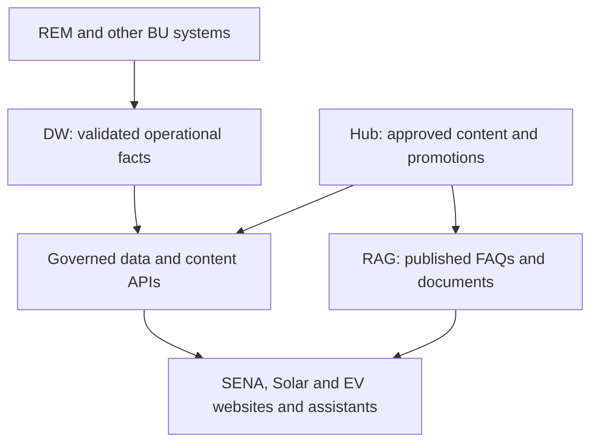

My recommendation is **one shared group platform, separate BU workspaces and assistants, Hub-owned public promotions, and controlled access to DW data**. Customer personalization should connect through CRM and marketing services.

Your direction makes sense. After reviewing [REQUIREMENTS.md](D:/Personal/workspace/sena_digital_hub_mkt/REQUIREMENTS.md), I would adjust the architecture before implementation—especially BU ownership, promotion validity, and the boundary between content management and personalized marketing.

**Enterprise examples support shared governance with distinct assistants.**

Two useful examples from published customer stories:

| Enterprise | Reported approach | What we can learn |
|---|---|---|
| **Regal Rexnord** | Separate employee, public website, and customer-service assistants. Central AI governance; sensitive HR, legal, and finance domains use separate environments. | Share platform capabilities while giving assistants different knowledge, permissions, and responsibilities. [Microsoft case study, March 2026](https://www.microsoft.com/en/customers/story/26197-regal-rexnord-microsoft-copilot-studio) |
| **Grupo Bimbo** | Two internal audit assistants use approved procedures maintained by the quality team in SharePoint. | Business owners maintain authoritative knowledge once; multiple assistants consume it. [Microsoft case study, June 2026](https://www.microsoft.com/en/customers/story/26762-grupo-bimbo-microsoft-365-copilot) |

These are documented deployments, although the reports come from their technology supplier. They support the organizational pattern; they do not establish that every enterprise uses one database or vector index.

**For SENA, each BU should control its customer experience and knowledge within a shared platform.**

I would start with one modular backend and separate SENA, Solar, EV, and other BU workspaces. Each assistant should have its own:

- Brand, language, tone, and supported customer journeys.
- Authorized products, FAQs, documents, and promotions.
- Tools, service credentials, and human handoff destinations.
- Conversation history boundaries, quality tests, usage reporting, and budget.

They can share application code, model providers, publishing infrastructure, and DW integrations. Separate deployments become useful when confidentiality, performance, or independent release requirements justify them.

Crucially, **permissions must be enforced before content reaches the model**. A prompt saying “you are the Solar assistant” cannot enforce data isolation. Microsoft’s multitenant RAG guidance places authorization and tenant filtering in the retrieval/API layer. [Microsoft architecture guidance](https://learn.microsoft.com/en-us/azure/architecture/ai-ml/guide/secure-multitenant-rag)

The proposed flow is:

DW should serve validated data through controlled APIs, with freshness information. A nightly warehouse feed cannot support a promise of live availability. Newly approved Hub content should publish directly without waiting for a DW round trip.

Also, the common model must support more than property projects. Housing projects, Solar packages, and EV products can share names, assets, documents, and promotion links while retaining their own specifications.

Record **who owns content separately from where it applies**. A housing promotion that includes a solar package can remain owned by the housing BU, with Solar identified as a fulfilment partner.

**For promotions, I agree that the Hub should be the authoritative place for public offers.**

The requirements already partly support this:

- `ARCH-03` assigns public promotions to the Hub.
- `PROMO-22/23` allow promotions with no REM source.
- However, `PROMO-42/43` withdraw promotions when a cited REM offer becomes inactive or deleted.

That last rule needs refinement. I recommend two kinds of source relationship:

| Relationship | Example | Effect of a REM change |
|---|---|---|
| **Reference only** | An old REM record provides background or a migration reference. | Notify the owner for review. |
| **Required for fulfilment** | REM must recognize a discount for sales to honour it. | Suspend the affected offer when that dependency becomes invalid. |

This gives marketing control over publication while preserving the connection to what the business can actually deliver.

Define the promotion contract around customer and operational needs. Each published offer should specify:

- **Benefit:** what the customer receives, including structured benefit type and value where applicable.
- **Eligibility:** applicable products, projects, BUs, channels, exclusions, and stacking rules.
- **Validity:** start date, end date or explicitly approved evergreen status, and review deadline.
- **Responsibility:** business owner, fulfilment owner, approved terms, and approvals tied to the exact version.
- **Operations:** withdrawal control, change history, and any required source dependency.

An absent expiry date must not automatically mean an evergreen offer. Evergreen promotions should have a named owner and recurring review. An internal review deadline should remain distinct from the customer-facing validity period.

For the first release, I would publish a small, verified catalogue of current offers. Historical REM triage can proceed separately.

This direction aligns with Adobe’s offer-management model: authored offers have lifecycle dates, eligibility rules, priorities, and exposure limits. [Adobe decision-item documentation](https://experienceleague.adobe.com/en/docs/journey-optimizer/using/decisioning/experience-decisioning/manage-decision-items/items)

**The current requirements provide foundations for modern marketing, but they do not yet specify a complete personalization system.**

The repository currently describes planned capabilities; it does not establish that these are implemented.

| Capability | Current requirements | What remains |
|---|---|---|
| Approved content, assets, promotions | Covered | Implement publishing and distribution |
| Contextual recommendations | Partly covered by entity applicability | Rules using the selected product, page, language, and conversation |
| Recognized-customer personalization | Outside the Hub’s current boundary | Customer identity, preferences, events, consent, and audience membership |
| Offer selection for an individual | Limited to general applicability | Individual eligibility, ranking, exposure limits, and fallback offers |
| Advertising and marketing automation | Ads registration and tracking foundations | Channel integrations, audience delivery, suppression, and conversion feedback |
| Experimentation and optimization | Deferred or out of scope | A/B testing and measurement through qualified leads, bookings, and sales |

I would retain the prohibition on customer personal data in the content Hub. Use this division:

**Hub supplies approved content → CRM/customer platform supplies permitted customer context → a decision service selects eligible content → channels deliver it.**

Adobe similarly separates profile-based audiences from content and checks destination consent requirements during audience export. [Adobe audience and consent documentation](https://experienceleague.adobe.com/en/docs/experience-platform/segmentation/faq)

Start with contextual personalization—for example, showing approved offers for the project a visitor selected. Add recognized-customer journeys once identity, permissions, and events are reliable. Existing systems and explicit rules may be enough initially; purchasing a large customer data platform is not a prerequisite.

Measure outcomes beyond clicks. Google’s event model distinguishes lead generation, qualification, and conversion, which is useful for connecting marketing to sales results. [GA4 recommended events](https://developers.google.com/analytics/devguides/collection/ga4/reference/events)

**For AI knowledge, I would establish ownership and publication rules before loading documents.**

Use different serving methods for different information:

| Information | Authoritative owner | How assistants should consume it |
|---|---|---|
| Public FAQs, explanations, guides | BU content owners through Hub | Published RAG content with citations |
| Product specifications | Relevant product or operational owner | Structured API |
| Promotions | Hub, approved by business and legal owners | Current promotion API |
| Price and availability | Operational system, possibly served through DW | Structured API with freshness |
| Customer or account information | CRM or transactional system | Authenticated, narrowly authorized tools |

Every knowledge item should carry its BU owner, permitted audience, language, version, approval status, effective dates, review deadline, and source reference.

The lifecycle should be explicit: **draft → review → approve a version → publish → distribute → review or withdraw**. Website pages and assistants should consume the same approved content. Withdrawal must block retrieval immediately while background index cleanup catches up; scheduled synchronization alone does not guarantee immediate removal. [AWS knowledge-base synchronization documentation](https://docs.aws.amazon.com/bedrock/latest/userguide/kb-managed-sync.html)

Your idea of learning first and then filling missing data is the right sequence. I would make the next requirements revision follow these steps:

1. **Choose the first customer journeys and top questions for each BU.**
2. **Map every required answer to its owner, source, freshness requirement, and publication permission.**
3. **Classify the available data as usable, stale, conflicting, or missing.**
4. **Have BU owners create and approve missing content.**
5. **Pilot SENA and Solar together** to test two different business models.
6. **Verify BU isolation, expired-offer removal, citations, and human handoff**, then expand to EV and personalized marketing.

The first implementation should deliver **BU workspaces, governed knowledge, a reliable promotion catalogue, and scoped assistants**. Those capabilities create a dependable foundation for the broader marketing platform.